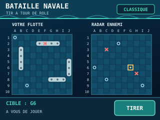
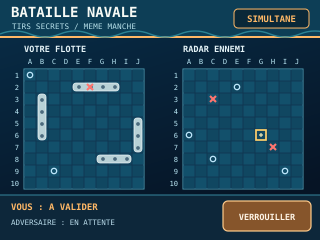
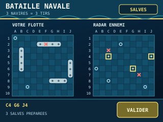
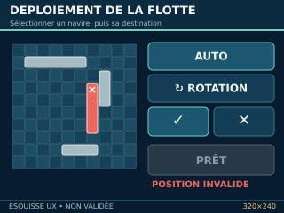
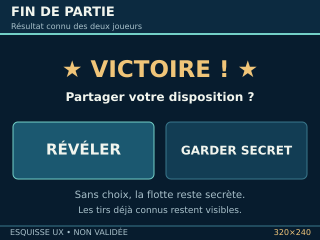
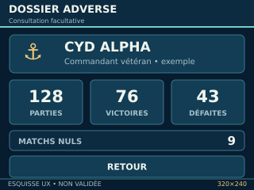
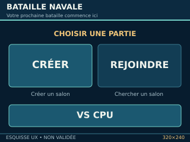

# I-009 — Bible produit : Bataille navale ESP32 CYD

**Version documentaire :** 0.5 — consolidation des règles métier V1.0 (revanche, palmarès, abandon, flottes tactiques, ciblage), 28 octobre 2026  
**Maturité :** expression de besoin en construction ; **ce document entier n'est pas encore validé**  
**Projet :** [ESP32-OTA-Battleship](https://github.com/Kharn27/ESP32-OTA-Battleship)  
**Origine :** [I-009 / IDEE.md — Le Grenier Geek](https://github.com/Kharn27/Le-Grenier-Geek/blob/main/plans/I-009-bataille-navale-cyd/IDEE.md)

> Gouvernance : **DÉCIDÉ** = approuvé par le PO ; **PROPOSÉ** = suggestion non validée ; **À ARBITRER** = règle encore ouverte ; **À VÉRIFIER** = faisabilité, mesure ou essai nécessaire ; **REPORTÉ** = hors du besoin immédiat. Une cible V1.0 ne signifie pas automatiquement « MVP fixé ».

## 1. Promesse et priorité de conception

Créer un jeu de bataille navale familial, tactique et rétro, d'abord sur **deux ESP32 CYD classiques**, un par joueur, avec sa propre flotte secrète et des interactions au stylet.

**DÉCIDÉ — principes d'expérience :**
- Le **gameplay passe avant le spectacle** : fluide, compréhensible sans se poser de questions, avec des retours immédiats.
- Combiner stratégie familiale facile d'accès et ambiance de petit poste de commandement naval rétro.
- Les animations, le sonar et les éventuels sons doivent renforcer le suspense **sans ralentir** les actions.
- Le jeu doit rester agréable à deux enfants comme à des joueurs qui souhaitent approfondir la stratégie.

**PROPOSÉ :** retour visuel immédiat à la sélection, à la validation et à la révélation ; animations courtes et discrètes plutôt que séquences imposées.

**Références graphiques :** [galerie des sept maquettes SVG 320 × 240](MAQUETTES.md), avec statut et provenance de chacune. Les visuels ne sont ni des captures de firmware ni des spécifications graphiques approuvées.

## 2. Cadre matériel et frontières

**DÉCIDÉ / contraintes de référence :**
- Prototype sur ESP32-2432S028R classique, tactile résistif, **320 × 240 en paysage**, stylet ; pas de PSRAM présumée.
- Deux consoles pour une partie humaine à deux ; liaison directe **ESP-NOW**, sans Internet, box ni serveur.
- Pas de carte microSD. Images, polices et ressources sonores embarquées en Flash.
- Utilisation économe de la RAM ; ne pas imposer un grand framebuffer plein écran.
- Batterie externe ou alimentation externe acceptable pour le prototype ; aucun joystick, bouton ABXY ou grand écran supposé.
- Les trois maquettes historiques 320 × 240 dans le Grenier Geek sont des **intentions UX**, non des interfaces validées.

**À VÉRIFIER :** précision tactile, notamment les petites cases des premières maquettes (~12 × 12 px) ; solution d'affichage des grilles 15 × 15 ; ressources mémoire ; matériel audio réellement présent ; comportement et portée radio.

**REPORTÉ / horizon distinct :** console multijeux, boîtier/batterie intégrés, commercialisation, mode « amiral » à pouvoirs spéciaux.

## 3. Expériences de jeu visées pour la V1.0

**DÉCIDÉ sur le principe :** trois familles d'expérience constituent une bonne base pour la V1.0 ; leur nom définitif, leur présentation et le découpage éventuel en MVP restent ouverts.

| Famille / nom provisoire | Flotte et grille | Combat |
| --- | --- | --- |
| **Classique** | Grille **10 × 10**, flotte traditionnelle fixe de 5 navires, 17 cases | **Mono-tir simultané par défaut** ; **mono-tir alterné** comme variante facultative |
| **Escadre tactique** | Composition personnalisable, **5 navires maximum** ET **17 cases maximum** | Salves préparées et simultanées |
| **Flotte libre** | Composition personnalisable, **17 cases maximum**, sans plafond supplémentaire de nombre de navires | Salves préparées et simultanées |

### Trois maquettes historiques des expériences de combat

**Références d'intention, non normatives** : la maquette « classique » ci-dessous représente le tour par tour d'origine ; le **simultané est désormais le mode standard**. Le nombre de tirs visible dans l'ancienne maquette des salves peut également différer de nos règles tactiques actuelles.

**À ARBITRER :** grille **15 × 15 envisagée**, non encore actée pour les deux familles tactiques ; arbitrage ergonomique réel sur CYD ; noms commerciaux ; place exacte des trois familles dans le premier MVP.

### Deux paramètres indépendants pour le combat — DÉCIDÉ

1. **Volume de tir :** mono-tir ou salve.
2. **Ordre de résolution :** alterné ou simultané.

Les **quatre combinaisons sont conceptuellement possibles**, mais cela **ne valide pas** leur exposition libre dans les menus dès la V1.0. **PROPOSÉ :** un accès simple aux trois expériences et, plus tard seulement, une personnalisation avancée des paramètres.

## 4. Flottes et budget

### Flotte classique — DÉCIDÉ

| Navire | Taille en cases | Contribution aux tirs en mode salve* |
| --- | ---: | ---: |
| Patrouilleur | 2 | 1 |
| Sous-marin | 3 | 2 |
| Contre-torpilleur | 3 | 2 |
| Croiseur | 4 | 3 |
| Porte-avions | 5 | 5 |

*Les contributions ci-dessus correspondent à la mécanique tactique proposée par le PO et retenue pour la réflexion sur les salves. En **mono-tir**, chaque joueur tire une seule fois, indépendamment de sa flotte.*

- **Classique :** un exemplaire de chaque navire, soit 5 bâtiments et 17 cases.
- **Tactique : DÉCIDÉ** — plafond **absolu de 17 cases occupées**, sans obligation de les remplir ; les cases inutilisées ne confèrent pas de bonus.
- **Escadre : DÉCIDÉ** — 5 navires maximum et 17 cases maximum.
- **Flotte libre : DÉCIDÉ** — nombre de navires non plafonné séparément ; seul le budget de cases fixe une borne matérielle.
- **BN-FT-006 — DÉCIDÉ :** chaque flotte tactique doit comporter **au moins un navire** ; une flotte vide est interdite. Une flotte d'un seul patrouilleur de deux cases reste autorisée.
- **DÉCIDÉ pour les compositions tactiques :** plusieurs exemplaires d'un même type sont autorisés.
- **À ARBITRER :** éventuelles restrictions d'équilibrage si une composition domine systématiquement les autres. Aucun « coût de construction » distinct de la taille n'est retenu pour l'instant.

**Exemples théoriques (pas des compositions recommandées) :** 8 patrouilleurs = 16 cases et 8 tirs de salve ; 2 porte-avions + 1 sous-marin + 2 patrouilleurs = 17 cases et 14 tirs de salve. Ces stratégies n'ont pas encore été équilibrées.

### Puissance de feu et dégâts — DÉCIDÉ

- Dans les variantes à salves, chaque navire **encore à flot** apporte sa contribution aux tirs.
- Un navire coulé **retire sa contribution des manches suivantes**.
- En résolution simultanée, les tirs déjà verrouillés sont exécutés même si leur navire d'origine est coulé au cours de la manche ; aucune suppression rétroactive.

**DÉCIDÉ :** une cible ne peut recevoir qu'un tir au cours d'une salve et une case attaquée lors d'une manche précédente ne peut plus être ciblée (§ 6, BN-FT-008 et BN-FT-009).

**À ARBITRER :** règles détaillées de fin d'affrontement, présentation de l'état des navires partiellement touchés et équilibrage réel des compositions tactiques.

## 5. Déploiement tactile — DÉCIDÉ

*Reconstitution conceptuelle 320 × 240 : commandes et positions à évaluer sur matériel, non validées graphiquement.*

**Objectif :** une flotte immédiatement jouable, avec la liberté de peaufiner son placement sur l'écran résistif.

1. L'écran de placement s'ouvre avec **toute la flotte déjà placée aléatoirement**.
2. Chaque pression sur **AUTO** **recompose aléatoirement toute la flotte**, autant de fois que souhaité.
3. Un navire peut être déplacé par **sélection du navire puis toucher d'une case de destination** ; pas de glisser-déposer nécessaire.
4. **ROTATION** change l'orientation du navire sélectionné, **même si la nouvelle position est invalide**.
5. Une position invalide reste visible **en rouge** ; le joueur peut poursuivre ses corrections.
6. La modification d'un navire est **provisoire** jusqu'à **✓** (confirmer, seulement si position valide) ou **✕** (annuler et retrouver la position/orientation précédentes).
7. Le bouton général **PRÊT** est indisponible **si une position est invalide ou si un navire attend encore ✓ / ✕**.
8. AUTO n'équivaut pas à PRÊT : seul le joueur confirme que son déploiement est terminé.
9. **BN-FT-006 — DÉCIDÉ :** en mode tactique, **PRÊT** reste indisponible si la flotte est vide.

### Déploiement lors d'une revanche — BN-REV-001, DÉCIDÉ

- Chaque joueur choisit librement, pour lui-même, de **conserver les positions précédentes**, de **relancer AUTO** pour obtenir un nouveau placement ou de **personnaliser** son déploiement.
- Conserver une disposition risquée est un choix stratégique autorisé : le jeu ne force pas un placement inédit lors d'une revanche.
- Les mêmes contrôles de validité et la confirmation **PRÊT** s'appliquent.
- **PROPOSÉ :** ne pas révéler à l'adversaire si la disposition précédente a été conservée.
- **À ARBITRER :** traitement de la composition d'une flotte tactique lorsqu'on change de mode, et possibilité de conserver aussi sa composition à l'identique.

**À ARBITRER :** comportement exact d'AUTO pendant une modification en cours, point d'ancrage du navire à la sélection de destination, messages tactiles et placement sur grille 15 × 15.

## 6. Combat — règles décidées

### Mono-tir alterné (variante classique)

- Un tir par joueur, à tour de rôle.
- Un tir **touché, raté ou coulé** termine le tour ; **aucun tir bonus** pour un touché.

### Mono-tir simultané (standard)

- Chaque joueur sélectionne secrètement **une cible**.
- Avant FEU, le joueur peut corriger sa cible.
- **FEU verrouille définitivement** la cible, même si l'autre joueur n'a pas encore validé.
- Une fois les deux tirs verrouillés, leurs effets sont **résolus ensemble**, sans révéler à l'avance la cible adverse.
- Une destruction réciproque et une égalité sont possibles.

### Salves tactiques simultanées

- Les joueurs préparent secrètement **toutes les cibles** de leur salve, sans retour sur les impacts intermédiaires.
- Ils peuvent modifier leurs sélections tant que FEU n'a pas été pressé.
- **Un seul FEU** verrouille définitivement toute la salve.
- Les salves des deux joueurs sont résolues simultanément après les deux validations.
- La perte d'un bâtiment réduit la puissance de feu des manches **ultérieures**.

### Sélection, salves partielles et historique des tirs — DÉCIDÉ pour la V1.0

- **BN-FT-007 — Salves partielles autorisées :** un joueur peut déclencher **FEU** avec **au moins une cible** et **au plus** le nombre de tirs disponibles. Les tirs non utilisés sont perdus pour la manche, sans cumul ultérieur. Le plafond disponible reste calculé à partir des navires encore à flot.
- **BN-FT-008 — Un tir par cible et par salve :** premier appui tactile = sélection ; deuxième appui = désélection. Une case ne peut figurer qu'une fois dans la salve. Le compteur de sélection est actualisé ; une fois le plafond atteint, il faut retirer une sélection avant d'en ajouter une autre.
- **BN-FT-009 — Une case déjà attaquée est verrouillée :** toute case tirée lors d'une manche précédente reste affichée comme **touchée** ou **manquée**, mais devient définitivement **non sélectionnable** pour cette partie. Appuyer dessus ne consomme aucun tir et ne provoque pas de nouvelle attaque.
- Ces protections de ciblage s'appliquent **au classique et aux modes tactiques**, en **VS humain et VS CPU**. Elles n'annulent pas le caractère irrévocable du bouton **FEU** : seul le pointage *avant* FEU est modifiable.

**PROPOSÉ :** compteur « X/Y tirs » bien lisible, indicateur sobre « Ordres transmis — en attente de l'adversaire », animations courtes et non bloquantes.

**À VÉRIFIER sur CYD réel :** lisibilité des cases déjà attaquées et ergonomie de la sélection/désélection au stylet.

**À ARBITRER :** ordre et animation de révélation des impacts ; définition exhaustive de victoire/égalité selon les variantes ; comportement de l'écran quand la liaison est interrompue après FEU.

### Fin de partie — confidentialité des flottes

**DÉCIDÉ — FIN-001 :** résultat connu des deux joueurs ; les tirs et impacts déjà révélés restent visibles. **La disposition complète de la flotte victorieuse demeure secrète par défaut**, et **le vainqueur choisit s'il souhaite la révéler** à son adversaire. Refuser ou ne pas choisir ne déclenche aucune révélation.

**Cas de l'égalité par destruction réciproque :** les deux flottes sont alors entièrement touchées et leurs positions déjà connues : un bouton de « révélation » symétrique reste envisageable **par analogie**, mais ne fournirait aucun nouveau renseignement. La présentation précise de cette option est **PROPOSÉE** et non encore fixée.

**À ARBITRER :** définition exhaustive de victoire/égalité selon les variantes, cas particulier VS CPU et interface de fin de partie. L'**abandon volontaire**, lui, est traité sans résultat comptabilisé (§ 7).

## 7. Identité et palmarès de chaque CYD

*Données fictives — esquisse UX, pas une interface validée.*

**DÉCIDÉ — BN-STAT-001 :**
- Chaque console conserve un **palmarès persistant propre à la CYD**, et non un compte joueur.
- Quatre catégories **indépendantes** sont conservées : **VS HUMAIN**, **VS MOUSSE** (CPU débutant), **VS CAPITAINE** (CPU intermédiaire) et **VS AMIRAL** (CPU expérimenté).
- Pour **chacune** de ces catégories : **parties jouées, victoires, défaites et matchs nuls**.
- L'adversaire peut consulter la fiche d'une CYD **à la demande** ; le palmarès n'est jamais un écran obligatoire avant de jouer.

**DÉCIDÉ — BN-STAT-002 : abandon volontaire et partie non comptabilisée**
- Une bataille abandonnée **avant un résultat définitif** est **ignorée** dans le palmarès des **deux participants** : ni victoire, ni défaite, ni nul, ni partie jouée. En solo VS CPU, les compteurs de la CYD restent également inchangés.
- Aucun malus de victoire/défaite n'est attribué à celui qui abandonne. Une coupure radio temporaire **suspend** d'abord la bataille (§ 8) et ne constitue pas un forfait.

**DÉCIDÉ — BN-UX-003 : confirmation d'un abandon volontaire**
- Une commande **QUITTER / ABANDONNER** lancée pendant une partie affiche une confirmation explicite : le joueur peut **CONTINUER** ou **ABANDONNER**.
- Annuler la confirmation ne modifie ni la partie ni les statistiques.
- La formulation et la disposition des boutons sur 320 × 240 restent à concevoir et tester.

**DÉCIDÉ — BN-STAT-003 : un seul compteur global de forfaits**
- Chaque CYD mémorise **un unique compteur global** de forfaits volontaires, sans ventilation par adversaire, difficulté ou mode.
- Ce compteur augmente de **1 uniquement lorsque le joueur confirme lui-même son abandon** ; les compteurs de parties/victoires/défaites/nuls restent inchangés.
- **Aucune déconnexion radio, extinction imprévue ou erreur technique n'augmente automatiquement ce compteur.** Le forfait est une information humoristique, non un classement.
- **Libellé humoristique PROPOSÉ :** « Canots de sauvetage empruntés ».

**PROPOSÉ :** accès « Dossier adverse » dans le salon de jeu, éventuel nom de console/commandant, taux de victoire, grades ou séries ; consultation des quatre catégories par onglets et éventuel total de parties.

**À ARBITRER :** éventuelles statistiques supplémentaires **par mode**, partage du palmarès lorsque plusieurs humains utilisent la même CYD, cas d'une session interrompue définitivement sans abandon confirmé, présentation exacte du compteur et de la fiche.

## 8. Créer / rejoindre : multijoueur humain

*Disposition graphique encore PROPOSÉE ; les trois accès fonctionnels sont retenus pour la cible V1.0.*

**DÉCIDÉ — expérience fonctionnelle :**
- L'accueil propose une action volontaire **CRÉER** ou **REJOINDRE** plutôt qu'un appairage automatique imposé.
- Chaque partie humaine oppose **deux CYD**, même si plusieurs consoles et plusieurs duos sont présents à proximité.
- Les joueurs doivent pouvoir changer d'adversaire sans opération technique pénible.
- Positions des navires et cibles secrètes restent confidentielles jusqu'aux révélations prévues par les règles.

**PROPOSÉ sur la base du retour architecte (non encore arbitré par le PO) :**
- L'hôte rend sa partie visible ; l'invité la choisit parmi les annonces disponibles.
- L'hôte **accepte ou refuse** explicitement l'invitation ; confirmation claire sur les deux écrans.
- Une partie occupée n'admet pas de troisième joueur ; invitation expirée ou ancienne rejetée ; changement d'adversaire après fermeture propre de la session.
- Un signe visuel commun peut aider deux enfants à vérifier qu'ils rejoignent le bon adversaire.
- Aucun canal radio, adresse MAC ou autre paramètre technique ne doit être saisi par le joueur.

### Interruption de liaison — DÉCIDÉ pour la V1.0

- Une **coupure radio temporaire suspend** la partie et doit être indiquée clairement aux joueurs.
- La partie **reprend lorsqu'une reconnexion cohérente est obtenue** ; aucun tir ne doit être perdu ou appliqué deux fois à cause de la coupure.
- Une simple coupure radio **ne constitue pas automatiquement une défaite**.
- **REPORTÉ après V1.0 :** sauvegarde/restauration complète de partie après extinction ou redémarrage de la CYD. Cela pourra être reconsidéré ultérieurement.
- **DÉCIDÉ :** l'abandon volontaire confirmé et son effet statistique sont traités au § 7.
- **À ARBITRER :** comportement si l'adversaire ne revient pas, délai d'attente, retour au menu et sort d'une partie interrompue définitivement sans abandon explicite.

### Résultats de la consultation de l'architecte (28/10/2026)

**Avis reçu : FAISABILITÉ TECHNIQUE FAVORABLE**, sans vérification sur les deux CYD physiques. Le parcours CRÉER / REJOINDRE et la coexistence de duos indépendants sont considérés réalisables sur ESP32 classique via ESP-NOW. La découverte des annonces, la synchronisation des associations et la reprise après rupture restent les sujets délicats.

**À VÉRIFIER sur matériel :** fiabilité de la découverte, présence de plusieurs parties, radio en environnement chargé, cohérence des sessions et reprises, consommation de mémoire, confidentialité des échanges. Aucun nombre maximal de parties simultanées n'est garanti.

**Recommandations d'architecture, NON validées comme décisions PO :** canal Wi-Fi commun prédéfini (sous réserve d'essais) ; annonces de découverte avec contrôle d'obsolescence ; confirmations applicatives et protection contre doublons ; distinction entre consentement visuel et sécurité cryptographique. Les annonces broadcast ne sont pas automatiquement chiffrées ; la sécurité des échanges privés requiert une étude adaptée.

**DÉCIDÉ — BN-REV-002 / BN-REV-003 / BN-REV-004 : parcours de revanche V1.0**
- Le joueur qui a choisi **CRÉER** est l'**hôte** de la session (pas un serveur central).
- Après le résultat, l'hôte est celui qui **propose la REVANCHE** ; **CHANGER DE MODE** n'est pas une option de même niveau que REVANCHE, mais un choix *dans* ce parcours.
- L'hôte choisit soit **REJOUER** (mêmes règles), soit **CHANGER DE MODE** (nouvelles règles et paramètres sélectionnés par l'hôte).
- L'invité voit la proposition et peut **ACCEPTER** ou **QUITTER** ; il ne peut pas modifier les paramètres choisis par l'hôte. **Aucune nouvelle partie n'est imposée.**
- Si la proposition est acceptée, les deux consoles **conservent leur association** ; chaque joueur revient au déploiement et dispose de la liberté prévue par BN-REV-001.
- La logique de revanche vise à enchaîner les batailles sans refaire le parcours CRÉER / REJOINDRE.

**À ARBITRER :** détails d'affichage et de fermeture de session, abandon ou absence durable de l'adversaire, refus initial d'une invitation, expiration et départ propre. L'accès QUITTER depuis la fin de partie reste à mettre en forme ; la règle d'accord de l'invité pour la revanche est décidée.

## 9. Mode solo VS CPU — DÉCIDÉ pour la V1.0

**DÉCIDÉ :**
- Un joueur peut affronter le **CPU sur une seule CYD**, sans deuxième console.
- Le **VS CPU est inclus dans la cible V1.0** et disponible dans **toutes les familles de jeu V1.0** : classique simultané, classique alterné, escadre tactique, flotte libre.
- **Trois niveaux de difficulté** sont prévus.
- Dans les variantes tactiques, la difficulté influence **aussi le choix stratégique de la composition de flotte du CPU**, pas seulement le choix de ses tirs.
- Le CPU doit respecter les mêmes contraintes de flotte et de résolution que l'adversaire humain.

**DÉCIDÉ comme intitulés des trois niveaux utilisés dans le palmarès : Mousse, Capitaine, Amiral.**

**PROPOSÉ — comportement précis des niveaux, non encore arbitré :**
- **Mousse** : débutant, comportement simple, compositions plutôt aléatoires.
- **Capitaine** : intermédiaire, recherche méthodique, flotte raisonnablement équilibrée.
- **Amiral** : expérimenté, exploitation plus poussée des indices et composition stratégiquement optimisée.
- **Principe d'équité souhaitable :** le CPU ne doit jamais accéder aux positions secrètes des navires humains ; sa difficulté provient de ses décisions, pas de tricherie.

**À ARBITRER :**
- Logique de décision exacte, différenciation observable des trois niveaux et équilibre des flottes tactiques.
- Présentation des adversaires, éventuels délais d'animation, tutoriel ou aide.
- La présentation et la vérification de la difficulté réelle des trois CPU ; le **palmarès séparé VS humain et par difficulté CPU est décidé** (§ 7).
- Conditions de victoire et comportement d'un CPU dans les différentes combinaisons de combat.

**Attention :** le solo facilite l'étude et les essais du gameplay, mais **ne remplace pas** les vérifications propres au multijoueur ESP-NOW.

## 10. Expérience à finaliser / questions transverses

- **Fin de manche et de partie :** annonce du résultat, secret optionnel du vainqueur et revanche pilotée par l'hôte décidés ; conditions exactes de victoire/égalité selon les variantes et présentation des états restent à préciser.
- **Cas d'erreur :** la double sélection d'une cible et les tirs sur case déjà jouée sont traités ; restent notamment les écrans en désaccord, expiration des sessions et absence prolongée d'un adversaire. L'abandon **volontaire confirmé** est décidé, mais une interruption définitive non confirmée reste à définir.
- **Lisibilité :** propre flotte versus eaux adverses ; possibilité d'une grande grille unique et d'une bascule immédiate, surtout en 15 × 15.
- **Audio :** vérifier le matériel réel avant d'exiger des effets sonores.
- **Ergonomie :** évaluer chaque maquette sur une CYD physique, sans déduire la faisabilité d'une image.
- **MVP :** distinguer à terme première expérience jouable et cible complète V1.0 ; aucun planning, backlog ou chantier n'est lancé.

## 11. Registre succinct des décisions

| Référence | Décision ou sujet | État |
| --- | --- | --- |
| UX-001 | Gameplay fluide en priorité, immersion rétro sobre | **DÉCIDÉ** |
| UX-002 | Palmarès persistant par CYD, consultable à la demande | **DÉCIDÉ** |
| PL-001 | Flotte prépositionnée ; AUTO à volonté et retouche manuelle | **DÉCIDÉ** |
| PL-002 | Sélection + destination ; rotation autorisée même en position invalide | **DÉCIDÉ** |
| PL-003 | Rouge si invalide ; ✓ confirmer / ✕ annuler ; PRÊT bloqué en cas d'erreur ou de modification pendante | **DÉCIDÉ** |
| CL-001 | Classique : flotte fixe 5 bâtiments / 17 cases sur 10 × 10 | **DÉCIDÉ** |
| CB-001 | Simultané = standard ; alterné = variante facultative ; verrouillage irrévocable à FEU | **DÉCIDÉ** |
| CB-002 | Paramètres conceptuels mono-tir/salve et alterné/simultané | **DÉCIDÉ** |
| FT-001 | Flottes tactiques : 17 cases au maximum, non obligatoires, doublons autorisés | **DÉCIDÉ** |
| FT-002 | Escadre : max 5 navires ; flotte libre : sans plafond de nombre distinct | **DÉCIDÉ** |
| FT-003 | Salves secrètes simultanées ; puissance de tir liée aux navires encore à flot | **DÉCIDÉ** |
| BN-FT-006 | Au moins 1 navire en flotte tactique ; flotte vide refusée, PRÊT bloqué | **DÉCIDÉ** |
| BN-FT-007 | Salves partielles dès 1 tir ; tirs non employés perdus, sans cumul | **DÉCIDÉ** |
| BN-FT-008 | Sélection/désélection par appuis successifs ; une cible au plus par salve | **DÉCIDÉ** |
| BN-FT-009 | Case déjà attaquée non sélectionnable dans tous les modes, résultat conservé | **DÉCIDÉ / ergonomie À VÉRIFIER** |
| FIN-001 | Flotte du vainqueur secrète par défaut ; révélation volontaire après le résultat | **DÉCIDÉ** |
| BN-REV-001 | À la revanche, chaque joueur peut garder, randomiser ou personnaliser le placement | **DÉCIDÉ** |
| BN-REV-002 | REVANCHE : rejouer les mêmes règles ou choisir « Changer de mode » en sous-étape | **DÉCIDÉ** |
| BN-REV-003 | L'hôte CRÉER décide les règles de la revanche ; association conservée | **DÉCIDÉ** |
| BN-REV-004 | Invité : accepter ou quitter la revanche, sans négocier les paramètres | **DÉCIDÉ** |
| BN-STAT-001 | 4 palmarès : VS Humain, VS Mousse, VS Capitaine, VS Amiral | **DÉCIDÉ** |
| BN-STAT-002 | Partie abandonnée ignorée pour les deux joueurs ; aucune victoire/défaite/nul/partie jouée | **DÉCIDÉ** |
| BN-STAT-003 | Un unique compteur global de forfaits volontaires sur chaque CYD | **DÉCIDÉ** |
| BN-UX-003 | Confirmation obligatoire CONTINUER / ABANDONNER | **DÉCIDÉ** |
| CN-001 | Choix volontaire CRÉER / REJOINDRE | **DÉCIDÉ** |
| CN-002 | Étude ESP-NOW favorable sur le papier ; découverte, sécurité et multipaires à vérifier physiquement | **À VÉRIFIER** |
| CN-003 | Reconnexion d'une partie après coupure radio temporaire en V1.0 ; reprise après reboot reportée | **DÉCIDÉ / REPORTÉ** |
| FT-004 | Grille tactique 15 × 15 | **À ARBITRER / tester** |
| SOLO-001 | VS CPU sur une seule CYD, dans tous les modes V1.0 | **DÉCIDÉ** |
| SOLO-002 | Trois difficultés CPU, dont la composition de flotte tactique dépend du niveau | **DÉCIDÉ sur le principe** |
| SOLO-003 | Noms Mousse / Capitaine / Amiral pour les niveaux et palmarès ; comportements et équité CPU à préciser | **DÉCIDÉ (noms) / PROPOSÉ (comportements et équité)** |
| V1-001 | Trois familles de jeu comme cible de V1.0 ; MVP à préciser | **DÉCIDÉ sur le principe** |
| V1-002 | Catalogue V1.0 jugé assez riche ; priorité désormais à détailler règles et parcours | **DÉCIDÉ comme orientation de travail** |

## 12. Traçabilité et sources

**Visuels sauvegardés :** [MAQUETTES.md](MAQUETTES.md) : 3 SVG historiques recopiés à l'identique depuis le Grenier Geek et 4 esquisses UX reconstituées, en assets locaux. Les images d'ambiance externes et anciens composants interactifs du chat ne sont pas archivés à l'identique.

**Source de départ (27 octobre 2026) :** [IDEE.md du Grenier Geek](https://github.com/Kharn27/Le-Grenier-Geek/blob/main/plans/I-009-bataille-navale-cyd/IDEE.md). Les anciennes illustrations sont disponibles dans le dossier [assets](https://github.com/Kharn27/Le-Grenier-Geek/tree/main/plans/I-009-bataille-navale-cyd/assets).

**Consolidation des règles métier (28 octobre 2026, version 0.5) :**
- **Revanche :** conservation libre de la formation par chaque joueur ; REVANCHE comprend REJOUER ou CHANGER DE MODE ; l'hôte choisit les règles et l'invité accepte ou quitte ; association conservée si accepté.
- **Palmarès :** quatre catégories séparées (humain, Mousse, Capitaine, Amiral), quatre indicateurs par catégorie ; un compteur global de forfaits volontaires.
- **Abandon :** confirmation CONTINUER / ABANDONNER ; aucun résultat ni partie jouée comptabilisé pour les deux participants ; seule la CYD ayant volontairement confirmé incrémente son forfait ; coupures radio et incidents exclus.
- **Flottes et salves :** au moins un navire tactique ; salves partielles autorisées à partir d'un tir ; tirs non utilisés perdus ; sélection/désélection au toucher et pas de double cible.
- **Historique :** case déjà attaquée définitivement non ciblable dans la partie, résultat visible ; applicable à tous les modes.
- **Non décidé :** révéler ou non à l'adversaire qu'une formation a été conservée ; comportement précis des trois difficultés CPU ; grille 15 × 15 ; détails des victoires/égalités, des sessions interrompues définitivement et de l'UX de plusieurs écrans.
- **Traçabilité :** modifications apportées directement à la bible existante ; aucune modification du dépôt d'idées historique, pas de création de backlog ou de mission technique.

**Synthèse des échanges PO (28 octobre 2026) :**
- Le **mono-tir simultané** a remplacé le tour par tour comme **mode standard** ; l'alternance traditionnelle est **conservée comme variante** (elle n'a pas été supprimée).
- Le déploiement est devenu **prérempli avec AUTO**, retouche au stylet et validation explicite.
- La « flotte tactique » initiale a été distinguée en **escadre à nombre limité** et **flotte libre**, toutes deux sous plafond de 17 cases.
- CRÉER / REJOINDRE est le choix UX retenu ; l'architecte a rendu un **avis favorable de faisabilité**, mais la **validation sur matériel** et les détails de la découverte restent ouverts.
- Le **VS CPU est validé pour la V1.0 et tous ses modes**, avec trois niveaux de difficulté et des compositions stratégiques adaptées au niveau.
- La **reconnexion après perte radio temporaire** est un objectif V1.0 ; la reprise d'une partie après extinction/redémarrage est **reportée**.
- Le PO veut désormais **détailler les règles et les parcours** plutôt qu'ajouter des modes à la cible V1.0, tout en conservant la trace des bonnes idées.
- **Fin de partie :** le vainqueur décide seul de révéler ou non sa flotte ; les dispositions non découvertes restent secrètes. En cas de destruction réciproque, toutes les cases sont déjà connues.
- **Conservation visuelle :** les trois maquettes d'origine et quatre reconstitutions UX sont désormais archivées dans le dépôt et référencées depuis la bible.

**Aucune modification n'est apportée au dépôt historique Le Grenier Geek.** Ce document est une référence fonctionnelle vivante, destinée à être amendée avec les décisions du PO et le retour de l'architecte. Il n'autorise aucun développement.

## 13. Réserve d'idées — ne rien perdre sans gonfler la V1.0

Cette réserve n'est **ni un backlog ni un engagement de livraison**. Toute idée pourra être réexaminée sans devenir une exigence tacite.

| Piste | État | Commentaire |
| --- | --- | --- |
| **Mode « Amiral » enrichi** avec ordres ou capacités tactiques spéciales | **REPORTÉ** | Évoqué dès l'idée I-009 ; aucun pouvoir défini |
| **Combinaisons libres de paramètres de combat et de flotte** | **PROPOSÉ** | Les deux axes mono-tir/salve et alterné/simultané sont décidés, mais pas un éditeur de parties personnalisées V1.0 |
| **Mécanique de coût de construction distinct du nombre de cases** | **PROPOSÉ / en réserve** | Alternative envisagée au budget de 17 cases ; pas retenue pour les règles actuelles |
| **Statistiques supplémentaires** (par mode de jeu, taux de victoire, série, grades, nom de commandant) | **PROPOSÉ** | Les quatre catégories humain/difficulté CPU et le compteur global de forfaits sont déjà décidés ; seules ces extensions restent ouvertes |
| **Tournois entre plusieurs CYD** | **PROPOSÉ / en réserve** | Idée induite par les rencontres entre plusieurs duos ; non exigée en V1.0 |
| **Sauvegarde/reprise après extinction** | **REPORTÉ** | Envisageable après V1.0 ; complexe du fait de la cohérence des deux états |
| **Améliorations graphiques et audiovisuelles** (radar, explosions, son) | **PROPOSÉ / à vérifier** | Toujours au service de la fluidité et des contraintes CYD |
| **Console multijeux** (Puissance 4, etc.) et boîtier commercial | **REPORTÉ / horizon distinct** | Ne pas mélanger avec le prototype bataille navale |

### Prochain chantier de réflexion produit (sans mission de développement)

Préparer, avec accord du PO, le **découpage fonctionnel en lots** à partir du besoin consolidé, sans le confondre avec une planification technique ou un backlog déjà validé. Avant de figer le périmètre d'un lot, lever les ambiguïtés de règles qui le bloquent (notamment victoire/égalité, gestion de session, ergonomie et dimension des grilles).
