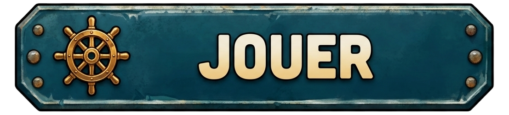
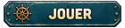
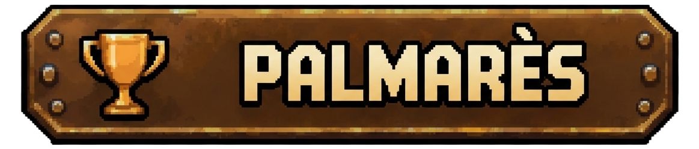

# Boutons — accueil CYD WARSHIP

Deux boutons **JOUER** et **PALMARÈS**, chacun décliné en version originale RGBA et sprite CYD. Les quatre fichiers sont des exports déjà existants, déplacés **sans retouche**.

## JOUER

**Taille originale — 1107 × 252 px**

**Taille CYD — 140 × 32 px**

## PALMARÈS

**Taille originale — 1163 × 250 px**

**Taille CYD — 140 × 30 px**

Ces sprites proviennent de l'[accueil composé](../../maquettes/accueil/legacy/accueil_cyd_warship_320x240.png). JPEG originaux PO : [JOUER](../../draft/Bouton_jouer.jpeg) et [PALMARÈS](../../draft/Bouton_palmares.jpeg). [GO sur PC — PR #90](https://github.com/Kharn27/ESP32-OTA-Battleship/pull/90#issuecomment-6740684237) ; [mandat de classement — Issue #103](https://github.com/Kharn27/ESP32-OTA-Battleship/issues/103). Les états **appuyé/enfoncé** restent à créer et les zones tactiles à valider ; **aucun test physique CYD** n'est revendiqué.
