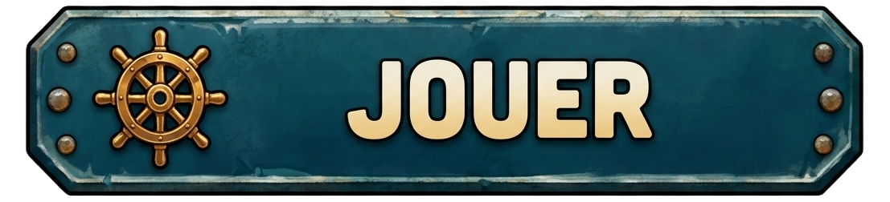
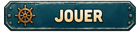
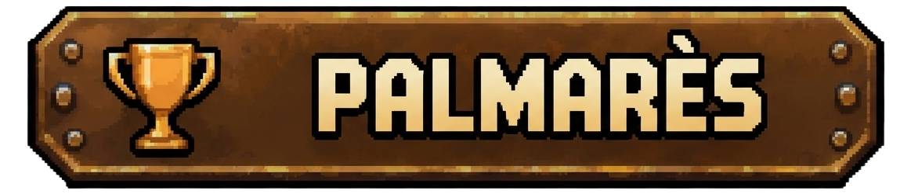
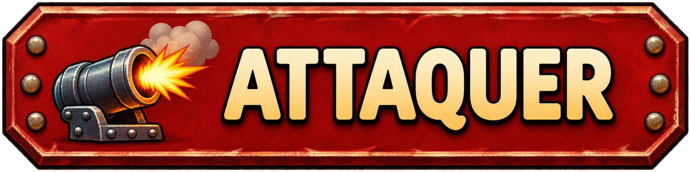

# Boutons — CYD WARSHIP

Pour l'accueil, deux boutons **JOUER** et **PALMARÈS**, chacun décliné en version originale RGBA et sprite CYD. Les quatre fichiers sont des exports déjà existants, déplacés **sans retouche**.

## JOUER

**Taille originale — 1107 × 252 px**

**Taille CYD — 140 × 32 px**

## PALMARÈS

**Taille originale — 1163 × 250 px**

**Taille CYD — 140 × 30 px**

Ces sprites proviennent de l'[accueil composé](../../maquettes/accueil/legacy/accueil_cyd_warship_320x240.png). JPEG originaux PO : [JOUER](../../draft/Bouton_jouer.jpeg) et [PALMARÈS](../../draft/Bouton_palmares.jpeg). [GO sur PC — PR #90](https://github.com/Kharn27/ESP32-OTA-Battleship/pull/90#issuecomment-6740684237) ; [mandat de classement — Issue #103](https://github.com/Kharn27/ESP32-OTA-Battleship/issues/103). Les états **appuyé/enfoncé** restent à créer et les zones tactiles à valider ; **aucun test physique CYD** n'est revendiqué.

## ATTAQUER — variantes picturales approuvées (BTN-ATK-02, Issue #144)

Les **quatre sprites PNG RGBA aux dimensions CYD** ci-dessous sont des copies **strictement identiques octet pour octet** aux exports validés du dossier [d'étude BTN-ATK-01](../../draft/etudes/bouton_attaquer/README.md). Ils ont reçu le [GO artistique explicite du PO le 16/11/2026](https://github.com/Kharn27/ESP32-OTA-Battleship/pull/141#issuecomment-6924527916). Aucune retouche, recompression ou régénération n'a été appliquée lors de leur promotion.

### ON — canon en tir

**Master HD détouré — 2000 × 500 px (source, non runtime)**

**140 × 35 px**

**112 × 28 px**

### OFF — canon au repos

**Master HD détouré — 2000 × 500 px (source, non runtime)**

**140 × 35 px**

**112 × 28 px**

### Provenance, usage et limites

- **Masters HD (demande PO BTN-ATK-03 #147) :** copies strictement identiques, sans retouche, des fichiers détourés `draft/etudes/bouton_attaquer/source_{on,off}_cutout_2000x500_RGBA.png`. Le master OFF possède une vraie transparence grâce au masque de l'étude. Il s'agit des sources de résolution **2000 × 500 px**, non des originaux `draft/Bouton_Attaquer_on/off.png` (2172 × 724 px) ; ils sont catalogués en `HD_MASTER_NOT_RUNTIME` et **ne doivent pas être intégrés tels quels au firmware CYD**. Poids combiné des masters : **2 781 854 octets sur disque** ; cette valeur n'est pas une mesure Flash/RAM de firmware.

- **Sources de travail réelles :** `draft/etudes/bouton_attaquer/source_upload_on_2048x682.png` et `source_upload_off_2048x682.png`, avec masque `mask_off_2000x500_L.png`. Elles ne sont **pas** identiques aux originaux PO `draft/Bouton_Attaquer_on/off.png` de 2172 × 724 px ; cette différence a été [acceptée par le PO](https://github.com/Kharn27/ESP32-OTA-Battleship/pull/141#issuecomment-6924527916).
- **Exports certifiés :** `draft/etudes/bouton_attaquer/attaquer_{on,off}_{140x35,112x28}_RGBA.png`. La recette `draft/etudes/bouton_attaquer/generate.py --check` et les preuves 320 × 240 / zoom ×4 NEAREST restent en `draft/` ; elles ne sont pas dupliquées dans le catalogue.
- **Sens pictural uniquement :** ON représente le canon qui vient de tirer, OFF le canon au repos. Cela ne définit **ni** l'état applicatif enabled/disabled **ni** l'état tactile `pressed` (GUI-01). L'action de combat reste nommée **FEU** dans la Bible et la maquette G04-R2 ; aucune décision d'intégration dans cet écran n'est prise ici.
- **Statut :** `VALIDATED_PO_PC` (artistique) / `ON_DEVICE_UNVERIFIED`. Aucun test réel CYD, budget RAM, décodage firmware ou comportement tactile n'est revendiqué. Les quatre fichiers PNG représentent **38 677 octets cumulés sur disque**, sans préjuger de leur consommation Flash réelle après intégration.
