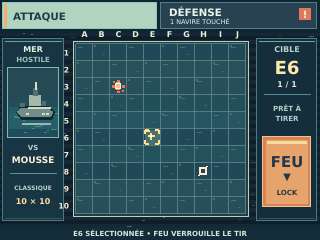
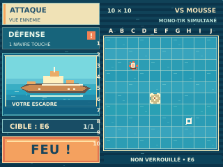
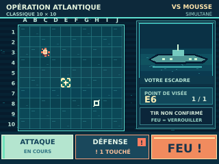

# I-009 — Exploration des agencements ATTAQUE D/E/F

**PROPOSÉ — DESIGN_PREVIEW — NON VALIDÉ PO — ON_DEVICE_UNVERIFIED**

Cette **deuxième** exploration isole les **agencements** de l'écran de combat après l'étude des [trois univers A/B/C](../2026-10-29-attaque-themes/README.md). Il n'y a **aucun choix de composition validé**. Chaque SVG a un canevas **320 × 240 pixels natifs** et reste éditable et consultable dans GitHub.

| D — Grille centrale | E — Navigation latérale | F — Commandes basses |
|:---:|:---:|:---:|
|  |  |  |
| [Ouvrir SVG](D_grille_centrale.svg) | [Ouvrir SVG](E_navigation_laterale.svg) | [Ouvrir SVG](F_commandes_basses.svg) |
| Grille 17 × 17 px, FEU vertical à droite | Grille 16 × 16 px à droite, barre d'onglets à gauche | Grille 15 × 15 px à gauche, 3 commandes en bas |

## Situation et conformité au produit

- **Classique 10 × 10 VS Mousse**, **mono-tir simultané**.
- **Une seule grille visible : ATTAQUE** ; bascule immédiate et volontaire vers DÉFENSE.
- Coordonnées **A à J**, **1 à 10**.
- **E6 sélectionnée, mais tir non verrouillé** ; **C3 touchée** précédemment ; **H8 manquée** précédemment.
- FEU verrouille le tir sans changement automatique de vue, les cases déjà jouées restent verrouillées.
- Un navire du joueur a été touché : alerte visible sur la commande DÉFENSE jusqu'à consultation.
- Aucun emplacement ennemi secret révélé ; les bâtiments illustrés hors de la grille sont ceux de **notre propre escadre**.

## Comparaison UX à réaliser sur CYD

**D — Grille centrale** : cases les plus grandes (17 px), réticule au centre ; contrôler la précision du bouton vertical FEU et le confort des petits libellés.

**E — Navigation latérale** : navigation distincte et FEU large (139 × 37 px) ; contrôler le trajet main/stylet entre onglets et cible.

**F — Commandes basses** : toutes les actions concentrées dans le bandeau inférieur, informations de visée sur la droite ; contrôler la visibilité en utilisation réelle.

## Vérification et réserves

- SVG vectoriels **320 × 240**, à vocation de **maquettes PC** ; non prêts pour intégration dans l'ESP32.
- PNG natifs, aperçus 4× et comparatif ont été produits localement et remis au PO dans la discussion ; **ils ne sont pas versionnés dans cette PR**.
- **Pas de test tactile sur CYD**, pas de compilation, pas d'estimation mesurée des coûts Flash/RAM ; polices et rendu SVG non retenus comme format firmware.
- Les notes originales sont dans [NOTES_AGENCEMENTS.md](NOTES_AGENCEMENTS.md).
- L'idée de **thèmes interchangeables** A/B/C est une **piste évoquée par le PO**, pas une fonctionnalité validée.

**Décision PO attendue :** comparer le principe d'agencement, sans verrouiller la palette ou le gameplay. **Pilotage seul responsable de fusionner.**
