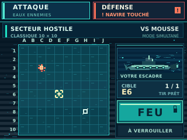
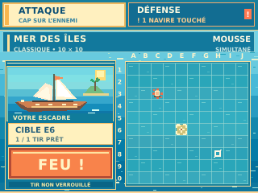
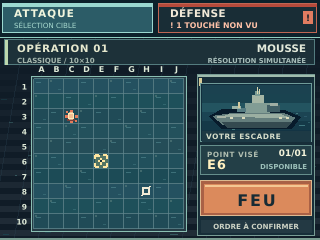

# I-009 — Archives historiques A/B/C : habillages de l'écran ATTAQUE

**STATUT OFFICIEL : `EXPLORATION_HISTORIQUE — NON_RETENUE_COMME_REFERENCE_VISUELLE — NON_VALIDEE_PO`**

**Conclusions de la revue Pilotage du 29/10/2026 :** les propositions A/B/C restent conservées pour la **traçabilité historique et l'étude UX**, mais **ne sont plus candidates à un choix de direction artistique de production**. Le PO a réorienté la recherche vers un **pixel art indie contemporain, riche, expressif et immersif**. Aucune charte, palette ni interface graphique de production n'est validée.

| A — Abysses électriques | B — Archipel | C — Escadre |
| :---: | :---: | :---: |
|  |  |  |
| Bleu profond et cyan | Azur et sable | Métal et cuivre |

### Ce que cette archive permet encore de comparer
Les trois prototypes historiques illustrent **une seule grille 10 × 10 ATTAQUE**, la hiérarchie des commandes FEU et DÉFENSE, la lisibilité des impacts et le confort supposé du ciblage. Leur ambiance visuelle n'est **pas** une référence à reproduire dans les futurs assets.

**Situation fictive commune** : classique vs Mousse, mono-tir simultané ; E6 sélectionnée (non tirée), C3 touchée et H8 manquée auparavant ; FEU verrouille sans basculement de vue ; DÉFENSE est accessible volontairement, avec une alerte persistante tant que les dégâts n'ont pas été consultés. Les cases déjà attaquées restent non sélectionnables et aucun emplacement ennemi secret n'est révélé.

**Retour PO historique (non décision de production)** : le PO avait apprécié les trois ambiances et évoqué des thèmes interchangeables. **La fonction de changement de thème n'a jamais été décidée.** La revue Pilotage a ensuite classé ces images comme archives non retenues.

### Références et vérifications
- [Notes artistiques rétrospectives](NOTES_ARTISTIQUES.md) ; [variantes de disposition D/E/F, également historiques](../2026-10-29-attaque-layouts/README.md).
- Six SVG 320 × 240 de ces deux séries **conservés sans déplacement, suppression ou renommage**.
- Sources SVG éditables pour documentation ; **pas** des sprites runtime.
- PNG et zooms produits lors de l'exploration initiale, **non versionnés ici**.
- **DESIGN_PREVIEW / ON_DEVICE_UNVERIFIED** : aucun test CYD physique, aucune compilation, aucune mesure Flash/RAM, aucune validation PO.

**Cette archive n'est pas une sélection de thèmes à proposer au PO.** Les règles LOT 1 demeurent dans [BIBLE_PRODUIT.md](../../../BIBLE_PRODUIT.md).
