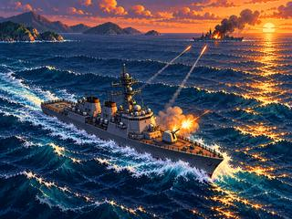
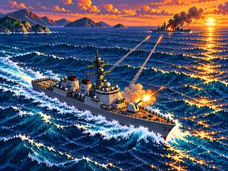

# I-009 — Scène de bataille en cours

**EXPLORATION ARTISTIQUE — NON VALIDÉE PO**

Deux illustrations générées par OpenAI le 29 octobre 2026 : destroyer au premier plan, navire ennemi endommagé à l'horizon, tirs, feu et fumée.

| Scène narrative | Rendu plus pixelisé |
| :---: | :---: |
|  |  |

La première génération est `a7162bd7-fb6e-49cd-9961-a46bca06b5f5` ; la deuxième est `2674048b-ed4f-45a0-9107-02e4fcc94b57`.

**Provenance** : les deux originaux OpenAI sont des PNG 1448 × 1086 et sont disponibles dans l'archive de conversation. GitHub contient ici des **copies JPEG de revue** converties pour le transfert, et les aperçus 320 × 240 : ce ne sont pas des originaux PNG ni des assets firmware. La variante 2 est une nouvelle génération, pas un zoom exact de la variante 1. Aucun fichier source multicouche n'existe.

**Palette et intention** : mer bleu pétrole, turquoise et écume froide, soleil or-corail, fumée anthracite. Deux plans et un impact adverse rendent le récit plus immédiat.

**Contrôles** : aperçus de 320 × 240 ; sources originales dans l'archive séparée. Aucun essai CYD, aucune compilation, aucune validation PO et aucun calcul RAM/Flash. Aucune modification de firmware ou de Le-Grenier-Geek.

**Pilotage** est seul responsable de la fusion.
