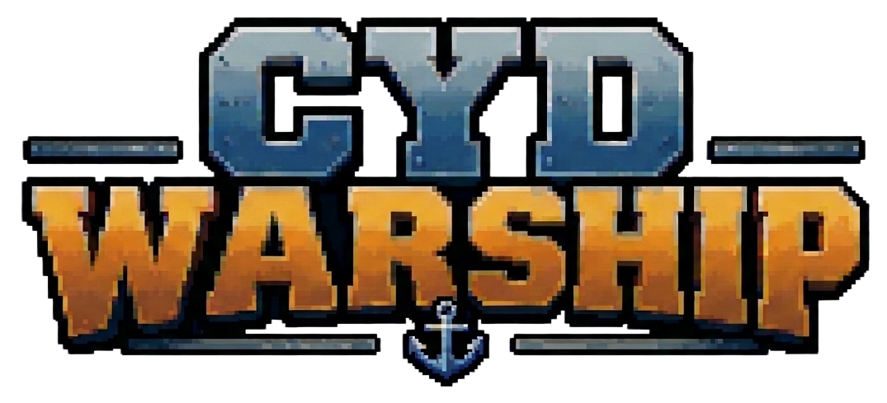
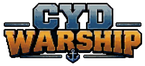

# Logo — CYD WARSHIP

Le logo de l'accueil, **transparent en PNG RGBA**, est conservé dans deux tailles, sans nouveau détourage ni retouche.

## Taille originale — 1075 × 489 px

## Taille CYD — 145 × 66 px

La grande version est le **sprite RGBA original détouré**, distinct du [JPEG remis par le PO](../../draft/Logo_titre.jpeg). Le sprite CYD est utilisé dans la composition d'accueil à la position proposée **(88, 8)**. [GO visuel sur PC — PR #90](https://github.com/Kharn27/ESP32-OTA-Battleship/pull/90#issuecomment-6740684237) ; [mandat de classement — Issue #103](https://github.com/Kharn27/ESP32-OTA-Battleship/issues/103). **Rendu réel sur CYD et budget mémoire non vérifiés.**
