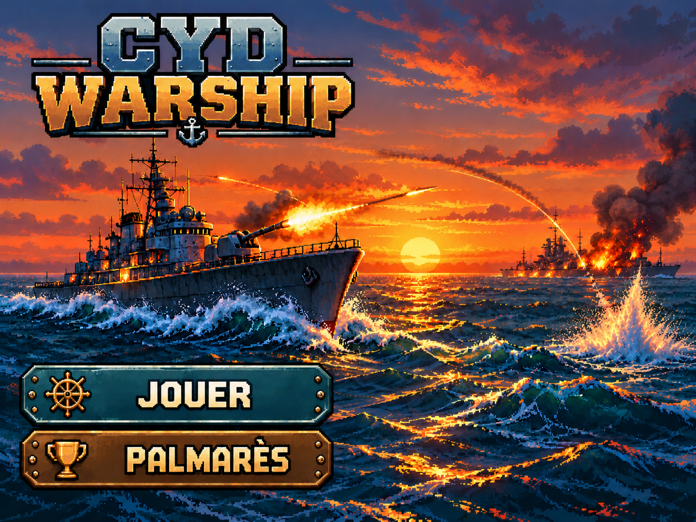
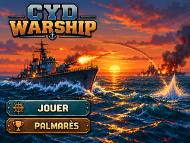

# Wallpapers d'accueil — CYD WARSHIP

Deux visuels d'accueil historiques, chacun en **grand format lisible** et en **320 × 240 natif CYD**.

## Fond actuellement retenu (sans interface incrustée)

**Original PO — 1195 × 896 (JPEG)**

**Export CYD — 320 × 240 (LANCZOS)**

Ce fond nu est celui de l'[accueil modulaire validé en PR #90](../../maquettes/accueil/legacy/README.md). Le [logo](../logo/) et les [boutons](../boutons/) sont des éléments séparés.

## Première version — composition historique de l'accueil

**Illustration originale extraite sans perte de la source SVG — 1448 × 1086**

**Export CYD historique — 320 × 240**

**Attention :** cette [première maquette, PR #8](https://github.com/Kharn27/ESP32-OTA-Battleship/pull/8) est une **composition aplatie avec titre et boutons intégrés**. Elle est archivée à titre comparatif ; ce n'est **pas un wallpaper nu réutilisable derrière des boutons supplémentaires**, et ce n'est pas l'accueil courant.

## Traçabilité

Le JPEG d'origine du PO reste intact dans draft/Wallpaper_accueil.jpeg. Le PNG CYD ancien et le raster HD historique viennent du commit immuable de la PR #8. Le nouveau PNG 320×240 est issu d'un redimensionnement unique LANCZOS du JPEG choisi. Voir le [manifeste des empreintes](../manifest.json), le [script reproductible](../../scripts/export_wallpapers.py), la [PR #90](https://github.com/Kharn27/ESP32-OTA-Battleship/pull/90#issuecomment-6740684237) et le [mandat PO #105](https://github.com/Kharn27/ESP32-OTA-Battleship/issues/105).

**ON_DEVICE_UNVERIFIED** — ni rendu sur CYD réelle, ni budgets Flash/RAM ou intégration firmware ne sont validés par ce rangement.
