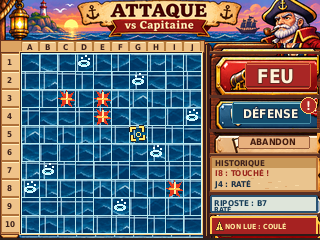
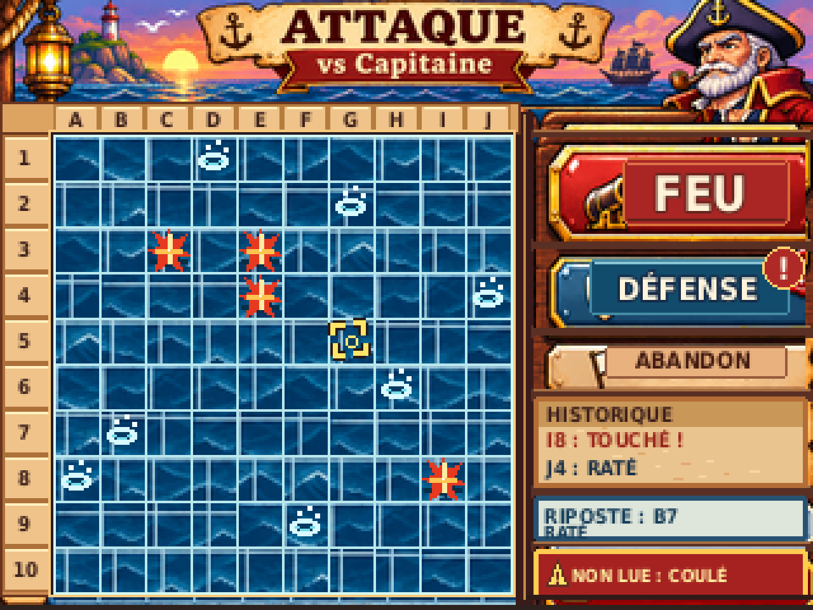
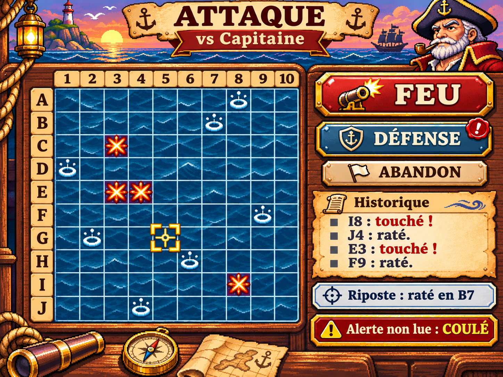

# G04-R2 — ATTAQUE vs Capitaine — recomposition picturale

> **DESIGN_PREVIEW — ON_DEVICE_UNVERIFIED** · **Non validé artistiquement par le PO** · PR Draft **Refs #45** · branche `design/g04-r2-attaque`.
>
> Nouvelle version destinée à remplacer la reconstruction vectorielle trop plate de la première remise, **sans reprendre G07 R1** (rejetée artistiquement). Cette image conserve volontairement le concept artistique expressif de l'illustration HD et sa cohérence d'usage / géométrie avec G08.

## Maquette principale : 320 × 240 pixels NATIFS



<details><summary>Zoom ×4 NEAREST strict — 1280 × 960</summary>



</details>

## Référence artistique HD : concept, non écran firmware



L'**image HD de ChatGPT** est fournie **comme référence picturale et atlas de matières**. La maquette PC native est une **recomposition** de fragments peints de mer, bois, laiton, ciel et boutons avec **grille/labels/impacts/cible/alertes dessinés à 320×240**, et non le résultat de la réduction globale de l'illustration HD. Le résultat combine peinture source et retouche déterministe ; le master de peinture n'est **pas vectoriel ni rééditable élément par élément**. La **mise en page, les cases, les marqueurs, les coordonnées et les textes sont éditables dans `build_g04_r2.py`**. L'ancien SVG vectoriel plat `g04_r2_attaque.svg` est une **archive dépassée** qui ne décrit plus les nouveaux PNG : ne pas le présenter comme source de cette version.

## Cadrage, interactions et contenu

- **Seule grille ATTAQUE** de 100 cases, 18×18 px, origine `(21,53)`, surface `(180×180)` : colonne **A–J** en haut, ligne **1–10** à gauche. Alignement géométrique strict avec G08, qui reste valide pour son écran sans imposer le rendu rejeté de G07 R1.
- La mer compose les cases ; **aucun navire ennemi n'est visible**. Impacts antérieurs **TOUCHÉ** en gerbes orange ancrées dans l'eau et **RATÉ** en anneaux d'écume clairs. Exemple cohérent, positions modifiables en source : `C3/E3/E4/I8` touchés, `A8/B7/D1/F9/G2/H6/J4` ratés. Le réticule **G5 jaune** désigne une case encore inconnue et n'est pas un impact.
- **FEU** : bouton cuivre/rouge le plus saillant, activable avec cible inconnue. Sélection réversible avant validation ; case déjà tirée indisponible ; au tir les commandes sont verrouillées durant l'animation, puis deux résultats révélés synchronisés. Tous ces comportements sont des **états du firmware à représenter**, pas des nouvelles mécaniques.
- **DÉFENSE** : bouton bleu avec `!` non numérique. Navigation volontaire ; conserve la cible lors du retour si FEU n'a pas été déclenché. L'ouverture de DÉFENSE acquitte résumé et alerte, jamais les impacts.
- **ABANDON** secondaire : ouvre la confirmation existante **CONTINUER / ABANDONNER**, sans abandon immédiat.
- **HISTORIQUE** : deux exemples de tirs affichés ; ils ne résument pas les marques cumulées de toute la grille. **Dernière riposte : `B7 RATÉ`** ; **alerte maximale non consultée : `COULÉ`** — volontairement séparées, sans compteur inventé.

## Preuves de génération PC

```bash
python3 -m pip install Pillow
python3 design/ecrans/attaque/build_g04_r2.py
python3 design/ecrans/attaque/verify_g04_r2.py
```

- **Source éditable :** `build_g04_r2.py` (paramètres, positions, composition native, sources de textures, marqueurs/axes/textes). L'illustration HD est **une ressource raster** appartenant à ce flux de production, pas un sprite firmware homologué.
- **Exports :** `g04_r2_attaque_320x240.png` et `g04_r2_attaque_x4.png` (NEAREST strict, 1280×960).
- **Rapport :** `generation-report.json` avec SHA256, positions et origine des données ; `verification-PC.txt` avec contrôles sur fichiers réels et essai négatif d'un pixel altéré.
- **Limites de la preuve :** géométrie 100 cases, échantillonnage NEAREST, positions/types d'impacts et hashes prouvables ; jugement « agréable et lisible à 320×240 », lisibilité TFT, taille tactile, contraste physique et profondeur visuelle relèvent de la contre-revue du PO et du test sur vraie CYD.

## Statuts et provenance

| Élément | Statut |
| --- | --- |
| Mer comme plateau ; profondeur maritime ; règles FEU / DÉFENSE / alerte | **DÉCIDÉ** G01 / Bible |
| Style matériel et composition du nouvel écran ATTAQUE | **PROPOSÉ PAR LE GRAPHISTE**, à juger par le PO |
| Grille `(21,53)` / 18 px conservée pour continuité G08 | **CONTRAINTE TECHNIQUE DE MISSION** |
| Référence HD originale | Génération ChatGPT, aucune ressource externe ni police transmise |
| PNG / source Python / zoom / vérifications PC | **VÉRIFIÉS PC seulement** |
| Touch/stylet, rendu TFT réel, Flash/RAM, décodage de textures | **À VÉRIFIER CYD avec Développeur** |

**G05-R2, G07-R2, G08, Bible et firmware sont hors périmètre de cette PR. Pas de validation PO ni de fusion par le Graphiste.**
