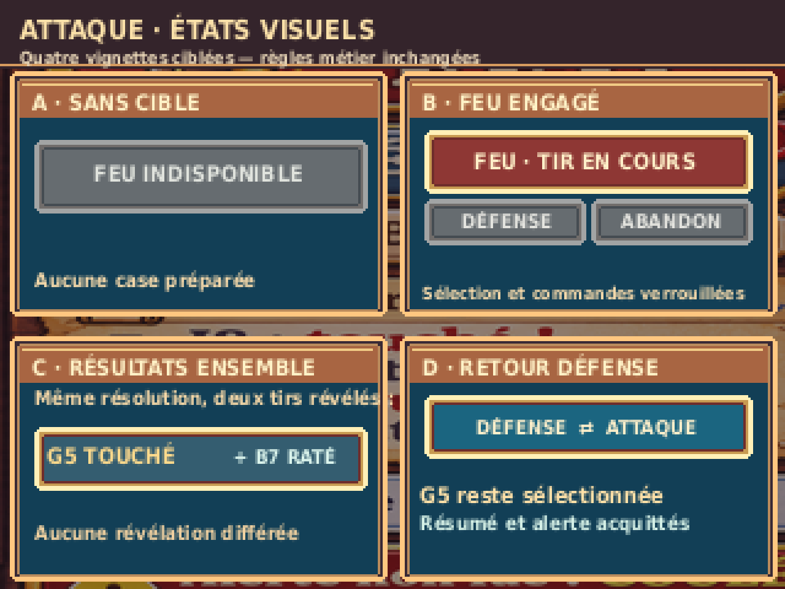

# G04-R2 — ATTAQUE VS Capitaine — contre-revue corrective

> **`DESIGN_PREVIEW — ON_DEVICE_UNVERIFIED` · `CORRECTIONS_REQUISES` de Pilotage traitées sur PC · accord artistique PO non reçu.**  
> Issue [#45](https://github.com/Kharn27/ESP32-OTA-Battleship/issues/45) · PR Draft [#64](https://github.com/Kharn27/ESP32-OTA-Battleship/pull/64) · Branche `design/g04-r2-attaque`. **Seul Pilotage fusionne.**

## Proposition principale 320 × 240 native


<details><summary>Zoom ×4 NEAREST strict — 1280 × 960</summary>


</details>

## Annexe visuelle ciblée — quatre états demandés (§2.5, Issue #45)

**Vignettes, pas quatre écrans concurrents :** A / sans cible → FEU indisponible ; B / FEU engagé → sélection, DÉFENSE et ABANDON verrouillés pendant l'animation ; C / résultats **des deux tirs révélés ensemble** (exemple illustratif G5 touché + B7 raté, non verdict séparé) ; D / consultation DÉFENSE puis retour ATTAQUE → cible G5 conservée avant FEU, résumé et alerte acquittés, impacts inchangés.


<details><summary>Vignettes ×4 NEAREST strict — 1280 × 960</summary>



</details>

## Corrections suite à la contre-revue [#6606077196](https://github.com/Kharn27/ESP32-OTA-Battleship/pull/64#issuecomment-6606077196)

1. **Lisibilité RIPOSTE** : un seul libellé **`RIPOSTE B7 : RATÉ`**, 9px, centré verticalement dans le cartouche, sans deuxième ligne écrasée en bas. La boîte typographique est vérifiée dans le générateur (x214–299, y197–207, strictement dans la zone visible). **`NON LUE : COULÉ`** passe de **7 à 9px** et tient entièrement dans la zone d'alerte (x225–304, y220–230). L'alerte et la dernière riposte restent distinctes, sans compteur inventé.
2. **États visuels** : les quatre mini-vignettes ci-dessus sont des **PNG réels**, dessinés dans la source éditable Python. Aucune mécanique ajoutée : FEU sans cible, FEU engagé, résolution simultanée et consultation-retour DÉFENSE sont ceux de la Bible.
3. **Contrôle physique du quadrillage sur les PNG** : le vérificateur lit le fichier PNG réel et sonde indépendamment des métadonnées du rapport **121 intersections et 220 segments** sur les 11 lignes verticales et 11 horizontales de la grille, origine **(21,53)**, pas **18**, 100 cases de **18×18**, cadre **180×180**. Une mutation d'un pixel d'une ligne déclenche volontairement un échec ; la mutation d'un seul canal rouge du zoom ×4 reste également rejetée.
4. **Reproductibilité** : `Pillow==12.3.0`, police système `DejaVuSansCondensed-Bold.ttf` du paquet Debian/Ubuntu `fonts-dejavu-core` (chemin `/usr/share/fonts/truetype/dejavu/DejaVuSansCondensed-Bold.ttf`). Source Python éditable, sans prétention de source picturale vectorielle : l'illustration de fond est raster.

## Règles et périmètre

- Une **seule grille 10×10 ATTAQUE**, colonnes **A–J** et lignes **1–10** en continuité géométrique avec G08. La mer texturée est le plateau ; aucun navire ennemi ni silhouette de flotte révélée.
- Tir préparé en **G5** : réversible avant FEU et conservé au retour de DÉFENSE si FEU non engagé. Les tirs passés TOUCHÉ (`C3 E3 E4 I8`) et RATÉ (`A8 B7 D1 F9 G2 H6 J4`) sont des exemples fictifs, marqués par **formes** différentes (explosion / anneau d'écume), pas la couleur seule.
- **FEU** est dominant seulement avec une cible valide. **DÉFENSE** est une navigation volontaire ; l'indicateur `!` désigne une notification non consultée, **sans nombre**. La riposte **B7 RATÉ** et la gravité maximale plus ancienne **COULÉ** restent deux informations séparées ; consulter DÉFENSE les acquitte sans effacer l'historique des impacts.
- **ABANDON** ouvre **CONTINUER / ABANDONNER**, ne déclenche pas de sortie directe. FEU engage les deux tirs puis révèle leurs résultats synchronisés, sans interaction pendant l'animation.
- Ambiance illustration maritime riche (soleil/capitaine, bois/laiton, mer, éclairage) inspirée de la direction G01, **pas** des anciens habillages G04/G05/G07 R1 rejetés. G08 demeure approuvée pour son écran propre ; aucun fichier G08 n'est modifié ici.

## Source, provenance et reproduction PC

- `reference_concept_1448x1086.png` : illustration maritime **générée par ChatGPT**, référence picturale / atlas de matières **raster**, non asset firmware ni source vectorielle élément par élément.
- `build_g04_r2.py` : **source réellement éditable** du compositing, texte, pastiches de métal/bois, grille, cibles, effets, alertes et quatre vignettes ; tous les paramètres d'implantation sont dans le code.
- `g04_r2_attaque_320x240.png` / `_x4.png` : maquette native et zoom. `g04_r2_etats_320x240.png` / `_x4.png` : vignettes natives et zoom.
- `verify_g04_r2.py` : contrôle indépendant des **pixels des PNG relus**, du zoom NEAREST, des marques, des variantes, des rapports SHA256 et deux preuves négatives ; `generation-report.json` et `verification-PC.txt` : traces des exports réellement livrés.

Sur Linux avec Python 3 et le paquet système `fonts-dejavu-core` :

```sh
python3 -m pip install 'Pillow==12.3.0'
python3 design/ecrans/attaque/build_g04_r2.py
python3 design/ecrans/attaque/verify_g04_r2.py
```

**Preuves PC uniquement** : les contrôles ne valident ni visuellement le style auprès du PO ni matériellement le TFT, le contraste, les hitboxes stylet, la mémoire Flash/RAM et le contrat d'assets avec le Développeur. Aucune certification `ON_DEVICE_VERIFIED` revendiquée. Le matériel n'est **pas une condition de réception de cette maquette PC** ; cette dette demeure tracée pour l'intégration firmware.

**Décision attendue :** nouvelle contre-revue Pilotage sur le HEAD exact, puis présentation PO pour acceptation artistique, sans passage en Ready ni fusion par le Graphiste.
