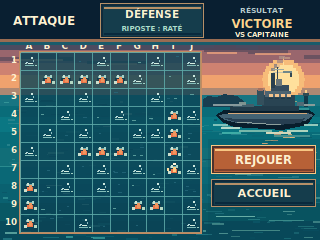
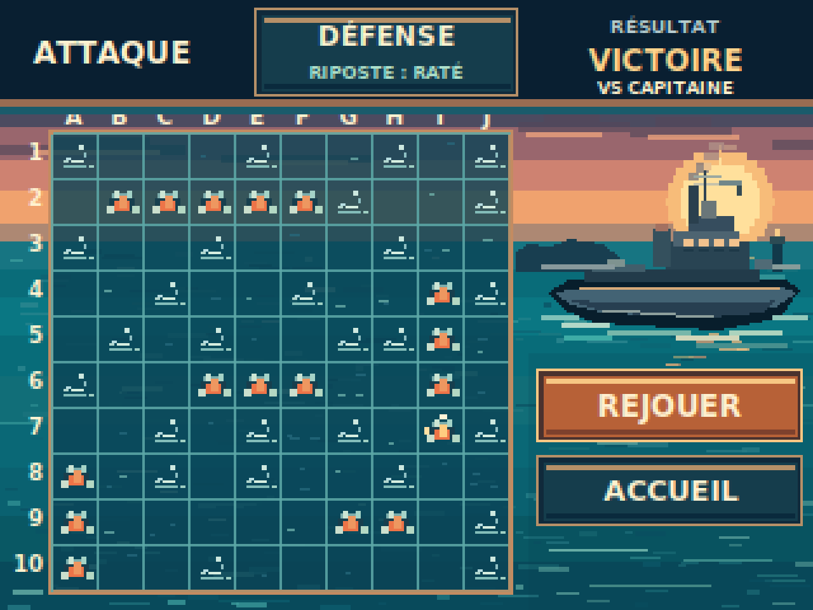
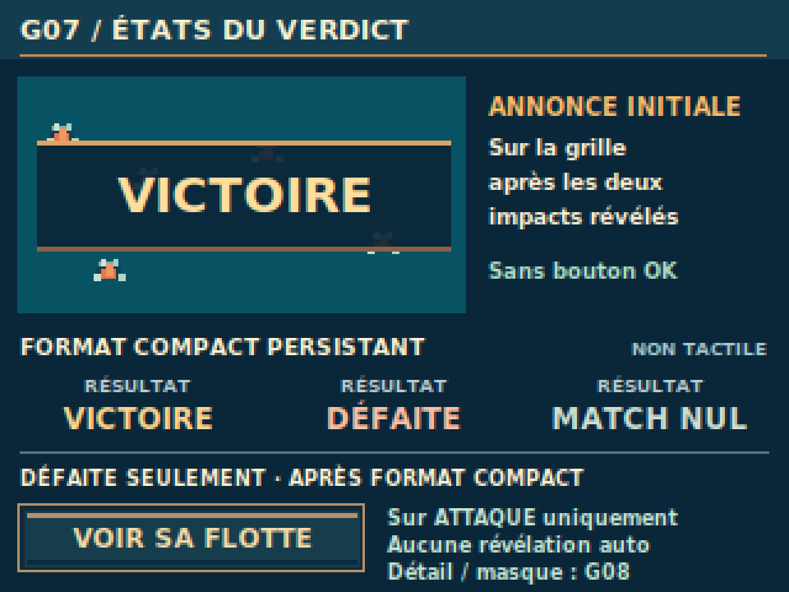

> **RÉFÉRENCE ACTIVE — VALIDÉE PAR LE PO (maquette PC).** FIN DE PARTIE G07 (post-verdict compact). [Issue #53](https://github.com/Kharn27/ESP32-OTA-Battleship/issues/53) · [PR #54 fusionnée](https://github.com/Kharn27/ESP32-OTA-Battleship/pull/54). `DESIGN_PREVIEW — ON_DEVICE_UNVERIFIED` : ni rendu TFT, ni hitbox, ni assets firmware homologués.

# G07 — FIN DE PARTIE VS Capitaine — Issue #53

## Aperçus intégrés — FIN DE PARTIE G07

| Verdict sur ATTAQUE — 320 × 240 | Planche des variantes — 320 × 240 |
| :---: | :---: |
|  |  |

Voir les zooms ×4 (1280 × 960, NEAREST)

**Verdict principal :**

**Planche des variantes :**

Sources : [verdict SVG](g07_verdict_320x240.svg) · [variantes SVG](g07_variantes_320x240.svg) · [générateur](build_g07.py).

**Graphiste / DA — DESIGN_PREVIEW — ON_DEVICE_UNVERIFIED.**
**Acceptation artistique PO : VALIDÉE pour la maquette PC (PR #54 fusionnée).** Cette livraison est une maquette PC,
sans preuve matérielle ou contrat d'assets firmware.

## Fichiers livrés

- **build_g07.py** : source originale de dessin éditable, objets SVG
  regroupés et nommés (ambiance, navire ami, 100 cases, impacts,
  commandes, cartouches), génération et assertions reproductibles.
- **g07_verdict_320x240.svg** : composition ATTAQUE post-verdict
  compact en SVG natif **réellement éditable** (rectangles,
  polygones, lignes et textes, sans PNG encapsulé).
- **g07_verdict_320x240.png** / **g07_verdict_x4.png** :
  export PC 320×240 et zoom 1280×960 strictement NEAREST.
- **g07_variantes_320x240.svg** / **.png** /
  **g07_variantes_x4.png** : planche de petites variantes annotées
  (mise en avant initiale, trois inscriptions de résultat compacts, commande
  disponible seulement en DÉFAITE).

## Intention artistique

**« La mer est le plateau »** : grande grille 10×10 intégrée dans
une mer continue, reflets de coucher du soleil par fragments, houle
texturée, coque d'escorte militaire **amie** en perspective à
droite, canons / passerelle / fumée et sillage ancrés au niveau
de l'eau. Cuivre patiné pour les commandes, sans faux insignes,
barres arbitraires ni ornement purement technique.

**Exemple montré : victoire contre Capitaine.** La dernière
manche est résolue et **les deux tirs déjà révélés ensemble**
avant le verdict. La grille affiche **17 TOUCHÉ** répartis
entre cinq groupes compatibles avec les longueurs
5 / 4 / 3 / 3 / 2 (sans tracer de coque, épave ou
appartenance des cases), et **27 RATÉ**. Dernier coup
offensif de l'exemple : **I7** ; dernière riposte Capitaine :
**RATÉ**. Ni silhouette ni plan de flotte adverse secret
ne sont affichés. Aucune cible en attente et **aucun FEU actif**.

## Contrat des états : DÉCIDÉ PO vs PROPOSÉ DA

| État ou action | DÉCIDÉ par la Bible v0.17 | PROPOSÉ par la DA pour maquette PC |
| --- | --- | --- |
| Dernière manche | Révélation des **deux tirs simultanée** puis évaluation du verdict | Historique immobile, pas d'animation de FEU dessinée |
| Verdict initial | VICTOIRE, DÉFAITE ou MATCH NUL mis en avant **sur le champ de bataille** | Cartouche cuivré semi-opaque au-dessus de la grille, vignette seule |
| Verdict persistant | Réduit ensuite, sans confirmation, timer ni écran intermédiaire imposés | **Inscription à plat** en haut à droite (RÉSULTAT / VICTOIRE, DÉFAITE ou MATCH NUL / VS CAPITAINE), sans cadre, fond surélevé, bordure ni volume ; zone x208..316, y3..38 |
| Inspection | Consultation volontaire ATTAQUE ↔ DÉFENSE ; plus aucun tir, impacts conservés | Zone DÉFENSE dans le bandeau haut ; suppression visuelle de FEU et de toute sélection |
| REJOUER | Retour au déploiement VS Capitaine, formation précédente du joueur par défaut, AUTO / PRÊT, nouvelle flotte adverse aléatoire secrète | Plaque cuivrée x212..316, y146..174 |
| ACCUEIL | Sortie après résultat **sans forfait** | Plaque marine cuivrée x212..316, y180..207 |
| VOIR SA FLOTTE | **Seulement en défaite** contre Capitaine, sur ATTAQUE, après verdict compact, volontaire | Plaque discrète x212..316, y212..236. **Réservation UX**, aucune révélation effectuée |

Le bouton **DÉFENSE** affiche dans l'exemple
« RIPOSTE : RATÉ » comme dernière riposte ; les
règles distinctes de résumé/alerte maximale non consultée
restent celles du §14.10.2. Une ouverture volontaire de DÉFENSE
acquitte l'alerte et le résumé, mais **jamais les marques**
sur la grille. G07 ne redessine pas G05 : sur DÉFENSE après
résultat, la grille humaine est consultable, retour ATTAQUE,
REJOUER/ACCUEIL accessibles, et le verdict demeure connu.

Les trois résultats se déclinent dans **la même composition** ;
la planche montre leurs **inscriptions typographiques non interactives**,
avec la même grammaire graphique que la maquette principale. Pas de commande
MONTRER MA FLOTTE pour VICTOIRE, pas de commande de révélation
pour MATCH NUL. La création de l'état de révélation effective,
son basculement AFFICHER/MASQUER, ses navires et ses assets sont
**hors G07 (mission candidate G08)**.

## Reprise ciblée après revue PO / Pilotage du 02/11/2026

**Motif de correction :** dans la première livraison, VICTOIRE partageait
avec DÉFENSE un cartouche rectangulaire surélevé à liserés cuivrés.
Ce langage commun confondait **information** et **action tactile**.

**Solution graphique proposée : une inscription dans le bandeau marin.**
Le verdict est maintenant rendu directement par la typographie
**RÉSULTAT / VICTOIRE / VS CAPITAINE**, sans contour, sans plaque,
sans fond d'appui ni relief ; les trois issues partagent **strictement
la même grammaire**, seules la couleur et les lettres changent.
La planche des états reprend le même traitement, à l'échelle réduite.
À l'inverse **DÉFENSE**, **REJOUER** et **ACCUEIL** conservent leur vraie
plaque à bordure cuivrée, dessus éclairé et dessous ombré :
le relief matérialise volontairement une zone d'action.

**Préservé sans refonte :** mer continue, navire militaire,
lumière, échelle et position des 100 cases, 17 touches, 27 ratés,
FEU absent, navigation / reprise / accueil, révélation après défaite
facultative (G08 hors mission). Aucun comportement ni règle modifiés.
Cette distinction est testée structurellement dans le SVG, mais
reste à **faire juger visuellement par le PO sur PNG natif 320×240**.

## Mesures, risques et provenance

- Grille x21..201, y53..233 : **100 cases de 18×18 px**.
  Colonne A–J, lignes 1–10. Aucune seconde grille visible.
- Tailles de texte proposées : ATTAQUE 12 px, DÉFENSE
  10,5 px, verdict 11,7 px, libellés commandes 11–12 px,
  sous-libellé 7,1 px, VOIR SA FLOTTE 9,1 px.
- Dimensions **visuelles**, non des hitboxes homologuées :
  DÉFENSE 103×34 px, REJOUER 104×28 px, ACCUEIL
  104×27 px, VOIR SA FLOTTE 104×24 px, cases 18×18 px.
  Les plus petits textes et zones exigent une **revue sur
  vraie CYD/stylet** ; non évalués matériellement.
- Rendu PC original à base de formes vectorielles créées
  pour cette Issue ; **aucune image tierce importée**.
  Polices hôtes DejaVu Sans si disponibles, **non distribuées**.
  PNGs produits sous Python 3 avec CairoSVG 2.7.1 et
  Pillow 11.3.0. Aucune contrainte RGB565, PSRAM,
  compression, taille Flash/RAM ni latence imposée.
- G01 = direction artistique ; G04/G05 = comportements
  provisoires, **pas modèles de pixels**. Rien n'est
  modifié en G01–G06, Bible ni firmware.

## Preuve reproductible PC

Depuis la racine du dépôt, avec Python / CairoSVG / Pillow :

    python design/ecrans/fin-partie/build_g07.py

Le script exporte les deux SVG éditables, deux PNG 320×240,
deux PNG 1280×960 ; vérifie dimensions, zoom x4
nearest-neighbor **pixel pour pixel** dans les deux sens,
100 cellules uniques, 17 touches / 27 ratés disjoints,
absence de flotte adverse dévoilée, absence de FEU après
verdict, REJOUER / ACCUEIL / DÉFENSE, trois libellés de
verdict et commande de défaite uniquement. Les assertions
contrôlent désormais explicitement **1 verdict informatif
sans rectangle ni data-action** dans la scène, **3 variantes
informatives sans relief** et **3 commandes réelles avec
plaques de volume et data-action**.

**Preuves non acquises :** affichage physique TFT 320×240,
stylet, qualité des tailles de polices sur dalle, temps de
rendu, mémoire et intégration firmware. Statut strict
**DESIGN_PREVIEW — ON_DEVICE_UNVERIFIED**.

**Validation obtenue :** acceptation artistique PO sur
maquette PC, revue du HEAD et fusion par Pilotage exclusivement.
