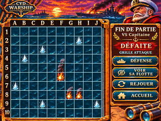
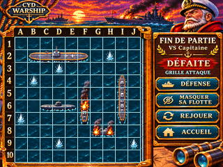
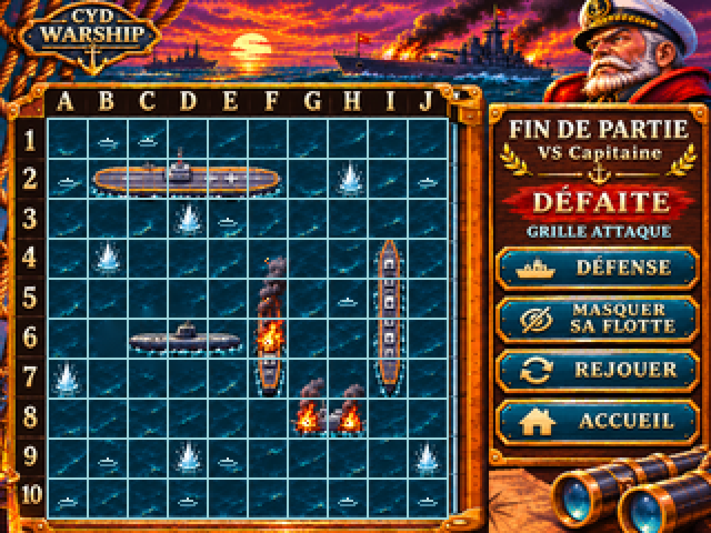
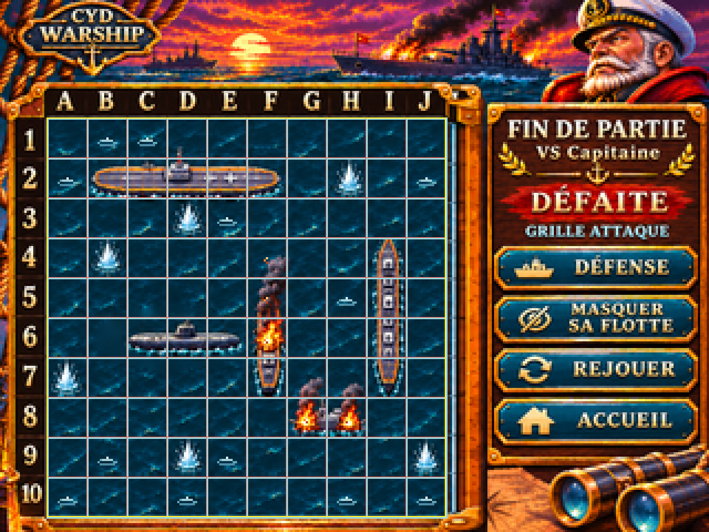
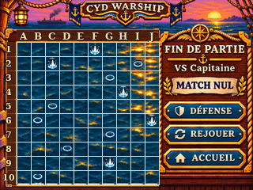
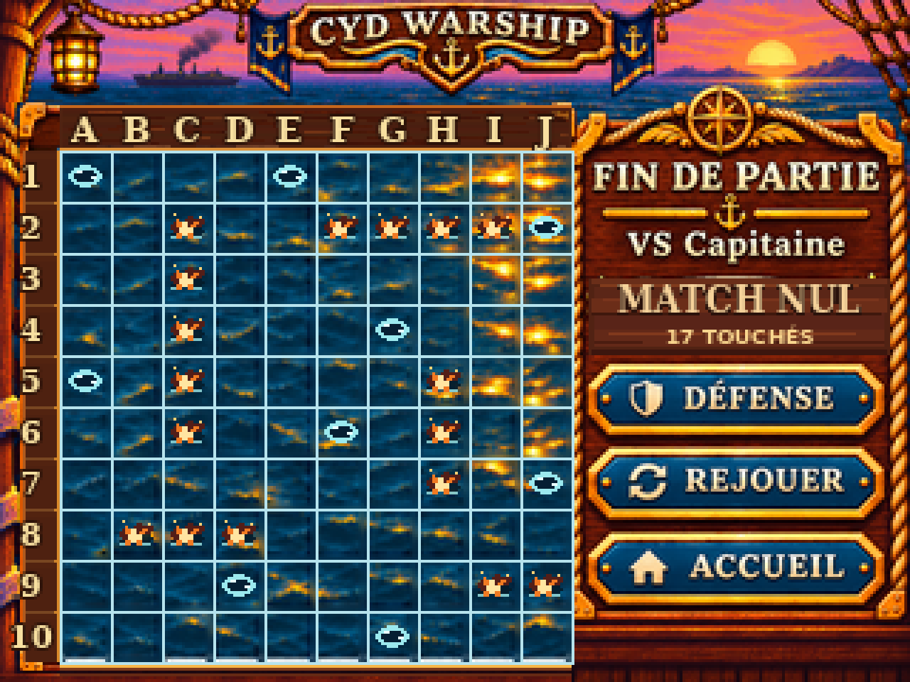
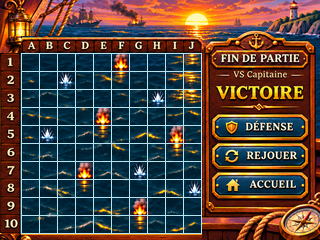
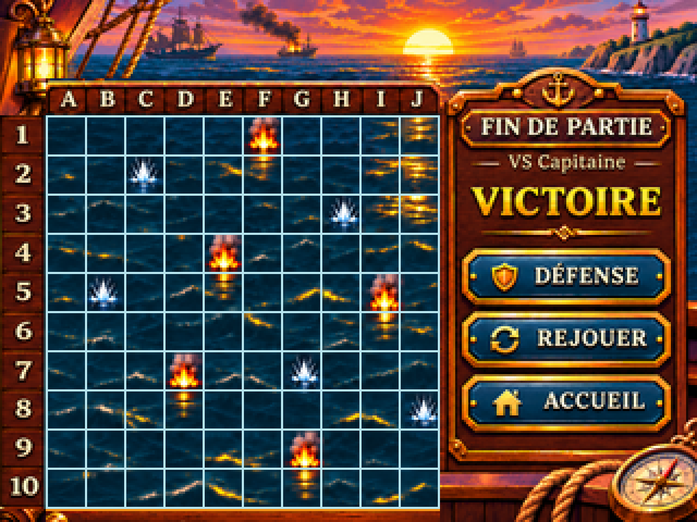

# G07-R2 — FIN DE PARTIE / DÉFAITE ET MATCH NUL (Issue #53)

## Nouveau : DÉFAITE initiale — flotte ennemie masquée (G07, état A)

Zoom ×4 NEAREST strict — 1280×960

- **État initial conforme métier** : aucune coque adverse visible, verdict DÉFAITE compact, historique des tirs, touche « VOIR SA FLOTTE » ; les commandes DÉFENSE, REJOUER et ACCUEIL restent présentes.
- **Contrôle géométrique PC PASS** : 11 lignes X=21…201, 11 lignes Y=53…233, pas exact de 18 pixels, 100 cases carrées, zoom ×4 pixel-exact, translation +1 px rejetée.
- [Source OpenRaster 4 calques](g07_r2_defaite_masquee_source.ora) · [script reproductible](build_g07_r2_defaite_masquee.py) · [original auteur HD](g07_r2_defaite_masquee_original_1448x1086.png) · [manifeste SHA](g07_r2_defaite_masquee_provenance.json) · [preuve 320×240](g07_r2_defaite_masquee_proof_320x240.png) · [preuve ×4](g07_r2_defaite_masquee_proof_x4.png).
- [README et limites spécifiques](README_DEFAITE_MASQUEE.md).

**Statut** : DESIGN_PREVIEW / ON_DEVICE_UNVERIFIED ; GO PO non acquis, aucun test matériel ou contrat de format firmware. Les éléments artistiques complexes sont partiellement aplatis dans les calques ORA. Cet état rejoint la variante révélée G08 B/C présentée ci-dessous.

---

> **PR Draft, candidat graphique non validé PO ; DESIGN_PREVIEW — ON_DEVICE_UNVERIFIED.**
> **Ce rendu correspond à DÉFAITE avec flotte adverse DÉJÀ révélée volontairement (suite G08 B/C), et NON à l'état initial secret G07.** La commande visible est « MASQUER SA FLOTTE ».

## PNG natif 320 × 240 (état révélé)

Zoom ×4 — 1280 × 960 strict NEAREST

Preuve de géométrie — repères superposés, non destinée à l'interface

[Source native aplatie](g07_r2_source_320x240.png) · [Générateur PC](build_g07_r2.py) · [SHA-256 et tests](g07_r2_provenance.json).

## Image 2/7 — MATCH NUL, verdict compact (géométrie CONFORME)

Zoom ×4 pixel-exact (1280×960)

[Preuve 320×240](g07_r2_match_nul_geometry_proof_320x240.png) · [Preuve ×4](g07_r2_match_nul_geometry_proof_x4.png) · [Source ORA](g07_r2_match_nul_source.ora) · [Manifest SHA/mesures](g07_r2_match_nul_provenance.json) · [Script de contrôle](build_g07_r2_match_nul.py) · [README dédié et réserves](README_MATCH_NUL.md).

**Contrôle PC PASS :** 11 lignes X=21…201 et Y=53…233 (pas exact de 18), 100 cases 18×18, zoom ×4 strict NEAREST, deux fichiers d'origine vérifiés SHA-256 lors de l'import [Actions #42062625539](https://github.com/Kharn27/ESP32-OTA-Battleship/actions/runs/42062625539) : **SUCCESS**. Source d'auteur encore partiellement aplatie : seul le calque de repères est isolé. La conformité géométrique ne préjuge ni du GO PO ni des tests TFT/stylet.

## Image 1/7 — VICTOIRE, verdict compact (géométrie PC CONFORME)

Zoom ×4 strict NEAREST

[Source OpenRaster partiellement éditable](g07_r2_victoire_source.ora) · [Script déterministe](build_g07_r2_victoire.py) · [Provenance et contrôle](g07_r2_victoire_provenance.json) · [README VICTOIRE et réserves](README_VICTOIRE.md).

**Reconstruction réelle de la grille 10×10 à (21,53)→(201,233), 18×18 ; 22 traits mesurés, négatif de +1 px rejeté, panneau droit x ≥ 202 strictement inchangé.** Le master initial 1448×1086 reste conservé pour la reproductibilité. Source composite partiellement calquée, impacts et commandes droite encore aplatis. Pas de GO PO ni de TFT.

## Contrôles reproductibles

Exécuter `python3 -m pip install Pillow numpy` puis `python3 design/ecrans/fin-partie/build_g07_r2.py`.

Le script **mesure dans les pixels** les traits cyan RGB (156,214,220) au lieu de déclarer a priori leur présence. Il exige :
- 11 lignes verticales à X = **21, 39, 57, 75, 93, 111, 129, 147, 165, 183, 201**.
- 11 lignes horizontales à Y = **53, 71, 89, 107, 125, 143, 161, 179, 197, 215, 233**.
- Plateau **180 × 180** ; **100** cases de **18 × 18**. Les deux dernières limites sont incluses comme traits de bord.
- Test négatif : translation horizontale de 1 pixel **rejetée**.
- Reconstitution de l'agrandissement ×4 pixel pour pixel **NEAREST**.

Ces assertions prouvent la géométrie du *PNG précis*, et non sa conformité métier exhaustive ni son rendu physique.

## État présenté et points encore ouverts

Le navire porte-avions, le sous-marin, le croiseur long, le navire incendié central et le navire en feu bas sont des éléments visibles de la **flotte révélée volontairement**. Leur présence n'est **pas autorisée avant choix**. L'état initial G07 avec flotte cachée et bouton `VOIR SA FLOTTE` est désormais livré en tête de page ; le parcours G08 peut ensuite conduire à cette vue révélée, puis au masquage.

**G07-R2 n'est pas terminée :** annonce initiale, synchronisation vérifiable des deux tirs, raccord A/B/C G08, surcouches éditables plateau/impacts/verdicts/commandes. Le PNG DÉFAITE fourni est **aplati et sans calques éditables** ; pour MATCH NUL, une ORA contenant le raster aplati plus la surcouche de preuve masquée est livrée, sans isolation des objets UI. Aucun export firmware, aucune vérification CYD/stylet/Flash/RAM ; pas de GO artistique du PO. Conserver la PR #74 en Draft et réserver sa fusion au Pilotage.

Les anciens `g07_verdict_*`, `g07_variantes_*` et `build_g07.py` (G07-R1) restent **rejetés artistiquement** et ne doivent pas servir de référence. Ils seront retirés du canon actif à la réception complète de R2, conformément à l'Issue.
