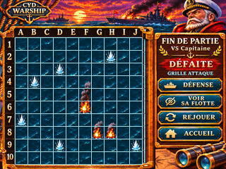
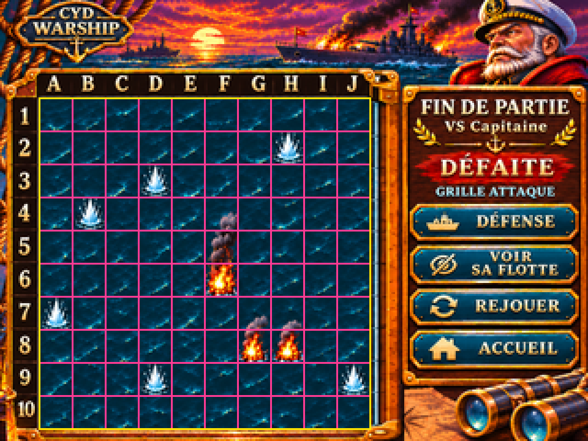

# G07-R2 — DEFAITE initiale / flotte Capitaine masquee

> Issue #53 · PR #74 · DESIGN_PREVIEW / ON_DEVICE_UNVERIFIED · en attente de validation artistique PO.

Zoom x4 NEAREST strict (1280x960)

Preuve geometrique non-runtime

**Etat illustre** : verdict compact DEFAITE, ATTAQUE, historique des impacts, flotte ennemie encore cachee. Actions DEFENSE, VOIR SA FLOTTE, REJOUER, ACCUEIL. Aucun FEU.

**Mesures PC** : grille 10x10, emprise (21,53)-(201,233), 180x180 pixels, case 18x18. Lignes X 21,39,57,75,93,111,129,147,165,183,201 ; Y 53,71,89,107,125,143,161,179,197,215,233. Scan des pixels du PNG final, decalage negatif +1px rejete, zoom x4 strict NEAREST verifie.

**Livraison** : PNG natif + zoom x4, deux preuves de geometrie, source OpenRaster 4 calques (decor sans coques / mer et impacts / quadrillage / panneau VOIR), original HD utilisateur, script Python de regeneration et manifest SHA-256. Pour regenerer: pip install Pillow numpy ; python3 design/ecrans/fin-partie/build_g07_r2_defaite_masquee.py.

**Reserve** : certains elements decoratifs et textes restent aplatis. Ce n'est pas un asset firmware. L'affichage materiel, le tactile, la Flash/RAM, la sequence des deux tirs simultanes, les transitions et le parcours complet G08 ne sont pas valides par cette image. GO artistique PO en attente, fusion uniquement Pilotage.
