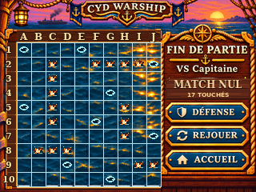
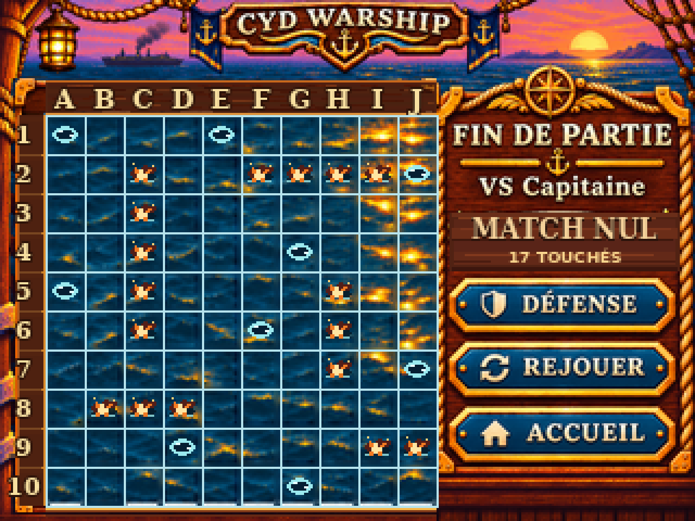
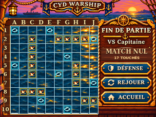
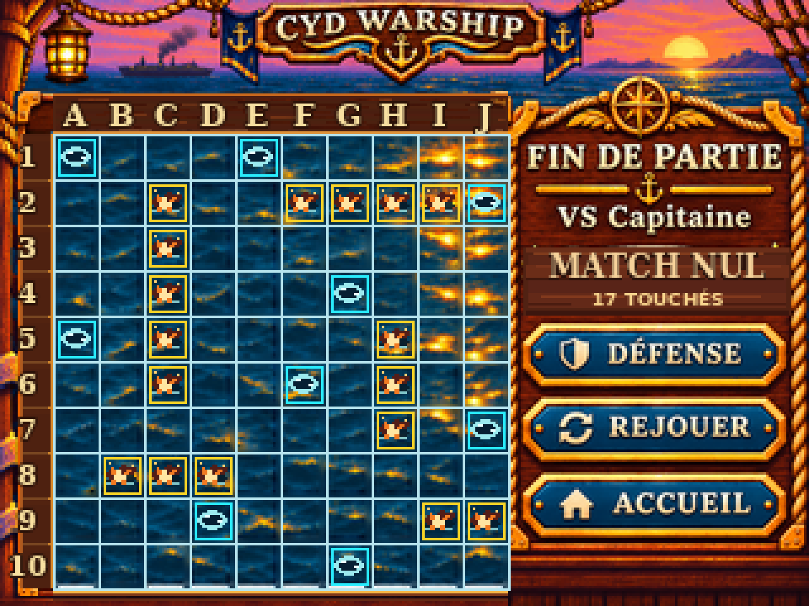

# G07-R2 — IMAGE 2/7 MATCH NUL, correctif Pilotage du 06/11/2026

> Issue **#53** · PR Draft **#74** · branche `design/g07-r2-verdict` · **DESIGN_PREVIEW / ON_DEVICE_UNVERIFIED**. Revue Pilotage / GO artistique PO en attente. Aucun firmware, budget Flash/RAM ni fonctionnement tactile validé.

## Maquette native 320 × 240

Zoom ×4 NEAREST — 1280 × 960, pixel-exact

Preuve de grille et marqueurs (diagnostic, hors UI)

## Corrections ciblées effectivement appliquées

- **Grille ATTAQUE unique 10×10** : origine `(21,53)` ; pas `18×18` ; emprise jusqu'à `(201,233)` ; 22 traits de **1 px** RGB `(182,227,237)`, continus. Décor, titre et boutons conservés ; 12 anciennes marques ambiguës ont été remplacées par des échantillons de mer de la même illustration.
- **Historique vérifiable** : exactement **17 touches ennemies**, une marque orange/cuivre par case, réparties sur cinq navires d'un placement légal 5+4+3+3+2. **9 ratés** sous forme d'ondulations cyan creuses. Les navires adverses restent **masqués** ; pas de silhouettes ni de groupes de coques visibles.
- **Verdict informatif non tactile** : suppression du cartouche en relief beige. `MATCH NUL` et `17 TOUCHÉS` deviennent des inscriptions plates sur le bois, distinctes des trois commandes bleues `DÉFENSE / REJOUER / ACCUEIL` conservées.
- **DÉFENSE (preuve documentaire uniquement)** : 17 cases humaines touchées, les mêmes 5 navires légaux (5+4+3+3+2). Pas de seconde grille dans la maquette compacte ATTAQUE.

## Scénario canonique d'illustration (données de test, pas logique moteur)

**Flotte adverse masquée sur ATTAQUE** : porte-avions `C2–C6` (5), croiseur `F2–I2` (4), sous-marin `H5–H7` (3), contre-torpilleur `B8–D8` (3), patrouilleur `I9–J9` (2). Les **17 cases** sont documentées explicitement dans `g07_r2_match_nul_scenario.json`, sans apparaître comme des coques sur le PNG.

**Flotte humaine sur DÉFENSE** (placement de référence de G05-R2) : porte-avions `B2–F2` (5), croiseur `I4–I7` (4), sous-marin `C6–E6` (3), contre-torpilleur `F5–F7` (3), patrouilleur `G8–H8` (2).

**26e et dernière manche** : `J9 TOUCHÉ` (joueur, dernier segment adverse) **et** `H8 TOUCHÉ` (Capitaine, dernier segment humain) sont résolus puis **révélés ensemble** ; les deux flottes passent à zéro **au même verdict MATCH NUL**. Aucun ordre de priorité fictif. Le JSON comporte les **26 paires de tirs** et les étiquettes `TOUCHÉ / RATÉ` pour contrôle mécanique et anti-doublon.

### Préparation graphique et fichiers

- `g07_r2_match_nul_correctif_source.svg` : **source principale éditable**, toile 320×240 ; `decor-original-aplati`, nettoyage des anciennes marques, `historique-attaque-touches` avec **17 groupes indépendants**, `historique-attaque-rates` avec **9 groupes indépendants**, bois plat et verdict/texte indépendants. Le raster maritime de départ reste aplati : **pas** de sprites runtime.
- `g07_r2_match_nul_source.ora` : ouverture OpenRaster, mais seulement **composite final et décor original séparés**. **Les impacts individuels sont modifiables dans le SVG, pas dans l'ORA.**
- `g07_r2_match_nul_original_320x240.png` : master d'entrée reproductible (visuel précédent, non approuvé). `g07_r2_match_nul_320x240.png` : export corrigé ; `g07_r2_match_nul_x4.png` : ×4 NEAREST, sans interpolation.
- `g07_r2_match_nul_geometry_proof_320x240.png` et `..._x4.png` : preuves annotées *uniquement pour la revue*, **ne jamais utiliser comme asset UI**.
- `g07_r2_match_nul_scenario.json` : historique exact et positions sous-jacentes ; `g07_r2_match_nul_provenance.json` : SHA-256, dimensions et statut de validation ; `build_g07_r2_match_nul.py` : reconstitution et assertions PC.

Reproduction en environnement Python avec `Pillow` et `CairoSVG` : `python3 build_g07_r2_match_nul.py`. Vérifications automatisées : 22 traits complets, 17 marqueurs TOUCHÉ + 9 marqueurs RATÉ par comparaison de pixels aux centres attendus, groupes d'édition, légalité géométrique 5/4/3/3/2, 17 impacts humains distincts, 26 paires légales, révélation conjointe finale, zoom exact et **test négatif** d'une translation de grille d'un pixel.

### Limites et gouvernance

Examen PC uniquement : la disposition générale a été inspectée en 320×240 et ×4. La maquette ne prouve pas l'animation annonce→compact, les hitboxes stylet, les transitions ATTAQUE↔DÉFENSE, la fluidité ni le rendu sur écran CYD. Le plan documentaire de DÉFENSE n'est **pas** une quatrième image fonctionnelle livrée. La source originale est une composition de projet fournie par le PO ; formes et symboles surajoutés dessinés pour le correctif, sans ressources stock tierces. Pas de `ON_DEVICE_VERIFIED`, pas de GO artistique. La branche et la PR restent **Draft**, et **seul Pilotage fusionne**.
