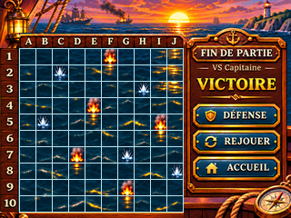
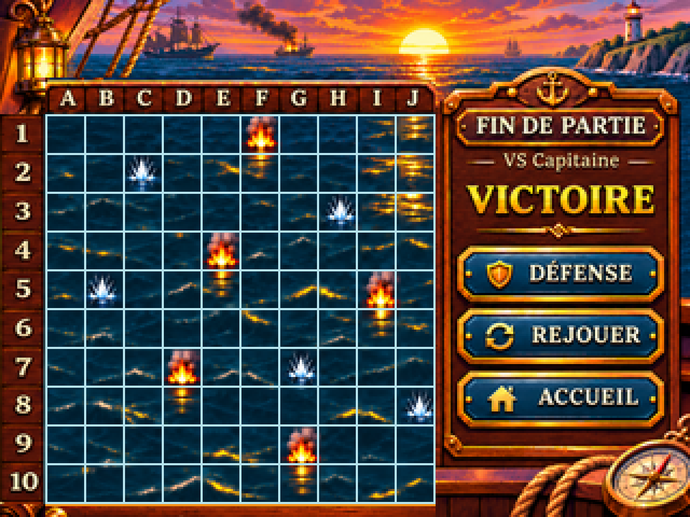
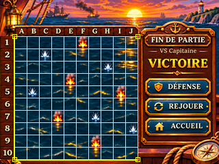
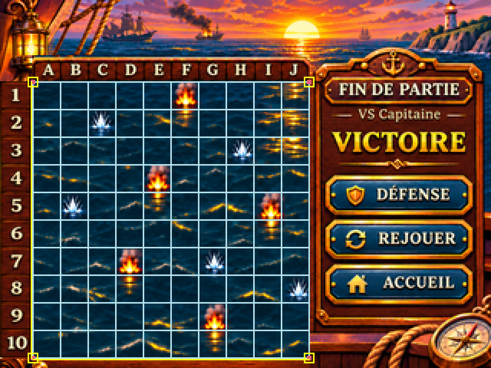

# G07-R2 — IMAGE 1/7 VICTOIRE compact (Issue #53 / PR #74)

> **DESIGN_PREVIEW / ON_DEVICE_UNVERIFIED**. Correction graphique ciblée reçue le 06/11/2026 ; validation artistique PO / contre-revue Pilotage en attente. L'Issue G07-R2 et la PR Draft ne sont pas achevées.

## Aperçu natif 320 × 240



<details><summary>Agrandissement ×4 strict NEAREST (1280 × 960)</summary>



</details>

<details><summary>Diagnostic géométrique uniquement — non destiné au jeu</summary>





</details>

## Géométrie démontrée sur le PNG

- Grille **10 × 10** de **18 × 18 px**, début **(21, 53)**, fin **(201, 233)**, emprise **180 × 180**.
- Verticales : **21,39,57,75,93,111,129,147,165,183,201**.
- Horizontales : **53,71,89,107,125,143,161,179,197,215,233**.
- Les 22 lignes sont effectivement vérifiées **sur les 181 pixels de leur longueur** (couleur RVB **182,227,237**), sans se contenter de prédire leurs coordonnées.
- Un déplacement artificiel de 1 px est **rejeté** ; PNG ×4 intégralement conforme à une duplication NEAREST de chaque pixel natif.
- **Panneau droit x ≥ 202 : zéro pixel modifié** par rapport à l'image d'origine une fois réduite au format natif.

La grille initiale, d'origine mal cadrée, a été retirée de la région maritime ; la mer a été recomposée avec suppression des anciens traits par *inpainting* déterministe, puis la géométrie 18 px a été tracée nativement. Le bas du plateau a été raccourci en boiserie pour permettre la 10e ligne à Y=233 ; les inscriptions A–J et 1–10 ont été repositionnées en restant dans l'identité graphique de l'image fournie.

## État et limites

État **FIN DE PARTIE — VS Capitaine — VICTOIRE** en verdict compact, avec boutons **DÉFENSE**, **REJOUER**, **ACCUEIL**. Une seule grille d'attaque, dix marqueurs d'historique de tir. Pas de FEU, pas de révélation spontanée de la flotte ennemie, pas de commande « VOIR SA FLOTTE » sur VICTOIRE.

**Ne prouve pas** : synchronisation des deux derniers tirs, animation initiale puis verdict compact, cohérence des placements avec un état runtime réel, hitboxes tactiles ou test TFT physique. Les autres images/états requis par l'Issue restent sous leur propre réserve.

## Sources et provenance

- `g07_r2_victoire_source_hd.png` : original **1448 × 1086**, fourni par le PO le 06/11/2026.
- `build_g07_r2_victoire.py` : source reproductible sous **Python 3**, **Pillow**, **NumPy**, **OpenCV** ; une invocation reconstruit les exports, la source ORA et le manifeste d'intégrité.
- `g07_r2_victoire_source.ora` : **source éditable partielle**, avec calques raster séparés pour le bandeau A–J, la réglette 1–10, la mer/impacts, les traits de grille natifs et la traverse basse, plus fond/panneau droit. Les commandes/typos à droite, la mer et ses impacts **ne sont pas décomposés en sprites indépendants**. L'illustration de départ était aplatie.
- `g07_r2_victoire_provenance.json` : sommes SHA-256 du master et des sorties, dimensions, contrôles PASS/NOT_TESTED, limitations.

Légitimité de source : PNG fourni par le PO dans la conversation. Pas de recherche Stock externe. Droits d'auteur sur éléments éventuels dans l'image d'origine non audités. Aucun format de firmware imposé, aucune mesure Flash/RAM, ni présomption d'usage de microSD ou de PSRAM.

### Reproduire

```bash
python3 -m pip install pillow numpy opencv-python-headless
python3 design/ecrans/fin-partie/build_g07_r2_victoire.py
```

**Réception :** `DESIGN_PREVIEW`, vérification PC du format/géométrie PASS, revue artistique PO **EN ATTENTE**, essai physique CYD **NON TESTÉ**. PR #74 toujours Draft, fusion exclusivement Pilotage.
