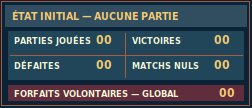
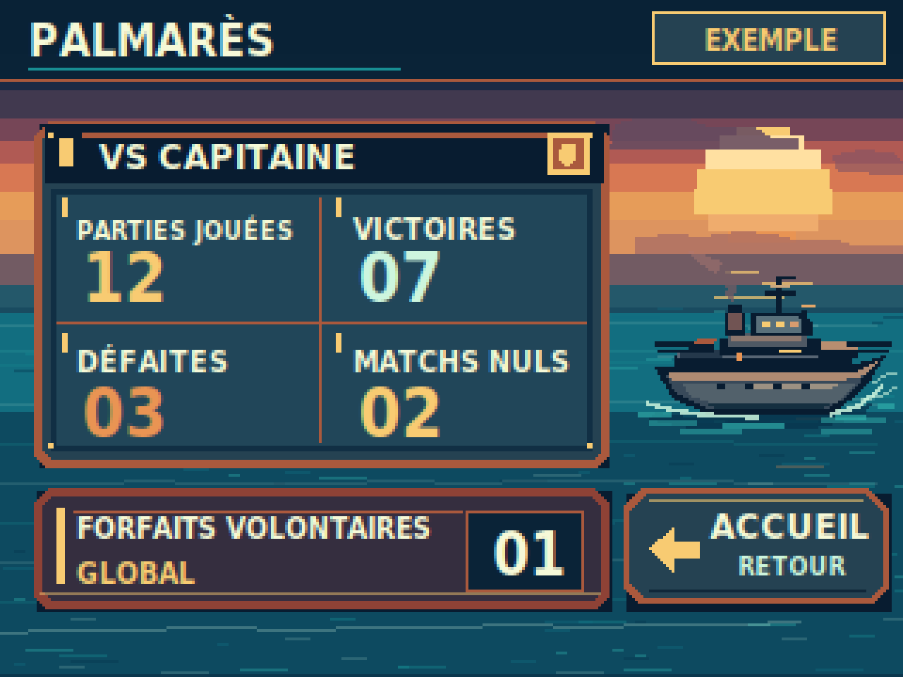

> **RÉFÉRENCE ACTIVE — VALIDÉE PAR LE PO (maquette PC).** PALMARÈS G06. [Issue #47](https://github.com/Kharn27/ESP32-OTA-Battleship/issues/47) · [PR #51 fusionnée](https://github.com/Kharn27/ESP32-OTA-Battleship/pull/51). `DESIGN_PREVIEW — ON_DEVICE_UNVERIFIED` : ni rendu TFT, ni hitbox, ni assets firmware homologués.

# G06 — PALMARÈS VS CAPITAINE · Issue #47

## Aperçus intégrés — PALMARÈS G06

**Écran principal approuvé, 320 × 240 px :**


**État zéro partie : vignette pédagogique, pas un deuxième écran complet.**



<details>
<summary>Voir le zoom ×4 du palmarès (1280 × 960, NEAREST)</summary>



</details>

Sources : [SVG principal](g06_palmares_320x240.svg) · [SVG zéro partie](g06_zero_partie.svg) · [générateur](export_previews.py).


**Graphiste / DA · LOT 1 · `DESIGN_PREVIEW — ON_DEVICE_UNVERIFIED`.**  
**Arbitrage artistique PO : VALIDÉ au niveau de la maquette PC.** PR #51 fusionnée par Pilotage.  
**Branche :** `design/issue-47-palmares`. **Base au lancement :** `main` `0642e7abc1d4285d978586042df66edcbff5b4ec`.

## Livrables

| Fichier | Destination |
| --- | --- |
| [g06_palmares_320x240.svg](g06_palmares_320x240.svg) | Source principale **SVG éditable**, avec groupes distincts scène, journal, forfait global, retour |
| [g06_palmares_320x240.png](g06_palmares_320x240.png) | Aperçu réel **320×240** |
| [g06_palmares_x4.png](g06_palmares_x4.png) | Preuve **1280×960 NEAREST** (aucune interpolation) |
| [g06_zero_partie.svg](g06_zero_partie.svg) / [PNG](g06_zero_partie.png) | **Petite vignette** `252×108` de variante zéro, **pas** un second écran |
| [export_previews.py](export_previews.py) | Validation sémantique + export SVG vers PNG reproductibles |

## Hiérarchie et proposition artistique G01

Une **page de journal de bord naval** paraît fixée au-dessus d'un océan crépusculaire **continu**. Le paysage persiste sur toute la toile : bandes de ciel au couchant, soleil, silhouettes de nuages, reflets aquatiques brisés et un bâtiment militaire de surface en silhouette pixel art, canonnerie, passerelle, cheminée, mât et sillage ancré dans l'eau. Le matériau du journal évoque une plaque de bord, entre cuivre, bois verni, rivets et encre marine. **Ce n'est ni une copie de l'accueil ni un nouveau thème produit** : reprend le langage chromatique et maritime G01, avec une densité d'information propre à PALMARÈS. La silhouette de navire de guerre, éclairée par le soleil à droite et intégrée à la houle, est **purement narrative et décorative**, n'est pas un navire tactique sélectionnable et ne représente aucun adversaire jouable.

La lecture suit : **PALMARÈS** → **VS CAPITAINE** → quatre compteurs → **FORFAITS VOLONTAIRES / GLOBAL** → **ACCUEIL**. Aucune ligne technique superflue, aucun podium/classement, pas de profil ni d'éléments hors LOT 1.

### Fixture explicitement fictive, PAS des données joueur

Le cartouche **EXEMPLE** est visible dans l'entête du PNG principal. **Tous les nombres présentés sont fictifs et servent uniquement à contrôler la composition.**

| Périmètre métier | Compteur **DÉCIDÉ par la Bible** | Valeur fictive G06 |
| --- | --- | ---: |
| VS CAPITAINE | PARTIES JOUÉES | **12** |
| VS CAPITAINE | VICTOIRES | **07** |
| VS CAPITAINE | DÉFAITES | **03** |
| VS CAPITAINE | MATCHS NULS | **02** |
| **GLOBAL UNIQUE** (toutes catégories) | FORFAITS VOLONTAIRES | **01** |

**Invariant métier respecté dans l'exemple :** `12 = 7 + 3 + 2`. Le forfait **01** n'est inclus ni dans « parties jouées » ni dans aucune catégorie VS CAPITAINE ; ce n'est pas un cinquième résultat. Aucun taux, série, grade, moyenne ou classement calculé n'est ajouté. Le PALMARÈS est **persistant localement sur la CYD**, via le socle D08, et ne dépend **d'aucun compte en ligne**. Cette maquette ne définit pas son API ni ses erreurs NVS.

**État zéro partie**, dans la vignette `g06_zero_partie.svg/png` : les **cinq compteurs sont exactement `00`**, présentés sans victoire ou forfait imaginaire. La vignette est un **état pédagogique de la maquette**, pas un écran complet supplémentaire ni une règle de remise à zéro accessible au joueur. En exploitation, on n'affiche pas les valeurs d'exemple.

### Zones proposées au stylet — PAS des hitboxes de production

| Zone visuelle approximative (x,y,w,h) | Usage | Statut |
| --- | --- | --- |
| En-tête `0,0,320,29` | PALMARÈS ; mention EXEMPLE dans la preview uniquement | DA proposée |
| Journal `12,43,204,123` | **Lecture sans interaction** des quatre valeurs VS CAPITAINE | Hiérarchie DA proposée |
| Plaque `12,173,204,43` | **Lecture sans interaction** du seul compteur global FORFAITS VOLONTAIRES | Séparation métier décidée, forme proposée |
| Bouton `221,173,94,41` | **ACCUEIL / RETOUR** : retour volontaire à l'écran d'accueil | Navigation décidée par la mission ; implantation et libellés proposés |
| Océan / navire de guerre à droite | Décor narratif uniquement, aucune entrée tactile | DA proposée |

**Tailles texte de maquette PC :** PALMARÈS 16 px ; VS CAPITAINE 13 px ; valeurs des 4 compteurs 24 px ; valeurs globales 21 px ; intitulés ~9,1–10,6 px ; retour ACCUEIL 13 px ; micro-libellé RETOUR 9 px. La lisibilité sur le **vrai écran 320×240**, contrastes et dimensions réelles de zones au stylet **ne sont pas validés**. Les textes sont rendus en `DejaVu Sans Condensed` du poste hôte, **pas une police firmware approuvée ou fournie**.

## Mini-contrat d'interface — décisions vs propositions

| Règle **DÉCIDÉE / mandatée** | Représentation G06 **PROPOSÉE** |
| --- | --- |
| ACCUEIL → PALMARÈS ; retour volontaire vers ACCUEIL | Un bouton fléché **ACCUEIL**, sous-texte « RETOUR », sur une plaque cuivrée avec flèche de navigation vers la gauche |
| Afficher uniquement le bilan VS CAPITAINE du LOT 1 | Un journal de bord avec **quatre chiffres à grands caractères** |
| Un compteur **global** unique pour forfait volontaire confirmé | Plaque cuivre sombre séparée, libellé explicite **GLOBAL**, valeur `01` d'exemple |
| PARTIES = VICTOIRES + DÉFAITES + MATCHS NULS | Chiffres inventés mais cohérents et signalés « EXEMPLE » |
| Valeurs persistantes sur CYD après des événements finaux reconnus | Affichage en lecture seule ; pas de login, pas de bouton sauver, pas de NVS inventée |
| Aucune statistique/jouabilité Mousse / Amiral / Humain au LOT 1 | Aucun autre adversaire, onglet grisé, podium ni commande fictive |

**Hors mission :** changement de règles, firmware C, nouvelles API, pack d'assets individuels, conversion couleur/Flash, catégories V1.0 non jouables, création de nouveaux boutons, remaniement de G01/G02/G03/G04/G05. Le statut G04/G05 n'est **fonctionnel que provisoire**, et leurs directions d'art sont **non approuvées** ; G06 se fonde artistiquement sur G01 et sur le **concept d'accueil PO retenu (PR #8)**.

## Correction artistique ciblée — PR #51 (02/11/2026)

Au retour Pilotage/PO, le voilier de plaisance de la proposition initiale est **remplacé**, à emplacement comparable, par un **bâtiment de guerre** (coque profilée, pont, deux tourelles, canons, passerelle, cheminée et antennes). Les matériaux et reflets chauds du soleil sont conservés ; l'écume rejoint physiquement la ligne de flottaison. Les petites marques évoquant des oiseaux et le faux pictogramme en croix dans l'en-tête sont retirés. Les détails de coque restent justifiés par la matérialité du navire.

**Invariants préservés :** cinq statistiques/valeurs et leur découpage, bloc de forfaits GLOBAL distinct, mention EXEMPLE, bouton cuivre ACCUEIL avec flèche fonctionnelle, vignette zéro, océan continu, perspective crépusculaire. Les ornements en cuivre, textures de plaques et détails navals expressifs ne sont pas retirés par principe.

**Statut après correction :** proposition à contre-revoir sur le nouveau HEAD, **sans** nouvelle validation artistique PO ni preuve sur matériel CYD. G07/G08 **non démarrées**.

## Provenance et preuve PC

SVG original G06, comprenant les formes, ciel/mer, bâtiment de guerre, boutons, plaque, lettrage. Aucune image tierce ni reprise de pixels de G04/G05 ; pas de fonte binaire incorporée ; aucun sprite runtime. Les sources de conception éditables restent dans le dossier G06.

Depuis la racine du dépôt :

```bash
python3 -m pip install 'CairoSVG==2.7.1' 'Pillow==12.3.0'
python3 design/ecrans/palmares/export_previews.py
```

Le validateur lit le **SVG réellement rendu** : cinq groupes de données/valeurs uniques, libellés et lien ACCUEIL, absence de catégories fictives ou supplémentaires, somme d'exemple 12=7+3+2, plaque globale séparée, état zéro `5×00`, dimensions natives, PNG **1280×960 RGBA égal octet pour octet au zoom NEAREST**, avec contrôle négatif RGB. Il contrôle aussi la taille de la vignette 252×108. Il ne remplace **pas** une revue artistique/ergonomique sur écran CYD.

**Non testés :** TFT/stylet réel (T02-B/D09), rendu police embarquée, lisibilité aux angles, consommation Flash/RAM, vitesse de rendu, comportement NVS ou redémarrage. Aucun budget mémoire, compression, schéma d'API ou format de pixel runtime imposé. La fusion et l'acceptation artistique attendent **avis explicite du PO**, puis décision Pilotage.

Références : [Issue G06 #47](https://github.com/Kharn27/ESP32-OTA-Battleship/issues/47), [Bible v0.17](../../../BIBLE_PRODUIT.md) §14.1/14.8/15.2, [G01](../../fondations/CONTRAT_GRAPHIQUE.md), [accueil retenu](../accueil/README.md), [D08 #36](https://github.com/Kharn27/ESP32-OTA-Battleship/issues/36), [politique de test](../../../docs/TEST_POLICY.md).
