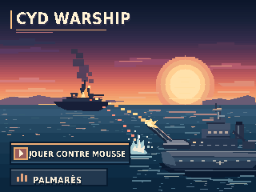

# GRAPH-ACC-001 — CYD WARSHIP, accueil LOT 1

**Statut :** DESIGN_PREVIEW — proposition artistique pour arbitrage du PO ; pas de validation PO anticipée.  
**Source :** issue #6 ; `BIBLE_PRODUIT.md` v0.8, §14 et §15 ; `MAQUETTES.md`, §H.  
**Portée :** un seul écran d'accueil fixe, sans code firmware, sans nouveaux modes, sans migration des anciennes archives.

## Fichiers

- `accueil_cyd_warship_320x240.png` — **320 × 240**, palette indexée sans perte, export natif (4 962 octets).
- `accueil_cyd_warship_x4.png` — **1280 × 960**, rééchantillonné uniquement **NEAREST** (9 933 octets).
- `accueil_cyd_warship.svg` — source **SVG éditable** autonome (Inkscape ou autre éditeur vectoriel). Contient des formes indépendantes en groupes nommés ; les textes sont convertis en rectangles éditables ; aucune police n'est embarquée.
- `generate_mockup.py` — méthode de création et régénération de la source/rendus ; nécessite Python, Pillow, CairoSVG et DejaVuSansCondensed-Bold installé localement pour recréer le lettrage. La source SVG autonome ne nécessite aucune police externe pour être affichée.

## Intention artistique

**Ambiance :** guerre navale lisible et accessible, avec le contraste d'un coucher de soleil orange/pêche, d'une mer bleu pétrole, de silhouettes acier sombre et de coups de canon dorés. La diagonale du tir ami, du premier plan (bas droit) vers l'ennemi (horizon gauche), guide le regard. La **réplique ennemie rouge** se termine en **gerbe blanche/bleutée dans l'eau**, devant et **sans toucher** la proue du navire allié. La silhouette ennemie dégage de la fumée et porte un foyer d'incendie.

**Composition :** titre `CYD WARSHIP` discret en haut à gauche ; soleil vers le tiers droit ; deux boutons sans panneau massif, superposés sur la zone sombre et peu chargée en bas à gauche. Le bouton principal reçoit un liseré doré et un triangle de lecture ; le secondaire est plus sobre, illustré par trois barres. Le style pixel-art demeure net sur la matrice 320 × 240.

**Aéronefs :** escadrille et avion en feu **volontairement exclus** de cette proposition unique : la fumée, les deux trajectoires, le soleil, les deux navires, le titre et les contrôles remplissent déjà le petit écran. Les ajouter nuirait à la hiérarchie et risquerait de brouiller la lecture de l'échange de tirs. Il ne s'agit pas d'un refus définitif des idées du PO.

## Rectangles tactiles proposés

Coordonnées en pixels, origine `(0,0)` dans le coin supérieur gauche ; **hypothèses UX, pas contrat firmware**.

| Action | x | y | largeur | hauteur |
|---|---:|---:|---:|---:|
| JOUER CONTRE MOUSSE | 12 | 177 | 151 | 29 |
| PALMARÈS | 12 | 210 | 123 | 23 |

Les deux commandes ne se recouvrent pas (4 pixels de séparation verticale). La seconde zone de 23 px en hauteur et le texte sur la dalle physique demandent validation au **stylet**.

## Contrôles réalisés hors matériel

- PNG natif : **320 × 240**, RGB reconstituable sans perte depuis **190 couleurs** indexées.
- Zoom : **1280 × 960**, identité pixel à pixel avec le PNG natif multiplié 4 fois par `NEAREST`, sans interpolation.
- SVG : document autonome valide en **320 × 240** ; groupes séparés (`sun-and-haze`, `distant-damaged-enemy`, `main-ship`, `enemy-return-and-near-miss`, `primary-touch-action`, etc.).
- Taille des fichiers et vérifications basées sur les exports du poste de conception, **pas sur une compilation ESP32**.
- **Aucune** compilation firmware ni mesure Flash/RAM embarquée. Par comparaison théorique, un RGB565 plein écran non compressé représenterait **153 600 octets** ; ce n'est ni le coût runtime prouvé ni une proposition d'architecture de rendu. Les PNG/SVG sont des **livrables de revue**, pas des assets intégrables sans adaptation.

## Protocole de revue sur une vraie CYD (PO / développeur)

1. Afficher le PNG **1:1 (320 × 240)** sur l'écran CYD **en paysage** avec un visualiseur de test approprié ; l'absence de firmware graphique de test dans cette PR interdit de revendiquer cette étape comme faite.
2. Juger sans zoom la lecture du titre, du libellé complet **JOUER CONTRE MOUSSE**, de **PALMARÈS**, des deux navires et de la gerbe **séparée de la proue**.
3. Vérifier avec le stylet les deux zones proposées, notamment **23 px de haut** pour PALMARÈS, sous les conditions d'éclairage normales.
4. Rapporter lisibilité, contraste, précision au stylet, perception du tir ami et de la riposte manquée, et photo facultative ; si affichage non implémenté, conserver `ON_DEVICE_UNVERIFIED`.

## Décisions et réserves

- **À trancher par le PO :** accepter ou réviser l'identité visuelle, la lisibilité des deux libellés, l'absence d'avions et la séparation de la gerbe de la proue.
- **À traiter ensuite seulement sur mandat distinct :** intégration au firmware, conversion en sprites/tuiles, palmarès, autres écrans, pipeline et optimisation réelle Flash/RAM.
- **Ne pas fusionner** cette proposition avant l'arbitrage graphique du PO et la revue finale du Pilotage.

**Provenance :** scène et formes originales générées pour cette mission ; aucune image tierce réutilisée. Lettrage pixellisé depuis une installation locale DejaVu Sans Condensed, famille redistribuée sous licence permissive dérivée de Bitstream Vera ; aucun fichier de police livré.
