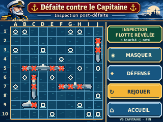

# G08 — Inspection post-défaite VS Capitaine — correction artistique

**Issue #55 · Branche `design/issue-55-g08-inspection` · PR Draft #56 · `DESIGN_PREVIEW — ON_DEVICE_UNVERIFIED`**

## Point de départ de la correction

Le PO a rejeté les aperçus initiaux de G08 et a explicitement retenu comme **référence artistique** l'illustration fournie dans la conversation : vraie personnalité maritime, portrait expressif du Capitaine, navires lisibles, bleu nuit, cuivre/or, commandes travaillées et contraste. Cette illustration **1448 × 1086** n'était **pas une maquette matérielle**. La présente correction est une **recomposition originale native 320 × 240**, dessinée et générée par code pixel/vectoriel ; il ne s'agit ni d'un simple redimensionnement ni de l'utilisation directe de l'image HD. L'image HD de départ reste une inspiration et non un asset distribué dans le firmware.

Le vocabulaire G01/G07 reste présent : **la mer est le plateau**, un unique champ ATTAQUE, verdict en inscription sans surface tactile, boutons cuivre en volume, bâtiment militaire illustré, impacts sur l'eau et inspection après résultat. L'ajout du portrait du Capitaine et le traitement bleu nuit / or sont une **nouvelle proposition artistique** conforme au retour PO, mais **pas encore une validation sur ce HEAD**.

## Écrans / preuves visuelles



[Vue B ×4 NEAREST 1280×960](g08_inspection_x4.png) · [Planche A/B/C 320×240](g08_variantes_320x240.png) · [Planche ×4](g08_variantes_x4.png) · [A secret natif](g08_etat_a_320x240.png) · [C masqué natif](g08_etat_c_320x240.png)

Chaque image a été réellement dessinée sur une grille de coordonnées **320 × 240**, puis exportée. Les aperçus ×4 sont obtenus par **NEAREST uniquement**, chaque pixel reproduit comme un carré 4×4 exact. Ce sont des conceptions PC ; aucune validation de rendu/tactile CYD physique.

## UX et états — règles DÉCIDÉES, formes PROPOSÉES

| État | Grille ATTAQUE | Commande disponible | Transition |
| --- | --- | --- | --- |
| A — DÉFAITE compacte | Flotte du Capitaine **secrète**, historique des tirs seul | **VOIR SA FLOTTE** (DÉCIDÉ) | premier appui volontaire → B |
| B — révélée | **5 navires / 17 cases** sous les impacts déjà présents | **MASQUER FLOTTE** (PROPOSÉ DA) | appui → C |
| C — masquée après consultation | Navires de nouveau **secrets**, **même historique** | **AFFICHER FLOTTE** (PROPOSÉ DA) | appui direct → B |

**DÉCIDÉ :** uniquement en cas de **DÉFAITE VS Capitaine**, pas en victoire ou nul. **Aucun écran indépendant**, boîte de confirmation, clic sur une coque, nouveau tir ni compteur. L'état B/C se conserve entre **ATTAQUE → DÉFENSE → ATTAQUE**, sans redessiner DÉFENSE. **REJOUER** et **ACCUEIL** sont toujours disponibles ; le verdict n'est **pas tactile**. Le toucher de DÉFENSE ou REJOUER ne modifie pas l'état de révélation comme règle métier.

## Scénario de maquette — nombres et positions FICTIFS

Les cinq navires sont B2–F2 (5), I4–I7 (4), D6–F6 (3), A8–A10 (3), G9–H9 (2). **17 cellules distinctes**, aucun chevauchement ; contacts autorisés par la Bible. **12 TOUCHÉ, 27 RATÉ** ; cinq segments ennemis encore intacts : **F2, I7, F6, A10, H9**. La flotte du Capitaine n'est donc pas détruite. Simultanément, la dernière riposte du Capitaine **COULÉ** achève la flotte du joueur dans la vue DÉFENSE (non modifiée ici) : il s'agit d'un scénario cohérent de **DÉFAITE**. Le dessin B ne fabrique **aucune nouvelle marque** de tir ; seules les coques apparaissent sous les marqueurs.

## Mini-contrat et prudence matérielle

- **Écran :** 320×240 paysage CYD ESP32-2432S028R, tactile stylet ; non testé physiquement.
- **ATTAQUE :** une grille 10×10 de 180×180 pixels, cases 18×18, origine `(21,53)`, repères A–J et 1–10. Une seule grande grille affichée.
- **Bandeau haut :** ATTAQUE comme vue, **DÉFENSE** relief tactile environ `(96,5,108,30)` ; **RÉSULTAT / DÉFAITE / VS CAPITAINE** inscrit directement sur le fond, sans boîte ni bouton.
- **Commandes fin de partie :** REJOUER `(211,149,105,26)`, ACCUEIL `(211,182,105,26)`, VOIR/MASQUER/AFFICHER FLOTTE `(211,215,105,23)` ; libellés et emplacements hors « VOIR SA FLOTTE » **PROPOSÉS DA, non homologués**.
- **Couleurs :** bleu nuit/mer, cuivre/or, acier gris, croix cuivrées sur écume pour TOUCHÉ, anneaux crème pour RATÉ. Le contraste des petites coques et marques doit être revu sur TFT réel.
- **Typographie PC :** DejaVu Sans, 6.6–11.5 px selon le contexte ; il ne s'agit pas d'une fonte Flash décidée. Petites légendes / zones tactiles de 23 px à vérifier au stylet et sur écran réel.
- **Aucun asset firmware homologué :** SVG, PNG et Python sont des maquettes PC. Aucun budget Flash/RAM/PSRAM, compression ou décodeur imposé.

## Sources, exécution et contrôles

- `build_g08.py` : source Python **éditable, autonome et originale**, formes vectorielles pixel alignées (aucune image générée intégrée au rendu), contrôles de structure et export ; Python 3 + CairoSVG + Pillow.
- `g08_inspection_320x240.svg` : vue B principale éditable ; `g08_variantes_320x240.svg` : planche éditable ; `g08_etat_a_320x240.svg` et `g08_etat_c_320x240.svg` : autres états éditables.
- PNG 320×240 et ×4 des vues B, variantes, A et C (issus du même script).
- `generation-report.txt` : sortie de validation reproductible et SHA256 sur les fichiers générés.

Reproduire depuis la racine du dépôt :

```bash
python3 -m pip install 'cairosvg>=2.7,<3' 'pillow>=11,<13'
python3 design/issue-55-g08-inspection/build_g08.py
```

**Vérifications non tautologiques :** tailles de flotte [5,4,3,3,2], 17 coordonnées distinctes, chaque coque continue sans superposition, 12 hits / 27 misses disjoints, cinq segments non touchés ; relecture XML de chaque SVG généré : 100 data-cell uniques, 39 marques avec coordonnées égales A/B/C, 5 coques seulement en B, ordre coque → impacts, verdict uniquement texte, quatre vraies actions tactiles, RIPOSTE : COULÉ et aucun FEU. Pixels PNG natifs et 4×4 NEAREST vérifiés un à un.

**Provenance :** idée graphique et référence HD issues de l'illustration déjà fournie au projet dans ChatGPT ; **composition 320×240 originale, créée et éditable dans `build_g08.py`**. Le code ne réutilise aucune photo, police externe propriétaire, sprite tiers ni image HD recadrée. Pas de modification G01–G07, Bible, firmware ou CI permanente. **Validation artistique sur le nouveau HEAD requise du PO ; revue/fusion exclusivement Pilotage.**