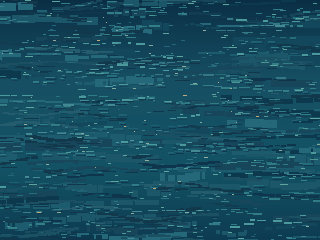

# CYD WARSHIP — Pack de fond océan modulaire

**Statut : `DESIGN_PREVIEW — ON_DEVICE_UNVERIFIED` · Validation artistique PO : EN ATTENTE.**

Revue pixel ×4 — 1280 × 960, NEAREST sans interpolation

## Usage et séparation des responsabilités

Ce visuel est un **fond océan réutilisable**, sans logique de combat. La **grille 10 × 10 sera dessinée en logiciel** aux coordonnées fixées par le firmware. Le fond ne contient volontairement **aucune grille, aucun impact, aucun navire, aucun texte, aucun bouton, aucun cartouche ni autre ornement d'interface**.

Il peut être dessiné comme fond plein écran 320 × 240, puis recouvert de la grille, des coordonnées, des marques TOUCHÉ/RATÉ, des navires éventuels, des boutons et des cartouches **en calques distincts**. `ocean_bg_battle_180x180.png` est un **extrait optionnel du même fond** prélevé à `(21,53)` (région `x=21..200`, `y=53..232`, soit 180 × 180) pour des essais. Il n'introduit pas une deuxième grille ou un nouvel écran.

## Fichiers

| Fichier | Rôle | Nature |
|---|---|---|
| `ocean_bg_full_320x240.png` | Décor plein écran natif, opaque RGB | Export raster 320 × 240 |
| `ocean_bg_full_x4.png` | Contrôle des pixels | Export raster 1280 × 960 par réplication NEAREST stricte |
| `ocean_bg_battle_180x180.png` | Essai de zone de bataille | Export raster 180 × 180, recadrage exact |
| `ocean_bg_source.svg` | **Source éditable** | Groupes de peinture vectorielle et rectangles individuellement modifiables |
| `render_ocean.js` | Reproduit les trois PNG depuis le SVG édité | Code source, Node.js sans dépendance tierce |
| `verify_ocean.py` | Contrôle dimensions et correspondances, preuve de lisibilité en calques | Script PC, Pillow requis |
| `preuves/manifest.json` | Empreintes SHA-256 et contrôles locaux | Rapport de preuve PC |

Les images `preuves/ocean_overlay_legibility_*.png` peuvent être produites **localement** par `verify_ocean.py` : elles comportent volontairement une grille et des marqueurs **pour essai uniquement**. Elles ne sont pas des assets à embarquer.

## Direction artistique et édition

- Vue de la **surface de la mer** sans horizon ni objets : courants sombres, longues rides interrompues, petites facettes turquoises et reflets chauds très rares. Les détails restent de faible contraste afin de laisser les calques de gameplay dominer.
- Peinture par **sept groupes distincts** dans le SVG : base, courants, sillages sombres, ombres de vagues, crêtes, facettes lumineuses, reflets chauds. Les rectangles sont des objets vectoriels éditables (aucune image raster encapsulée). Leur quantité rend l'édition pixel par pixel plus pratique dans un éditeur SVG ou dans le code de génération.
- Le PNG exporté est **raster** (sans objets modifiables). Le zoom ×4 est un outil de revue : **il n'apporte aucun détail supplémentaire** et ne doit pas être chargé comme fond natif.
- Les deux images d'océan évoquées dans le mandat PO **n'ont pas été accessibles comme fichiers identifiables dans cette session**. La palette et les vagues ont été créées originalement sur la base de l'intention maritime et du principe « la mer est le plateau » approuvés pour G01 ; **aucune reproduction ni traçabilité directe vers ces deux images n'est revendiquée**. Validation de similarité et d'ambiance par le PO encore requise.

## Production et contrôles

`node render_ocean.js` régénère les PNG à partir du SVG éditable dans ce dossier. `python3 verify_ocean.py` vérifie les dimensions, la réplication NEAREST, le recadrage `(21,53,180,180)` et produit **séparément** une preuve de superposition temporaire. `preuves/manifest.json` relève les empreintes du jeu de fichiers examiné.

La texture est intégralement opaque ; **aucune transparence n'est nécessaire pour un fond**. PNG est **un export de conception, pas un contrat de décodage firmware validé**. Format de stockage Flash, conversion éventuelle, débit de décodage, coût RAM, palette ou compression embarquée seront définis avec Pilotage et le Développeur C/ESP32. Aucune PSRAM ni microSD n'est supposée. Pas de framebuffer plein écran imposé. Pas de test sur CYD physique effectué (`ON_DEVICE_UNVERIFIED`).

**Limites connues :** fond statique sans animation ; la lisibilité est constatée sur épreuve PC avec grille-test et marques fictives, pas au stylet/TFT réel. La tonalité et la densité de facettes sont **PROPOSÉES** et nécessitent accord explicite du PO avant d'être présentées comme une direction finale. Les preuves avec grille sont volontairement **hors asset**.

**Périmètre :** pas de modification d'ATTAQUE, DÉFENSE, verdict, navigation, firmware ou règles de gameplay. Pas de fusion par le Graphiste ; revue et fusion par Pilotage.
