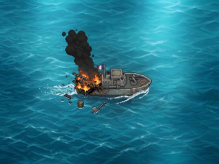
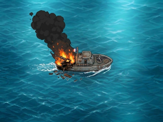

# PAT-02 / Issue #80 — COMPARATIF AVANT ARBITRAGE PO

**Statut :** `DESIGN_PREVIEW — ON_DEVICE_UNVERIFIED`. **AUCUNE VARIANTE CHOISIE / NON VALIDÉ PO.**
**Responsable :** Graphiste / DA. **Sources artistiques :** PO humain.
**Phase actuelle :** comparaison et avis du PO. **Ce dossier ne livre PAS encore un état de dégâts arrière final.**

## Les deux aperçus natifs 320 × 240

| T1A — Variante A | T1B — Variante B |
| :--: | :--: |
|  |  |
| [Zoom ×4 T1A — 1280×960, NEAREST](revue_pat02/patrouilleur_T1A_x4.png) | [Zoom ×4 T1B — 1280×960, NEAREST](revue_pat02/patrouilleur_T1B_x4.png) |

Comparer également le [patrouilleur intact PAT-01, 320×240](patrouilleur_intact_320x240.png), **déjà approuvé et inchangé**.

## Analyse visuelle à 320 × 240

| Critère | T1A — Image PO | T1B — Image PO |
| --- | --- | --- |
| **Dégâts à l'arrière (gauche de l'image)** | Partie arrière détruite nettement visible, avec flammes localisées au-dessus de la poupe | Partie arrière détruite nettement visible, flammes plus hautes et plus étendues |
| **Panache noir** | Colonne relativement étroite, dressée au-dessus de l'arrière, laissant plus d'océan visible | Colonne plus large, inclinée vers le haut-gauche, occupe davantage l'espace visuel |
| **Débris** | Plusieurs débris et pièces individualisées, dont des éléments séparés au-dessous de la coque | Débris fragmentés davantage concentrés sous et juste derrière la poupe |
| **Silhouette et lecture de la coque** | Proue et pont avant restent nets ; coque arrière lisible malgré le feu | Proue et pont avant restent nets ; l'incendie domine davantage la poupe |
| **Lecture native 320×240** | Navire reconnaissable, dommages situés à gauche, scène moins envahie par la fumée | Navire reconnaissable, incendie très perceptible ; masse sombre plus présente dans le tiers supérieur gauche |
| **Arbitrage** | Équilibre coque / effets ; meilleure séparation de certaines pièces | Intensité et dramatisation des dommages plus marquées |

**Synthèse DA :** T1A privilégie la lecture de la coque et la séparation des débris ; T1B privilégie l'intensité des dégâts et la lisibilité immédiate de l'incendie. **Préférence Pilotage (non validée PO) : T1B.** Le Graphiste **ne sélectionne pas à la place du PO**. Les deux sont exploitables à titre de maquette de comparaison ; l'acceptation artistique reste à décider.

## Géométrie et contrôle d'alignement avec PAT-01

- Sources : **1195×896**, images PO **plein cadre** avec océan peint ; **aucun crop, déplacement, détourage, recolorisation ni redessin**.
- Réduction : **320×240 RGB avec Pillow 12.3.0 LANCZOS**, identique à PAT-01 ; zoom ×4 **1280×960 NEAREST**, pixels identiques par blocs de 4×4.
- Ancrage nominal de composition PAT-01 : **(164,118)** natif ; rectangle de coque intact visuel approx. `(106,92)–(221,143)`. **Il s'agit de repères visuels, non d'une découpe alpha ni d'un contrat runtime.**
- Contrôle indicatif de la proue préservée sur la zone **(700,410)–(815,465)** source : la recherche numérique locale de déplacement (fenêtre ±8 pixels) trouve un meilleur score à **(+3,0) pixels source pour T1A comme pour T1B** (≈ +0,8 pixel natif). Comparaison image source JPEG sur la proue : `score moyen RGB` T1A non décalé **24,2708** → score min **14,4265** ; T1B **24,4242** → **14,7588**. Ce résultat **ne certifie ni déplacement global ni défaut d'échelle** ; différences JPEG ou dessin source peuvent jouer. Le léger écart potentiel est signalé et **non corrigé** pour ne pas trahir les originaux. **Le PO doit approuver toute correction de cadrage ou d'alignement.**
- Les flammes, la fumée, le sillage et les débris font partie de l'image aplatie : **pas de sprite transparent**.

## Provenance et reproductibilité

| Original PO conservé dans `draft/` | SHA-256 source |
| --- | --- |
| `patrouilleur_T1A.jpeg` | `1e25359998afdedbc93ebf6baebdbeae34b327f4ab75a2f4e9d55e4c7b8a9584` |
| `patrouilleur_T1B.jpeg` | `2bc761b1abcbced2fc760e8ef938571d58b3b4b14e390bad9f219846b32c8666` |

Script de travail : [`export_pat02_comparatif.py`](export_pat02_comparatif.py) ; preuves SHA-256, dimensions, décodage, ancrage et diagnostic : [`revue_pat02/preuves/export_manifest.json`](revue_pat02/preuves/export_manifest.json).

Depuis la racine du dépôt :

```bash
python -m pip install Pillow==12.3.0
python design/patrouilleur/export_pat02_comparatif.py
python design/patrouilleur/export_pat02_comparatif.py --check
```

Le mode `--check` relit et contrôle les PNG sans écrire de fichiers.

**Vérifications :** PASS provenance SHA-256 sources PO ; PASS SHA-256 du PNG intact PAT-01 préservé ; PASS dimensions et format RGB des deux natifs et zooms ; PASS exports natifs issus du JPEG original LANCZOS ; PASS agrandissement ×4 NEAREST exact pixel par pixel après relecture ; PASS reproductibilité du manifeste.

**NON TESTÉ :** affichage sur vraie CYD, mémoire Flash/RAM, intégration firmware et contrat runtime. Aucun de ces points n'est revendiqué.

## Décision attendue

**PO : choisir explicitement « T1A » ou « T1B »** sur la base du natif et du zoom, et indiquer si l'éventuel décalage local repéré mérite une correction. **STOP artistique.** Après le choix écrit, un seul état arrière final et son zoom seront exportés dans `design/patrouilleur/`; les PNG des deux candidats ne resteront pas tous les deux parmi les livrables finaux de la PR. Les sources PO originales dans `draft/` seront conservées intactes.

**Pilotage :** revue, arbitrages techniques et fusion exclusivement de sa responsabilité.
