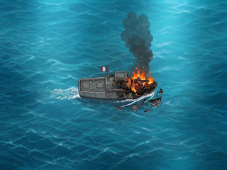
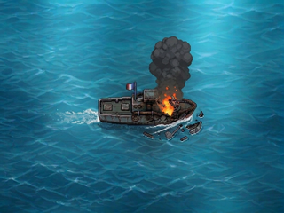

# PAT-03 — Comparatif des dégâts avant T2A / T2B — Issue #81

**Graphiste / DA · revue PO / Pilotage · Phase 1 uniquement.**  
**Statut : `DESIGN_PREVIEW — ON_DEVICE_UNVERIFIED`.**  
**Choix artistique requis : `PAT-03 = T2A` ou `PAT-03 = T2B`. Aucun choix n'a été acté.** La préférence provisoire de Pilotage pour T2A **n'est pas une validation du PO**.

## 1. Deux aperçus natifs, côte à côte — 320 × 240 chacun

| **T2A — avant endommagé A** | **T2B — avant endommagé B** |
| :---: | :---: |
|  |  |
| [PNG natif 320×240](revue_pat03/patrouilleur_T2A_320x240.png) · [Zoom ×4 NEAREST](revue_pat03/patrouilleur_T2A_x4.png) | [PNG natif 320×240](revue_pat03/patrouilleur_T2B_320x240.png) · [Zoom ×4 NEAREST](revue_pat03/patrouilleur_T2B_x4.png) |

Aucune interface ni écran de jeu n'est simulé : ce sont les **scènes complètes PO avec océan intégré**, redimensionnées sans modification graphique. Les fumées dépassent naturellement le rectangle estimé de coque PAT-01 et **ne constituent pas un défaut de cadrage**.

## 2. Comparaison visuelle à 320×240 (inspection native et zoom ×4)

| Critère | **T2A** | **T2B** |
| --- | --- | --- |
| **Localisation du dégât** | Incendie frontal très apparent, au-delà de l'avant de la superstructure | Même avant touché ; brasier plus contenu vers le centre de la proue |
| **Lecture de la proue** | Plusieurs flammes orange/jaunes et pièces noircies ; **extrémité de l'étrave moins distincte derrière les flammes** | **Contour de la pointe avant plus continu et lisible**, malgré les dégâts ; moins de flammes sur l'extrémité |
| **Fumée** | Colonne assez haute, remontant près de la partie supérieure de l'image ; silhouette plus irrégulière/étagée | Grosse masse noire arrondie et dense ; départ visuel plus bas ; impact visuel concentré au-dessus de l'étrave |
| **Débris / écume** | Débris sombres à droite et sous la proue, visibles mais petits | Débris presque à la même zone, comparables ; visibles mais petits |
| **Lisibilité du dommage natif** | Flamme très lumineuse : **l'avant en feu se reconnaît plus rapidement** | Dégât visuellement plus discret ; **fumée dense** et silhouette intacte plus lisible |
| **Risque visuel** | Les flammes masquent le détail de la proue ; fumée haute distrayante dans une future UI | Nuage compact visuellement dominant et risque d'affaiblir la lecture des flammes |

**Ce qui ressort du comparatif :** T2A met en avant **l'incendie**, T2B met en avant **la fumée et l'étrave**. Il ne s'agit **pas** d'un score ni d'une sélection du Graphiste : les deux restent soumises au PO. La lisibilité après éventuelle réduction de la scène à un bateau de deux cases **n'a pas été testée**.

## 3. Cohérence avec PAT-01 et PAT-02

- **PAT-01 (intact)** : [référence native 320×240](patrouilleur_intact_320x240.png) ; sens du navire, horizon d'eau, position du sillage et format sont conservés. Repères **indicatifs** : pivot nominal `(164,118)`, rectangle visuel de l'intact `(106,92)–(221,143)`.
- **PAT-02 (arrière T1A validé PO)** : [état arrière 320×240](patrouilleur_arriere_endommage_320x240.png). PAT-03 allume et détruit **l'extrémité opposée**, sans changer intentionnellement l'échelle de la scène.
- **Cadrage** : sources T2A et T2B **1195×896**, cadres complets, ratios `sx=320/1195` / `sy=240/896`, filtre LANCZOS, RGB sans alpha ; aucun crop ni décalage appliqué. Les zones arrière paraissent comparables visuellement à PAT-01, mais **pas identiques pixel à pixel** ; certaines textures de coque et d'eau changent entre les JPEG du PO.
- **Diagnostic numérique local** : la différence absolue RGB moyenne par canal, sur la petite région supposée indemne **`(110,109)–(150,139)`** de l'aperçu natif et sans déplacement, est **27,3942** (T2A) et **33,1467** (T2B), par rapport au PAT-01. Ce **n'est pas une mesure de translation**, ni une démonstration de conformité géométrique ; les différences de texture et de compression s'y mêlent. **Aucune translation n'a été appliquée**. Si un recalage apparaît nécessaire en revue, décision explicite PO/Pilotage exigée avant tout changement.

## 4. Provenance, méthode et preuves

Les fichiers **originaux PO du 06/11/2026** demeurent sous `draft/`, intacts :

| Variante | Source canonique | SHA-256 source |
| --- | --- | --- |
| T2A | [draft/patrouilleur_T2A.jpeg](../../draft/patrouilleur_T2A.jpeg) | `f8366482082febc917a812d94efd98a75d03c100a789d5db73ceacc379c41d4d` |
| T2B | [draft/patrouilleur_T2B.jpeg](../../draft/patrouilleur_T2B.jpeg) | `bcb36de1ef21c7992af3196d460ce57f68d654d4826302be0fdfa20b5515a9c3` |

**Reproductibilité :** script source [`export_pat03_comparatif.py`](export_pat03_comparatif.py) (Pillow **12.3.0**), [manifeste de contrôle et SHA-256 des quatre sorties](revue_pat03/preuves/export_manifest.json).

```bash
python -m pip install Pillow==12.3.0
python design/patrouilleur/export_pat03_comparatif.py --check
```

Pour recréer les exports sur un poste disposant des sources, lancer le script sans `--check`, puis avec `--check`. **En mode `--check`, le script ne touche à aucun fichier** et recalcule la conformité des deux aperçus au LANCZOS, des zooms au NEAREST strict, les tailles, les modes RGB, les SHA-256 et le manifeste. La génération a été effectuée par GitHub Actions ; la preuve du run sera reliée dans la PR.

**Fichiers de revue provisoires :** `revue_pat03/` contient quatre aperçus et une preuve JSON. Après le choix explicite PO, ces comparatifs sortiront du diff final et **une seule variante** sera livrée sous `design/patrouilleur/patrouilleur_avant_endommage_320x240.png` et `patrouilleur_avant_endommage_x4.png` avec script et manifeste définitifs.

## 5. Restrictions / décision requise

- **Aucune retouche artistique** : pas de redessin, substitution, nouveaux effets, correction fumée/flammes, crop, déplacement ni détourage ; mer PO préexistante conservée.
- **RGB non transparent** : ces fichiers ne constituent **pas** des sprites isolés, et aucun contrat Flash/RAM/décodage firmware n'est décidé.
- **Non testé :** écran réel ESP32 CYD, intégration, consommation RAM/Flash, lisibilité après réduction du bateau à deux cases.
- **STOP à l'issue de la Phase 1 :** le **PO choisit explicitement T2A ou T2B** et décide de toute modification de cadrage éventuelle ; le Graphiste n'entre en Phase 2 qu'après ce choix. Pilotage contrôle et fusionne seul.
