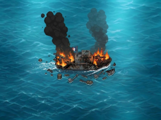

# PAT-04 — Patrouilleur détruit, fusion du PO (Issue #82)

**Responsable :** Graphiste / DA · **Choix artistique :** PO humain, image fusion avant/arrière du 07/11/2026.
**Statut :** `DESIGN_PREVIEW — ON_DEVICE_UNVERIFIED`. PR Draft `Refs #82` ; fusion réservée au Pilotage.

## Aperçu natif — 320 × 240



[Zoom de contrôle ×4 — 1280 × 960, NEAREST strict](patrouilleur_detruit_x4.png)

## Changement explicite de source

- Le PO a **remplacé l'ancienne direction artistique B** par son image fusionnant les états arrière **T1A** et avant **T2A** acceptés. Elle présente une destruction sur les deux extrémités, deux colonnes de fumée et des débris dans l'eau.
- **Master PO conservé sans perte ni retouche :** [`draft/patrouilleur_B_PO_fusion.png`](../../draft/patrouilleur_B_PO_fusion.png), image RGB **1024×768**, SHA-256 `e004d3b1274133f118ab407e7854d2050121654cca0881b513c7acbc3bd1a808`.
- **Ancien fichier retiré à la demande du PO :** `draft/patrouilleur_B.jpeg` n’est plus versionné. Le script PAT-04 **reconstruit seulement en mémoire** son JPEG de compatibilité avec Pillow 12.3.0 (`quality=98`, `subsampling=0`, `optimize=True` ; SHA-256 `0f6eb6a9dd4df3974a1cee5423d304930d4b1643c3612847e7599128fd374830`). Ce JPEG est **avec perte**, mais la source canonique PNG est conservée sans perte.
- Ancien B : blob Git `06c76f842a9d7dbbffb36044d55bdb27c61e8a69`, conservé **dans l'historique Git** ; ne participe pas à l'export.
- **Image finale :** `patrouilleur_detruit_320x240.png`, **RGB sans alpha**, pleine scène **1024×768 → 320×240 en LANCZOS**, calculée via le **JPEG intermédiaire en mémoire** régénéré depuis le PNG maître ; zoom `patrouilleur_detruit_x4.png` en **NEAREST**, vérifié pixel par pixel. Le résultat est identique aux exports de la revue initiale.
- **Aucun** détourage, translation, recadrage, nouveau feu, fumée redessinée, modification d'océan, correction esthétique ou animation ajoutée. Le master est une scène aplatie avec mer peinte, **pas un sprite transparent**. Aucun document en calques n'a été remis.

## Cohérence, lecture et limites

Le ratio 4:3, l'orientation du bateau et son placement au centre restent proches des états PAT-01, PAT-02 T1A et PAT-03 T2A. Le repère de coque intacte PAT-01 `(106,92)–(221,143)` et le pivot `(164,118)` sont **indicatifs**, non une promesse d'alignement pixel à pixel. Le script vérifie que les PNG acceptés antérieurs restent inchangés.

À **320×240 natifs**, les deux foyers de flammes, les deux panaches distincts et le patrouilleur en destruction restent reconnaissables. Les **fumées montent largement au-dessus** du rectangle indicatif de coque et les **débris s'étendent en dessous et sur les côtés**, tout en restant dans le canevas complet ; les effets n'ont **pas été coupés** pour entrer artificiellement dans la coque. Inspection également réalisée en zoom ×4 strict.

**Non démontré :** affichage réduit à deux cases de grille, résolution effective du bateau en jeu, suppression de la mer peinte, extraction alpha, consommation Flash/RAM ou rendu sur CYD physique. La scène entière n'est **pas** à déclarer sprite runtime. Aucun GIF ni code firmware n'est inclus.

## Reproduction et preuve

```sh
python -m pip install Pillow==12.3.0
python design/patrouilleur/export_pat04_detruit.py
python design/patrouilleur/export_pat04_detruit.py --check
```

Le `--check` est **non destructif** : il confirme le SHA du PNG PO, le JPEG **en mémoire** dérivé de façon reproductible, les trois états précédents, les dimensions, les pixels du natif et du zoom NEAREST, les SHA des PNG et le manifeste reproductible. Aucun fichier JPEG B n’est requis dans le dépôt.

[Manifeste de preuves JSON](preuves/pat04_export_manifest.json). **Revue artistique finale : PO. Revue diff / preuves et fusion : Pilotage uniquement.**

## Source d'animation mise à jour, hors livraison statique

Le GIF maître fourni par le PO est désormais conservé dans [`draft/patrouilleur_detruit.gif`](../../draft/patrouilleur_detruit.gif), **478×356, 9 frames de 160 ms (1,44 s)**, SHA-256 `64391042c66bb89cce8f04622a213d85fd028ea6bdbefbf59cd60ed611c4f096`. Ce fichier est **uniquement une référence pour PAT-05 #83**, sans animation intégrée, validation graphique frame par frame ni qualification ESP32.
