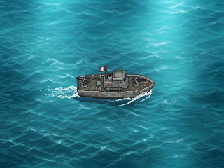
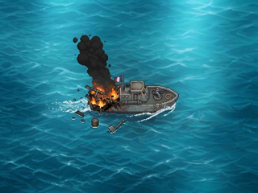

# PAT-01 — Patrouilleur intact (Issue #79)

**Responsable : Graphiste / DA.** Source artistique : **PO humain**.
**Statut : `DESIGN_PREVIEW — ON_DEVICE_UNVERIFIED`**, validation artistique PO **en attente**.
PR indépendante à fusionner uniquement par Pilotage.

## Aperçu natif — 320 × 240



[Zoom de contrôle ×4 — 1280 × 960, NEAREST exact](patrouilleur_intact_x4.png)

## Provenance et fidélité

- **Unique source de ce travail :** [`draft/patrouilleur_A.jpeg`](../../draft/patrouilleur_A.jpeg), original PO du 06/11/2026, **1195 × 896**.
- SHA-256 original attendu : `631ff1b8f4245599137b6d0d3bd6919b9db3e30844d478434ee864ff885f5df5`.
- **Aucun redessin, remplacement de mer, recolorisation, ajout ni extraction du navire.**
- Cadrage **plein cadre** (aucun crop) et conversion RGB ; réduction à 320 × 240 avec **LANCZOS** pour limiter les aliasings lors du sous-échantillonnage de la source JPEG ; contrôle ×4 par **NEAREST**, sans interpolation.
- Le JPEG source est une **scène aplatie avec océan peint et sillage**, **pas un sprite transparent**. Les exports PNG sont **RGB sans alpha**. Ni masque bateau ni animation firmware ne sont livrés.
- La source de travail éditable de l'export est le [script Python](export_patrouilleur.py). Il **ne remplace pas une source artistique en calques** qui n'a pas été remise.

## Géométrie commune proposée pour PAT-02 / PAT-03 / PAT-04

L'origine du canevas est `(0,0)` en haut à gauche ; `x` augmente vers la droite et `y` vers le bas.

| Repère | Source PO 1195 × 896 | Sortie CYD 320 × 240 |
| --- | --- | --- |
| Canevas complet | `(0,0)–(1195,896)` | `(0,0)–(320,240)` |
| **Rectangle visuel estimé du navire** (avec mât/drapeau, hors sillage) | `(397,343)–(827,535)` | `(106,92)–(221,143)` |
| **Pivot nominal de composition** (centre de silhouette) | `(612,439)` | `(164,118)` |
| Facteurs d'échelle | — | `sx = 320/1195 ≈ 0,26778` ; `sy = 240/896 ≈ 0,26786` |

**Attention :** le rectangle est une **estimation visuelle** de repérage, et **non** un détourage/périmètre alpha certifié. Il ne doit pas servir directement à une collision ou à une insertion firmware. Le pivot est un **ancrage proposé**, à confirmer avec le PO/Pilotage après examen. Pour les prochains états, conserver le **même cadre source plein 1195×896**, la même origine, les mêmes deux facteurs d'échelle et le même pivot de scène ; comparer la coque sans réalignement implicite, documenter tout décalage de dessin constaté avant correction.

Le navire occupe approximativement **115 × 51 pixels** à la taille native ; contrôler visuellement si les détails de silhouette restent lisibles. Une alternative d'échantillonnage ne sera étudiée que si le PO refuse la qualité du rendu courant, **sans création de nouvelle image artistique**.

## Reproduction et preuves

Depuis la racine du dépôt (Python 3 + `Pillow==12.3.0`) :

```bash
python -m pip install Pillow==12.3.0
python design/patrouilleur/export_patrouilleur.py
python design/patrouilleur/export_patrouilleur.py --check
```

Le mode `--check` **ne modifie aucun fichier** ; il vérifie SHA-256 de l'original, dimensions, correspondance des pixels issus du redimensionnement, zoom ×4 pixel-exact et empreintes/taille des exports. La [preuve JSON](preuves/export_manifest.json) enregistre les SHA-256, octets, provenance, repères et filtres.

## Restrictions et réception

- **DESIGN_PREVIEW seulement :** comparaison et contrôles PC, pas de validation de lisibilité sur écran physique.
- **ON_DEVICE_UNVERIFIED :** aucun essai sur CYD, ni build firmware, ni budget Flash/RAM/mémoire revendiqué ; contrat d'asset runtime à convenir avec Développeur et Pilotage.
- Le PO doit **accepter explicitement le PNG 320×240 et confirmer le cadrage/pivot** avant PAT-02/03/04.
- Aucun fichier de `design/ocean/`, des autres états ou du firmware ne doit être modifié.


---

# PAT-02 — Patrouilleur dégâts arrière T1A (Issue #80)

**Décision artistique PO du 07/11/2026 : T1A retenu** après comparaison T1A/T1B. Le motif est la **meilleure séparation visuelle de la coque, des flammes et des débris à petite échelle** ; le PO anticipe une meilleure netteté si le navire est affiché sur l'équivalent de deux cases de grille. **Ce dernier cas n'est pas testé** : les livrables sont des scènes complètes 320×240, et non des sprites réduits à deux cases.

## Prévisualisation de l'état arrière final — 320 × 240



[Zoom ×4 de contrôle — 1280×960, NEAREST strict](patrouilleur_arriere_endommage_x4.png)

La source canonique est [draft/patrouilleur_T1A.jpeg](../../draft/patrouilleur_T1A.jpeg) (**1195×896**, SHA-256 \`1e25359998afdedbc93ebf6baebdbeae34b327f4ab75a2f4e9d55e4c7b8a9584\`). T1B reste uniquement en \`draft/\` et dans l'historique comparatif de l'Issue/PR, **pas** dans les exports finaux. **Aucune retouche, reconstruction de fumée/coque, translation, crop ou recolorisation** ; pleine scène avec mer peinte en **RGB sans alpha**. Pas de sprite détouré.

Cadrage et facteur d'échelle **identiques à PAT-01** ; pivot nominal indicatif \`(164,118)\` et bbox de coque intacte approx. \`(106,92)–(221,143)\`. Le contrôle exploratoire de la proue sur l'original a indiqué un meilleur appariement à \`(+3,0)\` pixels source (≈ 0,8 pixel natif) ; cet indice **local** ne prouve pas un décalage global et **aucune correction n'a été appliquée**.

## Reproduction / vérification

\`\`\`bash
python -m pip install Pillow==12.3.0
python design/patrouilleur/export_pat02_arriere.py --check
\`\`\`

Pour une régénération complète, exécuter sans \`--check\` puis avec \`--check\`. Le script vérifie les SHA des originaux/du PAT-01 et ceux des **deux PNG finaux**, la fidélité LANCZOS, les dimensions et l'égalité zoom ×4 **pixel par pixel** après relecture. [Manifeste PAT-02](preuves/pat02_export_manifest.json).

**Statut : \`DESIGN_PREVIEW — ON_DEVICE_UNVERIFIED\`**. L'intégration jeu, le rendu sur vrai écran CYD 320×240, la lisibilité après réduction en cases et les budgets Flash/RAM restent à valider avec Pilotage et le Développeur. PR Draft **Refs #80** ; fusion exclusivement Pilotage.
