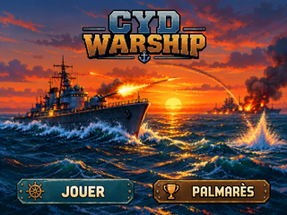

# Accueil 320×240 — composition des quatre ressources PO (PR #90)

**Statut : `DESIGN_PREVIEW / PO_REVIEW_PENDING / ON_DEVICE_UNVERIFIED`.**

## Exports réellement publiés

- [Accueil final 320 × 240](./accueil_320x240.png) : PNG RGB, 144 890 octets.
- [Zoom ×4 sans interpolation, 1280 × 960](./accueil_x4_NEAREST.png) : PNG RGB, 224 987 octets.
- [OpenRaster à 4 calques indépendants](./edition/accueil_4_calques.ora) : fond, logo, JOUER et PALMARÈS.
- [Logo RGBA](./sprites/logo_titre_145x66.png) : 145 × 66.
- [Bouton JOUER RGBA](./sprites/bouton_jouer_140x32.png) : 140 × 32.
- [Bouton PALMARÈS RGBA](./sprites/bouton_palmares_140x30.png) : 140 × 30.
- [Inspection alpha sur fonds clairs/sombres](./preuves/alpha_clair_sombre_640x720.png).
- [Proposition de rectangles tactiles](./preuves/zones_tactiles_320x240.png).
- [Manifest SHA-256, tailles, source et coordonnées](./manifest.json).
- [Générateur éditable/reproductible](../compose_accueil.py).

## Sources et composition (proposées)

Fichiers sources `draft/Wallpaper_accueil.jpeg`, `draft/accueil/Logo_titre_RGBA.png`,
`draft/accueil/Bouton_jouer_RGBA.png`, `draft/accueil/Bouton_palmares_RGBA.png`
identiques à ceux du commit **`5fd1ce6efd7a0c0b6f014a3b3da9fb323774570d`**.
Les SHA de blobs Git sont vérifiés par le générateur avant toute composition.

- Fond : `(0,0,320,240)`.
- Logo : `(88,8,145,66)`.
- JOUER : `(14,198,140,32)`.
- PALMARÈS : `(166,199,140,30)`.
- Rectangles tactiles proposés : JOUER `(8,190,152,46)` ; PALMARÈS `(160,190,152,46)`, adjacents sans chevauchement.

La composition garde les images et libellés existants : pas de redessin de l'océan, des navires,
du titre ou des boutons ; pas de changement de l'accueil canonique `design/ecrans/accueil/`.

## Production, contrôle et décisions en attente

Les fichiers ont été générés par GitHub Actions avec `Pillow==12.3.0` sur la
[run de publication n°42591469760](https://github.com/Kharn27/ESP32-OTA-Battleship/actions/runs/42591469760),
**conclusion `success`**, sur le SHA de départ `8894fb56823089cf6a342870e7e59defe53a7aa9`.
Le job a vérifié et relu les **7 PNG réels**, leurs formats, les tailles attendues, l'alpha,
le zoom ×4 pixel-identique au redimensionnement NEAREST, l'archive ORA et le manifeste ;
puis les a **commités sur la branche `assets/accueil-alpha-png`**, et non pas seulement sur
un artefact temporaire de CI.

**Inspection graphique :** les vrais rendus ont été affichés à 320×240 et ×4 ; le titre et
les commandes sont lisibles et les contours des sprites ont été examinés sur fond clair/sombre.
La réception du rendu, les choix d'implantation et les éventuelles franges à corriger sont
**soumis au PO** : cette inspection n'est pas une approbation artistique ni une preuve matérielle.

**Matériel :** aucun test sur ESP32-2432S028R. Les sprites sont des livrables de composition,
pas un contrat confirmé de format firmware, RAM ou Flash. Le PO valide le visuel ;
le Développeur et Pilotage valident l'intégration ; Pilotage décide seul de la fusion.
