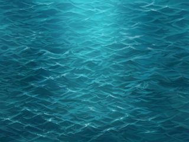

# Fonds d'océan — références PO A et B

**Statut :** exports de présentation, validation artistique PO en attente ; `ON_DEVICE_UNVERIFIED`. Aucun contrat de firmware ni essai matériel.

Les quatre PNG ci-dessous sont des **redimensionnements stricts** des deux JPEG du PO conservés dans `draft/` : `ocean_A_reference_1195x896.jpeg` et `ocean_B_reference_1195x896.jpeg`. Aucun élément n'a été dessiné, ajouté, effacé ou recolorisé.

## Variante A

[Aperçu A natif 320 × 240](ocean_A_320x240.png) · [Contrôle A ×4 NEAREST — 1280 × 960](ocean_A_x4.png)

## Variante B

[Aperçu B natif 320 × 240](ocean_B_320x240.png) · [Contrôle B ×4 NEAREST — 1280 × 960](ocean_B_x4.png)

## Provenance et reproductibilité

Le script original `draft/export_ocean.py` effectue `RGB → LANCZOS 320×240 → NEAREST ×4`. Les JPEG sources et le script demeurent dans `draft/`, où le script écrit son manifeste de contrôle. Les fichiers dans ce dossier `draft/etudes/ocean/` sont seulement les quatre PNG finaux et le présent README.

À l'écran CYD réel (320×240), les visuels et leur intégration restent à vérifier. Le PO choisira ou validera A/B ; Pilotage contrôle et fusionne seul la PR.
