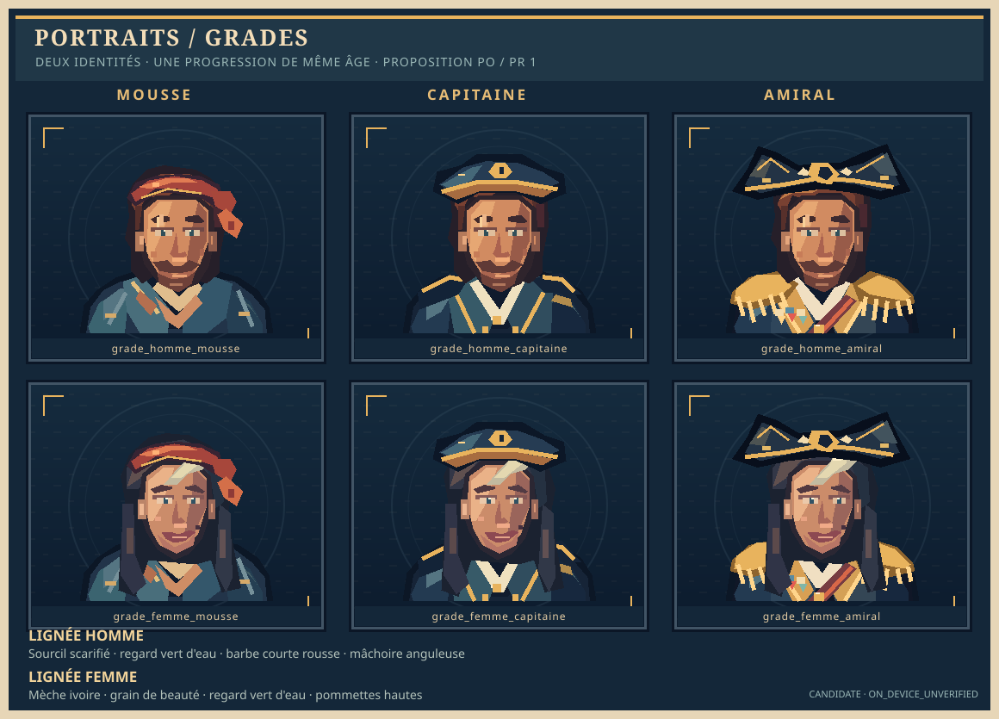
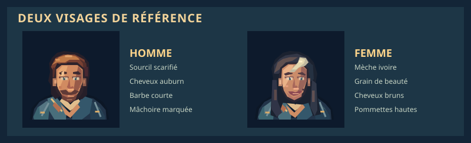
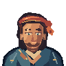
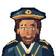
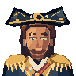
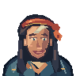
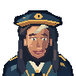
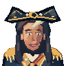
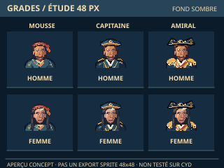
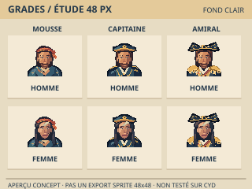

# PORTRAITS-GRADES — PR 1 : direction artistique (Issue #162)

**Responsable :** Graphiste / DA. **Statut :** `CANDIDATE — ON_DEVICE_UNVERIFIED`. **Arbitrages PO :** non rendus. **Périmètre :** concepts uniquement sous `draft/portraits/grades/concepts/` ; aucune promotion, master HD final, export 48/64 final ou changement firmware.

## Concepts et identités

| Sexe représenté | Mousse | Capitaine | Amiral |
|---|---|---|---|
| Homme |  |  |  |
| Femme |  |  |  |

**Identité homme constante :** cheveux auburn, sourcil gauche scarifié, paupières anguleuses, yeux bleu-vert, barbe courte, mâchoire affirmée et teint cuivré. **Identité femme constante :** cheveux foncés longs, mèche ivoire asymétrique, grain de beauté sur la joue gauche, yeux bleu-vert, pommettes hautes et teint chaud. Les visages restent au même angle et à la même taille ; **aucun vieillissement implicite par grade**.

**Transformation de grade commune aux deux lignées :**

- **Mousse** : bandeau rouille noué, vareuse bleu-vert souple, foulard de toile, épaule sans rang, presque aucune dorure.
- **Capitaine** : tricorne/bonnet structuré bleu nuit, insigne central laiton, uniforme croisé et col clair, liserés et boutons dorés, épaulettes discrètes.
- **Amiral** : grand bicorne à liseré et feuilles dorées, uniforme plus sombre, grandes épaulettes à franges, col ivoire, baudrier rouge profond, barrettes/médailles. L'écart repose sur la silhouette et les masses de couleur, pas seulement sur de minuscules insignes.

L'échelle, les visages, la lumière ambrée venant d'en haut à gauche et les ombres bleues sont communs. Les deux lignées reçoivent **exactement le même niveau de détail et de prestige à grade égal**.

## Aperçus sur simulation de l'écran CYD

Les panneaux ci-dessous sont des **épreuves graphiques natives 320 × 240**, avec étude à environ 48 px d'encombrement, sur deux fonds. Ils ne sont **pas** des exports 48×48 et ne sont **pas** des écrans du jeu à intégrer.

**Limitations assumées en PR 1 :** à cette taille, le grain de beauté et les rayures de médailles ne sont plus des identifiants garantis ; l'identité est d'abord portée par la forme du visage, la mèche ou la cicatrice et la couleur des cheveux. Les coiffes, épaulettes et le baudrier doivent continuer à fonctionner même si les microdécorations s'effacent. Un travail de simplification/redessin au pixel sera indispensable après les GO sur les concepts et sur les masters (PR 2 puis PR 3 uniquement).

## Source éditable et provenance

- `build_concepts.mjs` est la recette source **autonome** qui produit les **10 SVG** ; chaque SVG de portrait 96 × 96 se modifie dans n'importe quel logiciel vectoriel compatible SVG ; couleurs et repères numériques sont dans le code. SVG = étude graphique de PR 1, **pas master HD validé**.
- Générer : `node draft/portraits/grades/concepts/build_concepts.mjs draft/portraits/grades/concepts` ; contrôler sans écriture : `node draft/portraits/grades/concepts/build_concepts.mjs draft/portraits/grades/concepts --check`.
- Contrôle reproductible des SVG, PNG d’épreuve, empreintes et visages, **sans écriture** : `python3 draft/portraits/grades/concepts/check_concepts.py` (Pillow et CairoSVG, versions consignées dans `manifest_concepts.json`).
- Rendu de vérification sur PC (non livré comme export firmware) : CairoSVG pour le SVG vers PNG et Pillow pour le ×4 NEAREST ; aucun filtrage bicubique. On ne considère pas le 96×96 généré comme un « master HD » accepté.
- Références visuelles consultées, **sans copie ni modification** : [galerie PO A–E](../../README.md), notamment `A-L1-C1`, `C-L2-C3`, `D-L1-C2`, `E-L1-C3`. Étude d'ambiance non intégrée réalisée avec Adobe Firefly le 19/11/2026 : deux visages maritimes, éclairage ambre / contre-jours bleu nuit. **Aucun pixel de l'étude Firefly ni des originaux PO n'est réutilisé dans les dessins SVG.** Compositions, code et formes SVG originaux pour cette PR.

## Porte PO 1 — arbitrages demandés

1. L'identité **homme** (sourcil scarifié, barbe courte, cheveux auburn) et l'identité **femme** (mèche ivoire, grain de beauté, cheveux foncés) sont-elles acceptées **individuellement** ?
2. La progression **bandeau → tricorne de commandement → bicorne d'apparat**, ainsi que le langage des épaulettes et décorations, est-elle jugée immédiatement reconnaissable ?
3. L'équilibre **maritime aventurier / uniforme naval**, et la gamme **bleu nuit, cuivre, laiton et ivoire**, sont-ils retenus pour poursuivre les maîtres candidats ?
4. Quels détails doivent impérativement rester lisibles sur l'écran CYD avant d'entamer les masters ?

**Pas de PR 2** sans retour explicite du PO sur **les deux visages et le langage des trois grades**, transmis par écrit. **Pas de PR 3** sans validation des six HD de PR 2. Seul Pilotage contrôle et fusionne.
