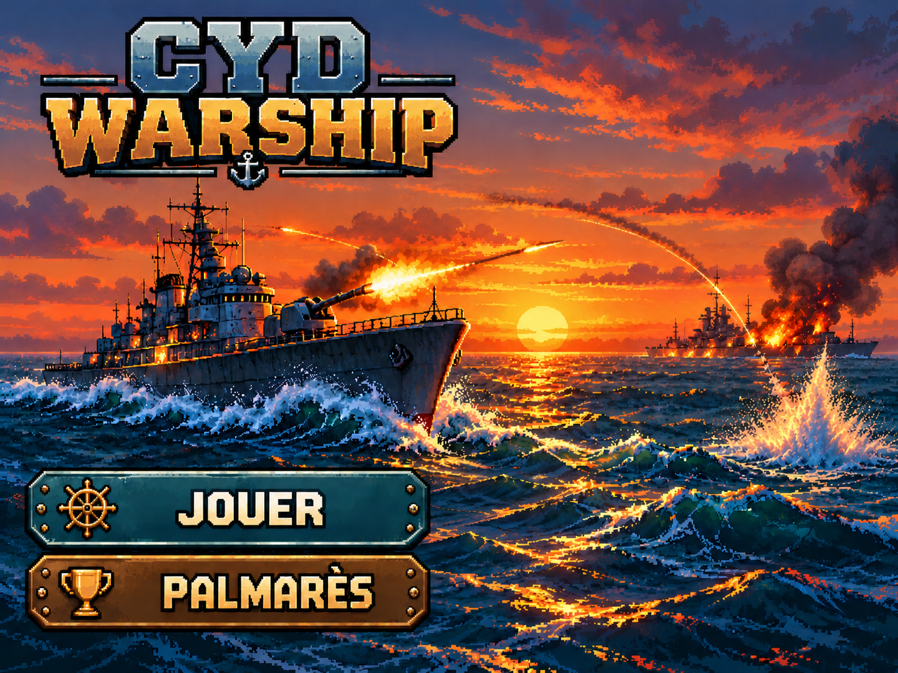
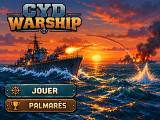

# Première maquette d’accueil — version historique (PR #8)

**Composition complète aplatie : titre CYD WARSHIP, boutons JOUER / PALMARÈS et décor sont peints ensemble dans les pixels.** Ce dossier archive la **première version retenue par le PO**, ultérieurement remplacée par l’accueil modulaire [PR #90](https://github.com/Kharn27/ESP32-OTA-Battleship/pull/90).

## Illustration originale — 1448 × 1086 px

## Aperçu CYD — 320 × 240 px

Ces deux fichiers ont été **déplacés sans changement d’octets** depuis `assets/wallpaper/` sur [arbitrage explicite PO #107](https://github.com/Kharn27/ESP32-OTA-Battleship/issues/107). Le PNG 320×240 est exactement celui de la [PR #8](https://github.com/Kharn27/ESP32-OTA-Battleship/pull/8) ; le grand PNG est extrait du raster présent dans son SVG historique (commit `50d9e1dabd71725adba50279929694123fde0fda`).

**Référence historique uniquement.** Aucun sprite de cette scène n’est disponible isolément ; ne jamais employer cette image comme fond derrière une nouvelle interface. Elle ne figure pas dans `assets/manifest.json`. Les fichiers et leurs empreintes Git sont consignés dans [`screen.json`](../screen.json) afin que le contrôle structurel du dépôt les protège.

**Statut :** `VALIDATED_PO_PC` historique, **remplacée** par l’écran courant ; `ON_DEVICE_UNVERIFIED`.
