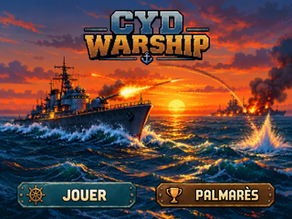

> **RÉFÉRENCE ACCUEIL MODULAIRE — VALIDÉE ARTISTIQUEMENT PAR LE PO LE 09/11/2026 (PR #90).**
> La précédente maquette GRAPH-ACC-001 de la PR #8 était approuvée sur PC. Cette nouvelle version est **acceptée artistiquement sur PC** ([décision PO](https://github.com/Kharn27/ESP32-OTA-Battleship/pull/90#issuecomment-6740684237)) et reste `DESIGN_PREVIEW — ON_DEVICE_UNVERIFIED` : aucun essai TFT, tactile, mémoire ou rendu alpha en firmware.

# CYD WARSHIP — accueil 320 × 240 paysage

## Nouvelle composition de quatre éléments indépendants



- [Accueil natif 320 × 240](accueil_cyd_warship_320x240.png) — PNG RGB, 144 890 octets, SHA-256 `ca73f029e80c95c09b3c7defe1437bba3156280b2f2169465ee3f30014343873`.
- [Zoom ×4 strict NEAREST](accueil_cyd_warship_x4.png) — 1280 × 960 RGB, 224 987 octets.
- [Source OpenRaster, 4 calques réellement éditables](accueil_cyd_warship_4_calques.ora) : fond, logo, JOUER et PALMARÈS.
- [Générateur reproductible](compose_accueil.py) et [manifeste d'empreintes, formats et positions](manifest.json).
- [Preuve alpha sur fond clair et sombre](preuves/alpha_clair_sombre_640x720.png) et [zones tactiles proposées](preuves/zones_tactiles_320x240.png).

## Sources et sprites de l'accueil

Les **JPEG originaux fournis par le PO** restent **inchangés dans `draft/`** : `Wallpaper_accueil.jpeg`, `Logo_titre.jpeg`, `Bouton_jouer.jpeg`, `Bouton_palmares.jpeg`. Les versions RGBA 8 bits détourées sont des **sprites de production graphique** catalogués dans [`assets/logo/`](../../../assets/logo/) et [`assets/boutons/`](../../../assets/boutons/), distincts des JPEG originaux du PO :

| Calque | Source RGBA détourée | Sprite RGBA natif proposé | Placement (x,y,w,h) |
|---|---|---|---|
| Logo | [Logo_titre_RGBA.png](../../../assets/logo/logo_titre_original_1075x489_RGBA.png) | [145 × 66](../../../assets/logo/logo_titre_CYD_145x66_RGBA.png) | (88,8,145,66) |
| JOUER | [Bouton_jouer_RGBA.png](../../../assets/boutons/bouton_jouer_original_1107x252_RGBA.png) | [140 × 32](../../../assets/boutons/bouton_jouer_CYD_140x32_RGBA.png) | (14,198,140,32) |
| PALMARÈS | [Bouton_palmares_RGBA.png](../../../assets/boutons/bouton_palmares_original_1163x250_RGBA.png) | [140 × 30](../../../assets/boutons/bouton_palmares_CYD_140x30_RGBA.png) | (166,199,140,30) |

Les six exports RGBA ont été **déplacés sans retouche** vers `assets/` : cette maquette ne contient plus de copies. Le manifeste de génération garde ses anciens noms de sorties temporaires `sprites/` et le champ `catalog_exports` précise leur emplacement définitif.

Le fond `draft/Wallpaper_accueil.jpeg` est ramené à 320 × 240 par **LANCZOS**. Les sprites sont composés sur ce fond sans modifier les JPEG maîtres. L'ORA et les PNG sont des **preuves PC, pas un contrat d'assets embarqués**.

### Toucher au stylet — proposition sans homologation

- JOUER : `(8,190,152,46)`
- PALMARÈS : `(160,190,152,46)`

Les zones sont adjacentes à `x=160`, sans intervalle neutre : **point à corriger/valider au calibrage tactile**, avant tout contrat de coordonnées firmware.

## Contrôle de reproductibilité

Depuis la racine du dépôt, avec `Pillow==12.3.0` :

```bash
python maquettes/accueil/legacy/compose_accueil.py \
  --repo . --out maquettes/accueil/legacy --check
```

Le contrôle reconstruit en répertoire temporaire et compare **octet par octet** les 5 livrables restés dans `maquettes/accueil/legacy/`, les 3 sprites catalogués dans `assets/` et le manifeste ; il ne modifie pas les fichiers existants. Les 4 entrées sont validées par Git blob SHA et dimensions, les sprites PNG conservent leur canal alpha, le zoom est NEAREST pixel-exact et les quatre calques ORA sont contrôlés. Le [workflow de génération historique #42591469760](https://github.com/Kharn27/ESP32-OTA-Battleship/actions/runs/42591469760) a réussi sur les mêmes pixels avant reclassement. Un **contrôle spécifique sur le nouveau HEAD** est requis pour solder le déplacement.

## Traçabilité et gouvernance

La précédente image d'accueil monolithique et son SVG associé restent consultables dans l'historique du dépôt ([PR #8](https://github.com/Kharn27/ESP32-OTA-Battleship/pull/8)). Les noms stables `accueil_cyd_warship_320x240.png` et `accueil_cyd_warship_x4.png` représentent désormais **la référence artistique acceptée par le PO pour remplacer cette maquette après fusion**. L'ancien SVG n'est pas une source valable pour cette nouvelle composition et a été retiré de la branche PR #90.

**Validation artistique PO et CI obtenues sur la PR #90 ; fusion sous responsabilité du Pilotage.** Une fusion de ressources graphiques PC ne valide pas l'affichage sur ESP32 CYD réelle, le rendu alpha, les hitboxes, ni les budgets Flash/RAM. L'intégration firmware demeure un travail distinct. Le GIF de destruction PAT-05 reste reporté.
