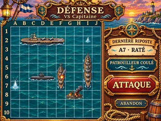
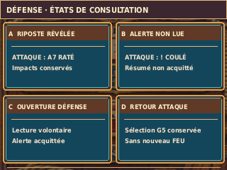

# G05-R2 — DÉFENSE VS Capitaine — maquette PC soumise à réception

> **Issue #46** · branche de travail `design/g05-r2-defense` · **`DESIGN_PREVIEW — ON_DEVICE_UNVERIFIED`** · **avis artistique PO : EN ATTENTE**. La validation G04-R2 sur PC ne vaut pas validation de cette nouvelle DÉFENSE.

## Maquette de référence unique




L'illustration d'origine fournie pour G05-R2 a été **recomposée**, pas simplement rapetissée : le sous-ensemble peint « grille + coques » est recalé sur les limites communes avec G04-R2, tandis que le ciel, la plaque de titre, l'océan hors grille et le panneau sont conservés comme décor. La **grille tactique est 10×10, origine (21,53), pas 18 px, emprise 180×180 px**. La mer conserve un fond continu et la scène une perspective unique. Les coordonnées du master HD se trouvent dans `build_g05_r2.py` et `layout.json`.

À examiner en taille réelle sur un écran 320×240 : contrastes des 100 cases, détail des coques, petits libellés « PATROUILLEUR COULÉ », séparation entre statut de navire et dernière riposte, zone tactile réelle du bouton ATTAQUE, densité du décor et coupe basse du cadre. Aucun test matériel n'a été effectué.

## Scénario illustratif strictement G02

| Navire visible | Longueur | Cases | État graphique illustré |
| --- | ---: | --- | --- |
| Porte-avions | 5 | B2–F2, horizontal | Intact |
| Sous-marin | 3 | C6–E6, horizontal | Intact |
| Contre-torpilleur | 3 | F5–F7, vertical | **Touché F6** |
| Croiseur | 4 | I4–I7, vertical | Intact |
| Patrouilleur | 2 | G8–H8, horizontal | **Coulé G8/H8** |

Démonstration des coups du Capitaine : `I2 RATÉ` (ancien), `A7 RATÉ` (**dernière riposte**), `F6 TOUCHÉ`, `G8/H8 COULÉ`. **17 cases occupées distinctes** ; contact par côté E6/F6 et en diagonale H8/I7 conforme aux règles. La gerbe blanche marque la mer, l'explosion marque la coque, la fumée et l'épave en flammes évoquent l'état coulé : les trois états sont discernables par leur forme, pas seulement par la couleur.

**« DERNIÈRE RIPOSTE A7 • RATÉ »** décrit uniquement le dernier tir reçu. **« PATROUILLEUR COULÉ »** décrit l'état historique d'un navire du joueur, **pas** une alerte « non lue » persistante après la consultation de DÉFENSE.

## Comportements à préserver lors de l'intégration




Les vignettes ciblées représentent : A) dernière riposte révélée, historique conservé ; B) alerte non lue visible sur **ATTAQUE** avant consultation ; C) ouverture volontaire de **DÉFENSE** qui acquitte l'alerte/résumé mais ne supprime aucun marqueur ; D) retour vers **ATTAQUE** avec la cible préparée (exemple `G5`) conservée. Ce sont des **preuves de logique visuelle proposées**, et non des écrans de combat supplémentaires à intégrer.

La commande **ATTAQUE** permet le retour ; **aucun FEU** sur DÉFENSE ; **aucune coque ennemie** affichée ; **ABANDON** est secondaire et doit ouvrir une confirmation CONTINUER/ABANDONNER conformément à la Bible. Aucun comportement de fin de partie, de révélation G08 ni de nouveau mode n'est ajouté.

## Source éditable, provenance et limites

- `reference_defense_1448x1086_lossless.webp` — **master HD raster aplati, encodé WebP sans perte à partir du PNG reçu** (RGB décodé vérifié strictement identique pixel pour pixel). Le PNG d’origine est conservé hors dépôt dans la livraison locale et a également été transféré sur Adobe Creative Cloud ; son SHA256 est dans `generation-report.json`. Il n'existe pas de fichier source HD à calques séparés fourni par l'illustrateur. Le master demeure modifiable au pinceau, mais **ses coques, ses textes et sa texture sont peints ensemble**.
- `build_g05_r2.py` — source de composition éditable : registration mathématique du plateau, séparation du panneau, exports, ORA à trois couches, scénario documenté, vignettes. Ne modifie pas G04.
- `g05_r2_defense_layers.ora` — **OpenRaster éditable** (Krita / GIMP : fond, plateau repositionné, joint laiton en calques). Il restitue exactement le PNG natif. **Ne prétend pas isoler chaque navire ou chaque glyphe** : cette décomposition est réservée à une mission ultérieure d'assets.
- `layout.json` — inventaire documentaire des navires/impacts/geometry/état et de l'absence de FEU. Il vérifie ce que représente l'art fourni ; ce n'est pas un moteur de jeu ni un fichier de sprites.
- `g05_r2_defense_320x240.png` et `g05_r2_defense_x4.png` — **rendus PC uniquement**. Le ×4 est généré depuis le PNG natif avec `Image.Resampling.NEAREST`, sans interpolation.
- `g05_r2_etats_320x240.png` / `g05_r2_etats_x4.png` — états explicatifs ciblés, non concurrents de la référence principale.
- `generation-report.json` — SHA256/poids des sources, exports et ORA ; `verification-PC.txt` — log du vérificateur ; `verify_g05_r2.py` — contrôle effectif des fichiers, négatifs et fidélité ORA.

**Provenance** : illustration d'origine fournie par le demandeur ; aucune reprise d'ancienne maquette G05/G07 R1 artistiquement refusée, aucune image de banque tierce acquise, aucune police redistribuée. Une police de substitution DejaVuSansCondensed-Bold installée sur le PC sert **uniquement** aux vignettes explicatives ; les textes de la maquette principale sont déjà peints dans le master.

**Reproduction locale** (depuis la racine du dépôt, Python 3.11+ / Pillow 12.3.0 recommandé) :

```bash
python3 -m pip install 'Pillow==12.3.0'
python3 maquettes/defense/legacy/build_g05_r2.py
python3 maquettes/defense/legacy/verify_g05_r2.py
```

Le rendu est volontairement une **maquette PC**, pas un pack d'assets firmware. Aucun format d'encodage/compression Flash, aucun budget de RAM/Flash, aucune carte microSD/PSRAM, aucune performance sur ESP32 ni hitbox/taille de doigt n'est préjugé. Le Développeur définira le contrat d'assets et les essais sur ESP32-2432S028R. Les avis PO sur ce visuel, la touche au stylet, les petits textes, la luminosité du TFT, les états animés et la génération de sprites restent **à recueillir**. Ne pas déclarer `ON_DEVICE_VERIFIED`.

### Statuts de décision

| Catégorie | Statut exact |
| --- | --- |
| **DÉCIDÉ PO** | Base G01 « La mer est le plateau » ; G04-R2 validée artistiquement sur PC ; DÉFENSE consultative, flotte G02 visible, une grille, pas de FEU, acquittement sans effacement, conservation du ciblage |
| **PROPOSÉ DA — À ARBITRER PO** | Cette nouvelle illustration G05-R2, ses matières, proportions et interprétations des impacts, ses libellés et la finition tactile à 320×240 |
| **VALIDÉ PC SUR CES EXPORTS** | Dimensions/états documentaires, positions G02, 17 cases, SHA256, ORA fidèle, zoom ×4 strict NEAREST, contrôles négatifs (voir `verification-PC.txt`) |
| **À VÉRIFIER SUR CYD** | Affichage TFT et stylet, contraste/lecture en conditions réelles, Flash/RAM, performance, contrats d'assets, ressources décomposées |

**Références** : [G05-R2 #46](https://github.com/Kharn27/ESP32-OTA-Battleship/issues/46) · [ordre du Pilotage](https://github.com/Kharn27/ESP32-OTA-Battleship/issues/46#issuecomment-6627167791) · [G04-R2 #45 / PR #64](https://github.com/Kharn27/ESP32-OTA-Battleship/pull/64) · [G02](../../flotte/) · [Bible produit](../../../BIBLE_PRODUIT.md) · [politique de test](../../../docs/TEST_POLICY.md).
