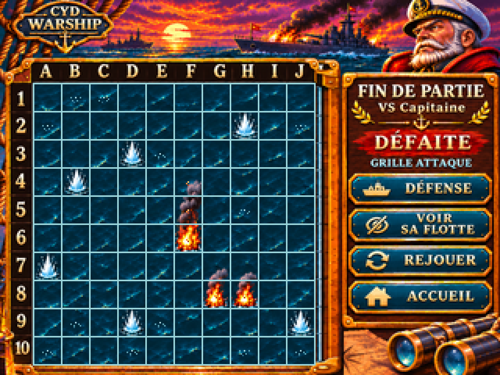

# G07-R2 — DÉFAITE initiale, Capitaine masqué (état A)

> Issue #53 · PR Draft #74 · DESIGN_PREVIEW / ON_DEVICE_UNVERIFIED · arbitrage PO non acquis.

Zoom ×4 NEAREST — 1280 × 960

## Invariants conservés

La scène dramatique, le Capitaine, la mer, les ornements, le panneau et les commandes **DÉFENSE / VOIR SA FLOTTE / REJOUER / ACCUEIL** sont préservés. **Aucune coque adverse ne figure sur ce PNG initial**. Pas de FEU. La flotte du Capitaine reste secrète jusqu'à l'appui volontaire sur VOIR SA FLOTTE, exclusivement après DÉFAITE. La variante [révélée G08 B/C](g07_r2_defaite_320x240.png) conserve les impacts et permet ensuite MASQUER SA FLOTTE.

Grille **(21,53) → (201,233)**, 10×10, pas 18, 180×180. Les 22 lignes 1px sont mesurées sur le PNG final, le test négatif +1px est rejeté et le zoom ×4 est pixel-identique NEAREST.

## Historique et cohérence métier

[Scénario documentaire JSON](g07_r2_defaite_scenario.json) : **23 manches synchrones** et 23 tirs uniques par camp. Sur ATTAQUE : 5 TOUCHÉ et 18 RATÉ (5 flammes/fumées, 6 grandes éclaboussures d'origine et 12 minuscules rides d'écume ajoutées). Les gros effets et le décor ne sont pas redessinés. Les états *secret* et *révélé* partagent **exactement les mêmes coordonnées d'historique** via les deux générateurs.

Sur DÉFENSE : **17 TOUCHÉ** sur les 17 segments humains et 6 RATÉ. Ultime paire simultanée : joueur **F6 = TOUCHÉ**, Capitaine **G5 = TOUCHÉ**, dernière case humaine détruite. Capitaine garde des navires à flot : verdict **DÉFAITE**. La grille DÉFENSE n'est pas affichée sur l'image ATTAQUE ; ce lien est prouvé par scénario de test, pas par une animation.

Les positions CPU légales 5/4/3/3/2 sont consignées uniquement pour vérifier le scénario, **jamais rendues sur l'état A**. Réserve honnête : le dessin des coques du raster G08 B/C déborde parfois de ses cellules ; sa correspondance case par case avec le scénario doit faire l'objet d'une revue distincte, et n'est pas certifiée par les seuls PNG.

## Sources et preuves

- [Script de validation 23 manches / surcouches](g07_r2_defaite_history.py), [JSON scénario](g07_r2_defaite_scenario.json), [générateur masqué](build_g07_r2_defaite_masquee.py), [générateur révélé](build_g07_r2.py).
- [Source OpenRaster 6 calques](g07_r2_defaite_masquee_source.ora) : décor, mer, ratés additionnels, lueurs des touches, quadrillage, panneau. Les textes et ornements restent aplatis dans leurs calques : pas de sprites firmware prêts.
- [Master HD](g07_r2_defaite_masquee_original_1448x1086.png), [manifest d'exports et SHA](g07_r2_defaite_masquee_provenance.json), [preuve géométrique native](g07_r2_defaite_masquee_proof_320x240.png), [preuve ×4](g07_r2_defaite_masquee_proof_x4.png).

Pour reconstruire sous Python après installation de Pillow et numpy, lancer dans cet ordre :
1. `python maquettes/fin-partie/legacy/g07_r2_defaite_history.py`
2. `python maquettes/fin-partie/legacy/build_g07_r2.py`
3. `python maquettes/fin-partie/legacy/build_g07_r2_defaite_masquee.py`

## Harmonisation graphique — proposition DA, non validée

**Ancrage candidat commun : emblème CYD WARSHIP en haut à gauche** dans la position et le style actuels de DÉFAITE. VICTOIRE ne l'affiche pas et MATCH NUL le centre : leurs corrections spécifiques devront appliquer un ancrage unique sous réserve de validation PO. **Cette livraison DÉFAITE ne prétend pas harmoniser d'office les trois scènes.**

**Statut : DESIGN_PREVIEW / ON_DEVICE_UNVERIFIED.** Les 23 tirs et leurs positions sont des données de démonstration, pas une partie réellement jouée. Ni animation des deux tirs, ni TFT, ni stylet, ni Flash/RAM ni go artistique global ne sont validés. La PR reste Draft ; Pilotage revoit et fusionne exclusivement.
