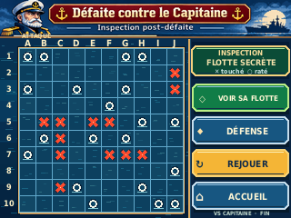
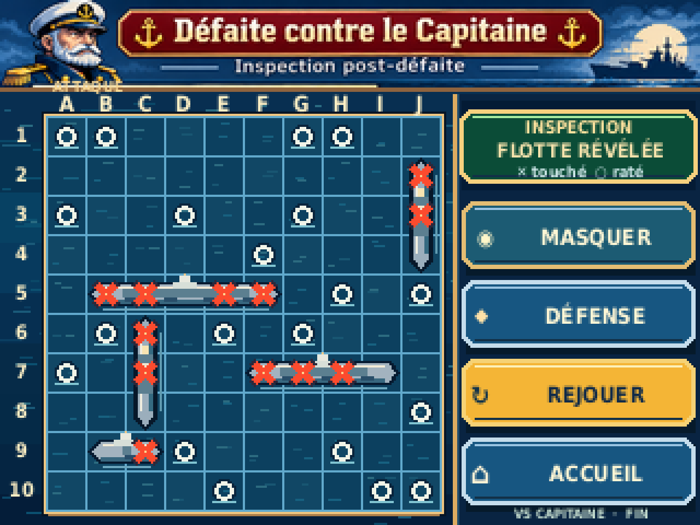
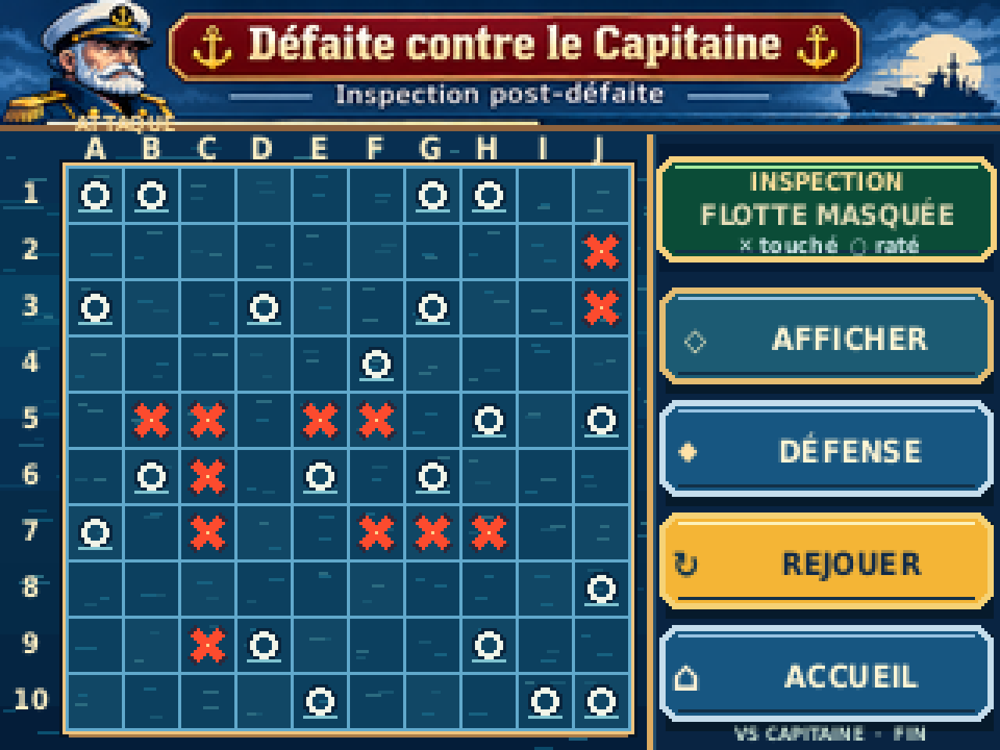
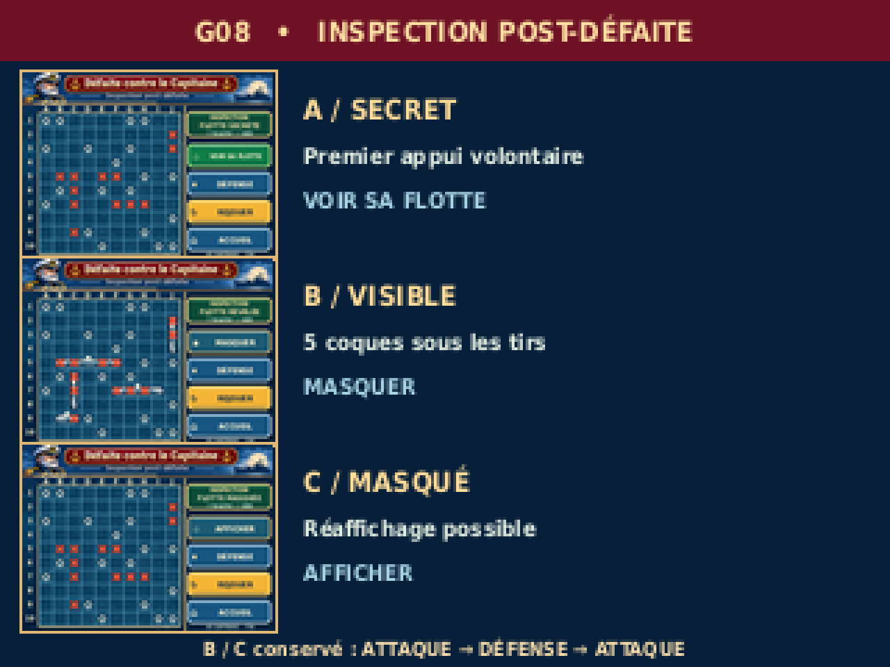
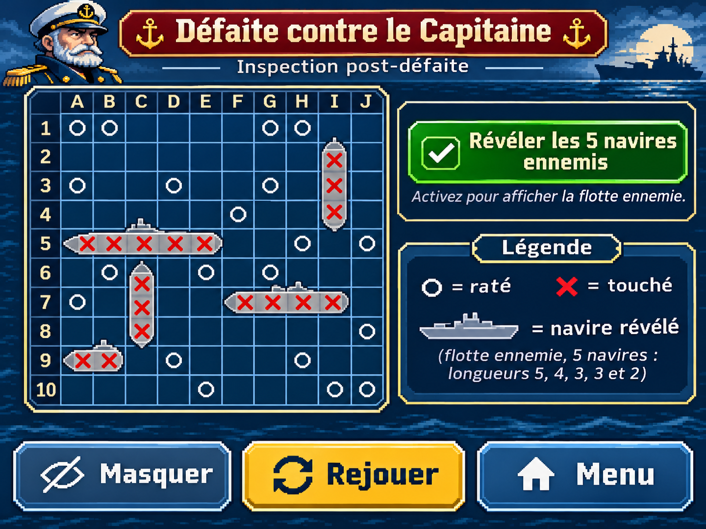

> **RÉFÉRENCE ACTIVE — VALIDÉE PAR LE PO (maquette PC).** INSPECTION DE LA FLOTTE ADVERSE G08 (A/B/C). [Issue #55](https://github.com/Kharn27/ESP32-OTA-Battleship/issues/55) · [PR #56 fusionnée](https://github.com/Kharn27/ESP32-OTA-Battleship/pull/56). `DESIGN_PREVIEW — ON_DEVICE_UNVERIFIED` : ni rendu TFT, ni hitbox, ni assets firmware homologués.

# G08 / Issue #55 — inspection volontaire après DÉFAITE VS Capitaine

## Aperçus intégrés — INSPECTION G08

**États natifs, 320 × 240 px :** les impacts sont identiques en A/B/C, les coques ennemies n'apparaissent qu'en B.

| A — flotte secrète | B — flotte révélée | C — flotte remasquée |
| :---: | :---: | :---: |
|  |  |  |

**Planche A/B/C, 320 × 240 px :**


<details>
<summary>Voir les zooms ×4 des trois états et de la planche (1280 × 960, NEAREST)</summary>

**État A :**


**État B :**



**État C :**



**Planche des variantes :**



</details>

<details>
<summary>Voir l'alias du rendu principal : état B (fichiers identiques à B ci-dessus)</summary>


</details>

<details>
<summary>Voir la référence d'intention artistique du PO — ce n'est pas la maquette finale 320×240</summary>



</details>

Sources : [ORA A](g08_etat_a_layers.ora) · [ORA B](g08_etat_b_layers.ora) · [ORA C](g08_etat_c_layers.ora) · [générateur](build_g08_reference.py).


**Reprise OPTION A validée par le PO — Direction artistique préservée, géométrie du G07 rétablie.** Statut : `DESIGN_PREVIEW — ON_DEVICE_UNVERIFIED`. Pour relecture du PO et contre-revue du Pilotage uniquement. Aucun changement dans G07, la Bible ou le firmware.

## Composition graphique native

Cinq visuels **320 × 240 pixels exactement** : trois états individuels A/B/C, composition principale B (`g08_inspection_320x240.png`) et planche de parcours (`g08_variantes_320x240.png`). Chacun possède son export ×4 **1280 × 960 par NEAREST**. La planche est vraiment 320×240 et non un montage 960×240 abusivement nommé.

**La géométrie ATTAQUE G07 est conservée telle quelle** : grille 10×10 de **18×18 pixels**, soit **180×180 pixels**, origine cellule `(21,53)`, limite `(201,233)` ; grille visible par-dessus l'océan, sur le **même champ de bataille** et à coordonnées identiques entre les états. Toute la colonne de commandes est disposée **à droite du plateau**, x≥207 : portrait, crépuscule marin nocturne, légende or et boutons expressifs de la référence visuelle du PO sont maintenus. La source d'illustration PO sert à la **partie haute du décor** ; le champ, les coques et les commandes sont recomposés à **résolution native**, sans écraser ni miniaturiser la grille.

### États visuels

| État | Quand | Flotte ennemie | Commande tactique |
|---|---|---|---|
| A | Après le verdict compact, **avant** premier appui | Secrète, impact historique seulement | **VOIR SA FLOTTE** |
| B | **Après demande volontaire** | **5 navires entiers, 17 cases**, révélés sous impacts | **MASQUER** |
| C | **Après masquage** | Secrète à nouveau, mêmes impacts | **AFFICHER** sans confirmation |

**Décidé PO :** uniquement après défaite contre Capitaine ; aucune révélation à la victoire ou au nul. Après B ou C, navigation **ATTAQUE → DÉFENSE → ATTAQUE** conserve la visibilité choisie. **DÉFENSE**, **REJOUER** et **ACCUEIL** restent des commandes. Verdict et cartouche vert sont des inscriptions non tactiles. **Aucun FEU** ou sélection de cible post-verdict ; aucune boîte, fiche ou compteur d'analyse.

## Exemple fictif de DÉFAITE

Cinq navires ennemis validés sans recouvrement, tailles **5 / 4 / 3 / 3 / 2**, soit 17 cellules occupées. Exemples de navires : B5–F5, F7–I7, J2–J4, C6–C8, B9–C9. **12 TOUCHÉ**, **20 RATÉ**, **5 segments ennemis intacts** : A/B/C emploient les **mêmes coordonnées** dans l'impact raster OpenRaster. La dernière manche est déjà résolue simultanément ; la flotte humaine a été détruite sur DÉFENSE, la flotte de Capitaine non. Le scénario d'attaque est illustratif, non une donnée sauvegardée.

## Mini-contrat UI — proposé DA, pas validé matériellement

Grille : `x=21..201`, `y=53..233` ; colonnes A–J, lignes 1–10 ; impacts en surcouche ; coques acier dans un calque **derrière l'historique**. Colonne droite : zone statut `(211,50)-(317,83)` ; toggle `(212,92)-(316,122)`, DÉFENSE `(212,128)-(316,158)`, REJOUER `(212,164)-(316,194)`, ACCUEIL `(212,200)-(316,230)` ; environ 30 pixels de haut, *positions et confort stylet proposés DA*. Distinction nette entre texte de résultat non tactile et commandes à relief. Polices DejaVu Sans Condensed hôte (6–10px dans les labels) **à valider sur écran TFT**. Contraste, couleurs, conversion firmware et budgets Flash/RAM ne sont ni mesurés ni homologués.

## Sources, provenance et régénération

- `build_g08_reference.py` : **source originale éditable Python**, produit les images, les ORA et leurs tests sur PC.
- `reference_design_PO.png` : **référence artistique illustrée fournie par le PO**, reprise en haut de la scène. Son emploi dans une maquette PC n'établit pas une licence de production firmware.
- `g08_etat_{a,b,c}_layers.ora` : **trois sources OpenRaster natives 320×240** à **5 calques réellement éditables** : mer / décor ; champ ATTAQUE ; coques visibles seulement B ; tirs historiques ; statut et commandes. Ouvrables avec Krita ou GIMP.
- `g08_etat_{a,b,c}_320x240.png` et `_x4.png` : exports des trois états ; `g08_inspection_*` : alias de l'état B principal ; `g08_variantes_*` : vraie planche 320×240 et 1280×960.
- `scenario_G08.json` : positions, géométrie, états et invariants fictifs.
- `generation-report.txt` : contrôles PASS, preuves négatives et SHA256 des fichiers.

Exécuter depuis le dossier de la maquette (Linux, Python 3 et Pillow ; font `DejaVuSansCondensed-Bold.ttf` fournie par `fonts-dejavu-core`) :

```sh
python3 -m pip install Pillow
python3 maquettes/inspection-flotte/legacy/build_g08_reference.py
```

**Contrôles positifs réels :** plateau x21,y53, 10×10 cellules espacées de **18 pixels** (contrôle des positions de traits), cinq navires alignés en 5/4/3/3/2 et 17 cases uniques, 12 touches et 20 ratés disjoints, 5 segments intacts ; ORA à 5 calques et calques d'impacts lus et **identiques byte-à-byte** A/B/C, coques absentes A/C ; dimensions PNG lus depuis fichier ; **RGBA des pixels du PNG ×4 relu exactement égaux au NEAREST attendu** pour chaque état et la planche.

**Contrôle négatif obligatoire :** une copie d'un vrai PNG ×4 est modifiée sur **le canal R d'un seul pixel** sans modifier son alpha, enregistrée puis relue ; la même fonction de vérification doit la **rejeter**. Un échec à rejeter invalide le build. Le rapport trace ce test. Il ne s'agit pas d'une comparaison de BBox alpha ni d'un auto-contrôle mémoire tautologique.

**Preuves = PC seulement**, aucun test sur CYD physique, aucune homologation de taille de zone tactile ni de format d'asset embarqué. Décision esthétique finale **VALIDÉE PAR LE PO** ; PR #56 **FUSIONNÉE** par Pilotage au commit `dab6e891657078b65229b4f2de33edd995309498`. Les limitations matérielles restent ouvertes.
